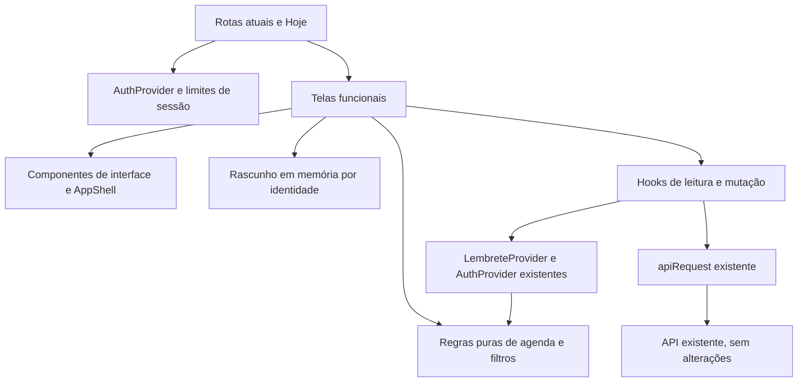
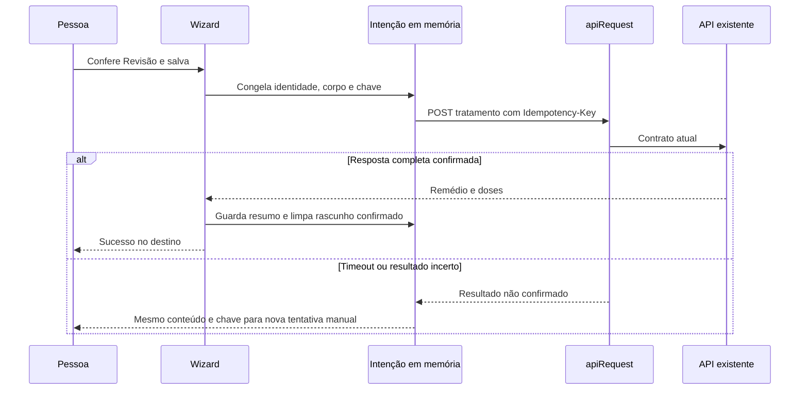

# Web UX Consistency Design

**Spec**: [spec.md](spec.md)
**Status**: Approved
**Approved**: 2026-11-14 - user: "aprovado, antes de iniciar a implementação ponha as skills e mcps citados no AGENTS.md do frontend"
**Date**: 2026-11-13, America/Sao_Paulo
**Scope**: Front_MedReminder only
**Product approval**: user: "aprovado". A confirmação posterior mantém o adendo de skills.
**Implementation**: T1–T47 implemented locally; final verification pending (2026-11-15)

## Architecture Overview

Manter Next.js App Router, React Context, Fetch e as dependências existentes. Acrescentar módulos locais em `src/app/features/web-ux/`, componentes reutilizáveis em `src/app/components/ui/` e adaptadores pequenos nas rotas existentes. Os destinos abaixo foram propostos no design aprovado. A implementação atual e seus valores reais estão documentados em DESIGN.md, na raiz do web.

Não existia `.specs/STATE.md` ao iniciar esta etapa. Nenhuma decisão global anterior foi encontrada nesse arquivo. Os contratos e as decisões aprovadas estão na spec e em context.md.

### Approaches Considered

| Approach | Benefit | Cost | Recommendation |
| --- | --- | --- | --- |
| Estender a estrutura atual com regras puras, hooks e componentes de tela | Preserva cliente HTTP, providers, isolamento e testes; migração por rota | Exige adaptar tipos legados e retirar duplicação por etapas | Recomendada para revisão conjunta do plano |
| Reescrever diretamente cada página existente | Poucos arquivos novos | Repete regras de tempo/filtro e amplia o acoplamento dos formulários atuais | Não recomendada |
| Adotar biblioteca de estado, framework visual ou motor de formulário novos | Oferece padrões prontos | Acrescenta migração e dependências sem necessidade demonstrada | Não recomendada |

As três alternativas entregam o mesmo escopo web. O usuário aprovou este design e o plano de tarefas em 2026-11-14; a primeira alternativa é a direção aprovada. Nenhuma execução é apresentada como concluída por essa aprovação.



### Where Rules Run

- Parsing decimal, recorrência, datas, estado, filtro, ordenação, contagem e próxima dose residem em módulos TypeScript importáveis pelos testes unitários.
- Hooks controlam solicitação, cancelamento, versão da identidade e resultados confirmados. Componentes recebem valores derivados; não repetem regras em JSX.
- Dados privados têm fronteira por identidade e token vigente. Nenhuma biblioteca nova de cache é necessária.
- A autorização de ownership continua no servidor. Filtrar no cliente não concede acesso a outro usuário.
- A atualização das regras é deliberada e rastreável à spec. As proteções atuais de idempotência, isolamento e resultado parcial devem ser preservadas.

## Visual Direction

**Surface mode**: operação de rotina de medicamentos. A informação distintiva é a próxima dose e a situação de hoje.

| Token | Proposed value | Purpose |
| --- | --- | --- |
| action.primary | #0B6E71 | Ação primária e seleção |
| brand.signature | #BE185D | Assinatura da marca, sem significado de erro |
| surface.page | #F6F6F6 | Fundo principal existente |
| surface.raised | #FFFFFF | Formulários e conteúdo agrupado |
| text.primary | #171717 | Conteúdo principal |
| border.default | #D1D5DB | Separação discreta; não define contraste de controles sozinha |

Erro, alerta, sucesso, foco, muted e disabled são tokens semânticos complementares com pares de contraste verificados na implementação. A paleta não é aplicada às cegas a textos pequenos. Kantumruy mantém a identidade, com pesos de 400/500/600/700 e fallback sans-serif. Tamanho base de 16px; escala proposta 12/14/16/20/24/32px; informação essencial não depende do menor tamanho. Raio 8px para controles e 12px para superfícies; espaçamento 4/8/12/16/24/32px. Estes valores concretizam as escolhas delegadas, sem alterar os limites de acessibilidade da spec.

Conteúdo textual e dados ficam alinhados à esquerda. Horário, nome e quantidade formam uma hierarquia estável. Detalhes de estoque e identidade ficam secundários. Listas não viram uma coleção de cartões idênticos com sombras em todas as camadas.

### Screen Concepts

```text
Desktop: Hoje
[Hoje | Medicamentos | Histórico | Perfil]  [Sair]
[Título e data]              [Adicionar medicamento]
[Próxima dose: hora, nome, quantidade, estado]
[Doses atrasadas e agenda de hoje, em ordem]
[Feedback no contexto da ação]

Estreito: Hoje
[Menu] [Hoje]
[Data e próxima dose]
[Item com horário, nome, quantidade]
[Ação de registro ampla]
[Demais itens em uma coluna]

Adicionar medicamento
[Medicamento -> Tratamento -> Revisão]
[Campos da etapa e erros associados]
[Voltar] [Continuar / Salvar tratamento]
```

A composição não transforma a aplicação em landing page. Nenhuma regra de hero, seção em tela inteira, sorteio de paleta, WebGL ou export estático substitui esta direção. As orientações de frontend-design e design-taste-frontend servem à hierarquia, clareza, ritmo, consistência e inspeção renderizada.

### Motion

Transições respondem à abertura de menus/diálogos, troca de etapa e feedback. Consultar transitions-dev antes de escolher a receita e transitions-polish antes do acabamento. A referência deve ser carregada na etapa pertinente. Duração segue o uso do token, sem atrasar registro. Respeitar reduced motion, foco e visibilidade; nenhum loop decorativo integra o fluxo de dose.

## Code Reuse Analysis

| Existing artifact | Reuse | Concern / treatment |
| --- | --- | --- |
| src/app/utils/api.ts | Origem, AbortSignal, erros estruturados, 401 e Retry-After | Não criar outro cliente nem repetir requisições automaticamente |
| src/app/contexts/AuthContext.tsx | Login/logout, restauração e invalidação por geração | Acrescentar destino interno validado e limpeza do rascunho |
| src/app/contexts/lembreteContext.tsx | Snapshot por identidade e cancelamento | Corrigir modelos de transporte e expor dados incompletos sem derrubar toda a lista |
| src/app/utils/navigation-feedback.ts | Avisos que atravessam navegação | Não colocar medicamento, token ou corpo de tratamento em URL/storage do aviso |
| components/CardCadastrar/cardCadastrar.tsx | Validações úteis e intenção idempotente | Separar regra e submissão do wizard; manter compatibilidade dos importadores durante a migração |
| components/CardBusca/cardBusca.tsx | Catálogo e seleção | Acrescentar comportamento acessível e caminho manual |
| components/RequestFeedback/RequestFeedback.tsx | role=alert/status existentes | Preservar anúncio e padronizar ação de recuperação |
| components/AlarmeDose/* | Fila e confirmação em primeiro plano | Preservar timers e resultado confirmado; fechar não confirma dose |
| tests/support/api-guard.ts e tests/setup.ts | Isolamento de rede, relógio e storage | Teste não previsto continua falhando; nenhuma operação de produção |
| tests/fixtures/backend-contracts.ts | Envelopes e limites conferidos | Estender fixtures sintéticas sem tratar mock como prova do deploy |

## Components and Interfaces

### Domain Modules

| Proposed module | Responsibility / proposed interface | Reuse |
| --- | --- | --- |
| features/web-ux/domain/agenda.ts | normalizeDose(raw), selectAgenda(doses, now, zone, filter); resultado com válidas/incompletas, totais e próxima | Transportes reais e exemplos DAY da spec |
| features/web-ux/domain/medication-filters.ts | filterMedications(items, query, today); validade em data local e busca sem acentos | Medicamentos atuais |
| features/web-ux/domain/treatment.ts | parseDoseAmount, validateDraft, buildSchedule e buildTreatmentPayload; funções do mesmo modelo de tratamento | Validação atual do formulário |
| features/web-ux/hooks/useLocalClock.ts | Relógio compartilhado com atualização por segundo e visibilitychange | Date e fuso do navegador, sem biblioteca nova |
| features/web-ux/data/loadDoseCollection.ts | Unificar envelope legado/paginado; indicar carga completa/parcial | apiRequest e limites de página existentes |

### Operations and State

| Proposed module | Responsibility | Boundary |
| --- | --- | --- |
| hooks/useDoseMutation.ts | Registrar/corrigir um ID, bloquear concorrência por item e atualizar snapshot confirmado | PUT dose/:id, booleano somente |
| hooks/useTreatmentSubmission.ts | Validar resposta completa, gerir intenção e chave, conservar resultado incerto e sucesso parcial | POST tratamento existente |
| data/updateMedication.ts | PUT com allowlist de metadados alterados | Sem reagendamento ou alteração de quantidade por dose |
| hooks/useMedicationDeletion.ts | Confirmação nominal, cancelamento e remoção somente após sucesso | DELETE remedio/:id |
| contexts/TreatmentDraftContext.tsx | Rascunho em memória e namespace por identidade; resumo de sucesso entre rotas | Nenhuma senha e nenhuma gravação adicional em storage |
| contexts/AuthContext.tsx | Destino interno seguro, sessão e limpeza ao trocar identidade | Mantém a política atual de 401 operacional de senha |

### UI Components

| Component / proposed file | Responsibility | Reuse / dependencies |
| --- | --- | --- |
| components/ui/Button.tsx | Botão primário/secundário com estados e área de toque | Tokens e botões HTML |
| components/ui/FormField.tsx | Label, descrição, erro e associação por ID | Campos HTML, sem lib de formulário |
| components/ui/Dialog.tsx | Modal acessível com foco, Escape e retorno ao acionador | API de diálogo disponível no navegador, com comportamento testado |
| components/ui/ColorSelector.tsx | Grupo de opções de cor nomeadas | Cores existentes, sem semântica clínica |
| components/layout/AppShell.tsx | Navegação comum e apresentação estreita/desktop | Next Link, contexto de sessão e Button/Dialog |
| components/RequestFeedback/RequestFeedback.tsx | Feedback e recuperação no contexto | Componente atual |
| features/web-ux/components/DoseCard.tsx | Horário, nome, quantidade, estado e ações | selectAgenda, useDoseMutation, Dialog |
| features/web-ux/components/MedicationStep.tsx | Identificação, estoque e cor | Search, FormField, ColorSelector |
| features/web-ux/components/TreatmentStep.tsx | Dose, unidade, recorrência e duração | Modelo treatment e FormField |
| features/web-ux/components/TreatmentReview.tsx | Resumo e lista completa de instantes | buildSchedule, sem recalcular por outra regra |
| features/web-ux/components/TreatmentWizard.tsx | Etapa atual, navegação e erros | Três etapas, rascunho e submissão |

### Screens and Route Adapters

Telas client recebem dependências dos hooks/contextos e compartilham AppShell. Adaptadores page.tsx mantêm a composição enxuta e compatível com App Router/Suspense. Rotas públicas não carregam dados privados.

| Screen | Proposed route | Existing URL preserved |
| --- | --- | --- |
| HomeScreen | / | / |
| LoginScreen | /login | /login |
| RegistrationScreen | /cadastro | /cadastro |
| TodayScreen | /hoje | /meus-lembretes continua disponível |
| MedicationsScreen | /meus-medicamentos | /meus-medicamentos |
| MedicationEditScreen | /meus-medicamentos/[id]/editar | Não substitui indevidamente Ver horários |
| TreatmentWizard | /novo-medicamento | /novo-medicamento |
| HistoryScreen | /historico | /historico |
| ProfileScreen | /Configuracoes, rotulada Perfil | /Configuracoes |

A rota legada de lembretes reutiliza TodayScreen com modo agenda: ao receber medicamentoId, lista as doses desse medicamento, inclusive futuras, em ordem temporal. Sem filtro conserva acesso ao conjunto de lembretes, com acesso evidente a Hoje. Histórico continua limitado aos instantes até agora. Os modos compartilham seletores, cartões e endpoints; não mantêm bancos de estado distintos.

## Data Models

As interfaces abaixo são propostas internas do cliente, não mudanças de DTO do servidor.

```typescript
type DoseState = 'scheduled' | 'due' | 'overdue' | 'registered';
type DoseView =
  | { kind: 'complete'; id: number; medicationId: number; medicationName: string;
      expectedAt: string; amountLabel: string; registered: boolean }
  | { kind: 'incomplete'; id?: number; reason: string; rawDate?: string };
type LoadResult<T> = {
  items: T[]; complete: boolean; loading: boolean; error: string | null;
};
type TreatmentIntent =
  | { phase: 'editing' }
  | { phase: 'submitting' | 'uncertain'; key: string; identity: string; body: string }
  | { phase: 'confirmed'; medicationId: number; firstDoseAt: string; refreshFailed: boolean };
```

- Instantes entram/saem do transporte como strings ISO; não tipar JSON como Date ou Blob.
- Datas de validade sem hora são tratadas como calendário, sem deslocamento de dia por UTC.
- Agenda usa instantes reais das doses. Nunca reconstruir registros legados de quantidadeDiaria.
- Duração e contagem seguem a spec: janela decorrida, fim exclusivo, máximo 1000; exemplo de 6 horas envia quantidadeDiaria=4.
- Foto e recuperação sem sessão não ganham endpoints fictícios. Avatar usa iniciais.

## Request Flows



## Error Handling Strategy

| Situation | Handling | Visible outcome |
| --- | --- | --- |
| Leitura falha | Retry somente da consulta | Último conteúdo identificado e Tentar novamente; não vazio de sucesso |
| Catálogo indisponível | Cadastro manual | Orientação de caminho alternativo |
| Resultado incerto na criação | Congelar intenção e reaproveitar chave/corpo | Retomar mesma intenção ou consultar registros; sem nova criação automática |
| Tratamento confirmado e refresh falha | Não repetir POST | Tratamento salvo, atualização pendente |
| Dose falha | Manter booleano confirmado | Erro por item, sem bloquear outros itens |
| Perfil salva e senha falha | Resultados separados | Perfil atualizado; senha não atualizada |
| 429 | Ler Retry-After existente | Contagem/espera no contexto; nenhuma repetição automática |
| Rede durante restauração | Não declarar expiração | Estado indisponível com recuperação |
| Outra identidade / resposta antiga | Abortar e descartar | Nada da conta anterior é reapresentado |

## Verification Design

As provas foram escritas junto ao código de cada tarefa; os resultados observados constam em tasks.md. Provas agregadas, migração de regressões, percurso independente e Verifier ainda estão pendentes.

- Unit: tabelas literais de instantes/valores para regras; não usar a função sob teste para fabricar o esperado.
- Integration: módulos reais com fronteira de rede simulada, payloads exatos, timers controlados e contas A/B sintéticas.
- Functional: navegação e ações no browser real com API interceptada; nunca afirmar persistência real a partir desse teste.
- Nonfunctional: contraste por par de cores e estado, foco, nomes, 44px, overflow, texto ampliado e reduced motion.
- Acessibilidade assistiva manual: registrar leitor de tela, versão, percurso e resultado; automação não vira certificação.
- Capturas de implementação serão tiradas nos tamanhos 320x568, 390x844, 768x1024 e 1440x900. Não há captura vinculante fornecida pelo usuário; as imagens existentes são baseline de regressão, não um veto às mudanças aprovadas.
- O plano tem um check por cada um dos 91 critérios. Nomes de provas futuras são contratos propostos; resultados observados só existem depois da implementação.
- Não executar E2E real sem API isolada configurada e descartável. Sua ausência deve ser registrada, sem tocar backend ou produção.

## Risks & Concerns

| Concern | Location | Impact | Mitigation |
| --- | --- | --- | --- |
| Monólito de formulário com estado e transporte | CardCadastrar/cardCadastrar.tsx:91 | Alterar UI pode quebrar idempotência | Extrair por tarefa com testes de timeout, chave e identidade |
| JSON tipado como Date/Blob e rejeição da lista inteira | contexts/lembreteContext.tsx:12 | Datas incompletas derrubam o conjunto | Adaptador explícito e união complete/incomplete |
| Seleção de hoje exclui atrasadas | contexts/lembreteContext.tsx:104 | Próxima ação oculta | Compartilhar selectAgenda e relógio testados |
| Barra lateral invisível ainda focável | components/Sidebar/sidebar.tsx:38 | Navegação de teclado incorreta | AppShell novo com conteúdo fechado fora da árvore acessível |
| Fontes globais Geist e classes locais Kantumruy | layout.tsx:2; globals.css:18 | Tipografia diverge | Tokens e herança global deliberada; verificar estilos calculados |
| Documentos de teste históricos divergentes | tests/README.md; docs/PLANO_TESTES.md | Comando/porta errados | Usar manifest e configs atuais: configuração compartilhada porta 3000; wrapper aprovado porta 3102, sem reutilização |
| Baseline de imagens vai mudar | tests/functional/fluxo.spec.ts-snapshots | Atualização indiscriminada esconde defeito | Revisão por tela/tarefa, sem aumentar tolerância para passar |
| Tasks exige nomes de prova futuros | tasks.md Checks | Aprovação documental pode parecer teste executado | Identificar nomes como esperados; copiar saída real e provar seleção durante Execute |
| Foto de medicamento obrigatória no DTO | Integração atual | UI não pode omitir campo ou inventar upload | Preservar formato aceito e fallback visual; eventual lacuna de URL é bloqueio explícito |
| Intenção em memória desaparece em reload | Spec STATE-05 | Não há garantia de retomada entre carregamentos | Informar limite; nenhuma mutação automática no retorno |
| Sem endpoint para editar agenda atomicamente | PUT remédio / PUT dose | Metadados podem aparentar reagendamento | Campos de tratamento somente leitura e texto explícito |
| Plugin orientado a sites promocionais | Required Skills and Plugin | Aplicação de padrões de landing prejudica operação | Aplicar critérios compatíveis; documentar exceções impostas por esta spec |

## Required Skills Application

- tlc-spec-driven: fluxo, critérios, atomicidade, gates e verificação independente.
- frontend-design: paleta/tipografia deliberadas, wireframes, hierarquia e revisão contra o produto.
- taste-skill:design-taste-frontend: qualidade visual, texto e resultado renderizado; não impor stack ou composição promocional em conflito com a spec.
- transitions-dev / transitions-polish: receitas e revisão de movimento somente no que comunica interação/estado; versão conforme skills-lock.json.
- O executor deve ler as referências e acionar os checks aplicáveis na fase de implementação. Esta documentação não alega gate visual aprovado.

