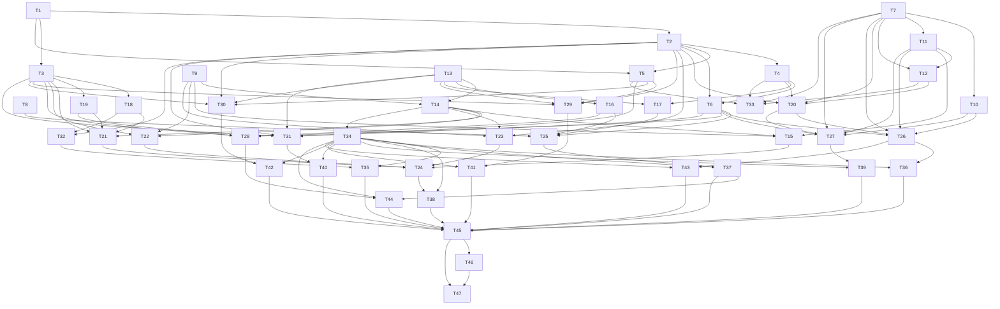

# Web UX Consistency Tasks

## Execution Protocol (MANDATORY -- do not skip)

Implement these tasks with the `tlc-spec-driven` skill: **activate it by name and follow its Execute flow and Critical Rules.** If the skill cannot be activated, stop and report it.

Utilizar também frontend-design, taste-skill:design-taste-frontend, transitions-dev e transitions-polish conforme spec.md. Priorizar a spec aprovada em conflitos de padrões visuais ou stack.

**Spec**: [spec.md](spec.md)
**Design**: [design.md](design.md)
**Status**: Implemented; verification pending
**Approved**: 2026-11-14 - user: "aprovado, antes de iniciar a implementação ponha as skills e mcps citados no AGENTS.md do frontend"
**Date**: 2026-11-13
**Build**: `npm run build && npx tsc --noEmit && npm run lint -- --max-warnings=0`
**Run coverage**: `npm run test:coverage -- --reporter=verbose && node scripts/check-coverage.mjs`
**Run functional**: `npm run test:functional -- --config playwright.web-ux.config.ts --reporter=list --workers=1 --retries=0`
**Run nonfunctional**: `npm run test:nonfunctional -- --config playwright.web-ux.config.ts --reporter=list --workers=1 --retries=0`

O usuário aprovou este plano em 2026-11-14 e solicitou registrar as skills e os MCPs no AGENTS.md do frontend antes de iniciar a implementação. Essa preparação documental não conclui nenhuma tarefa de produto.

As linhas Proof abaixo são **nomes de saída esperados para testes a escrever**, nunca logs observados. Durante Execute, criar o caso com o ID indicado, observar sua saída real e atualizar a referência exata sem mudar a afirmação para acomodar falha. Seleção vazia não é prova. Nenhum teste da aplicação foi executado nesta entrega documental.

## Test Coverage Matrix

> Generated from codebase, project guidelines, and spec. Guidelines: AGENTS.md, tests/README.md (isolamento), docs/PLANO_TESTES.md (cenários), vitest.config.mts, playwright.config.ts, .github/workflows/quality.yml e tests/coverage-baseline.json. Trechos históricos de README/plano sobre suítes vazias ou porta 3001 estão desatualizados; manifest/config atuais prevalecem.

| Code Layer | Required Test Type | Coverage Expectation | Location Pattern | Run Command |
| --- | --- | --- | --- | --- |
| Regras de agenda, parsing, filtros e recorrência | unit | Cada saída definida na spec e todos os limites/erros; tabelas literais de esperados | tests/unit/web-ux-t*.test.tsx | npm run test:unit |
| Componentes isolados de botão/campo/cor | unit | Nomes, estados, teclado, áreas de interação e erros associados | tests/unit/web-ux-t*.test.tsx | npm run test:unit |
| Hooks, providers e componentes compostos | integration | Módulos reais; sucesso, falha, dados vazios, identidade e concorrência pertinentes | tests/integration/web-ux-t*.test.tsx | npm run test:integration |
| Adaptadores de rota e fluxos reais | functional | Gesto, destino, payload e resultado do requisito com API interceptada | tests/functional/web-ux-t*.spec.ts | npm run test:functional |
| CSS, tokens e comportamento entre telas | nonfunctional | Asserções de contraste/foco/overflow/zoom/movimento; coleta sem asserção não aprova | tests/nonfunctional/web-ux-t*.spec.ts | npm run test:nonfunctional |
| Documentação DESIGN.md | none | Revisão documental de correspondência com UI, tokens e estados implementados | DESIGN.md | Build gate e leitura documentada |

Proveniência dos padrões: amostrados CardBusca.test.tsx, navigation-feedback.test.ts, backend-tratamento.test.tsx, cadastro-feedback-treatment.test.tsx, tratamento.test.tsx, backend-profile.test.tsx, backend-session.test.tsx, backend-history.spec.ts e acessibilidade.spec.ts. A cobertura atual não limita o alvo: cada AC exige uma prova. Não reduzir nenhuma das quatro métricas versionadas nem remover arquivos do denominador para passar.

## Gate Check Commands

> Generated from codebase. Commands are proposals for approval, not execution results.

| Gate Level | When to Use | Command |
| --- | --- | --- |
| Quick | Tarefa unitária | npx vitest run CAMINHO_DO_TESTE_DA_TAREFA --reporter=verbose |
| Full | Tarefa de integração | npx vitest run CAMINHO_DO_TESTE_DA_TAREFA --reporter=verbose |
| Browser | Tarefa de rota ou não funcional | npm run test:TIPO -- CAMINHO_DO_TESTE_DA_TAREFA --reporter=list --workers=1 --retries=0 |
| Build | Antes da primeira tarefa, fim de fase e tarefa documental | npm run build && npx tsc --noEmit && npm run lint -- --max-warnings=0 |
| Final | Depois da última tarefa | check_proofs.py executa Build e os três grupos Run acima, sequencialmente, uma vez por grupo |

Cada tarefa abaixo contém o comando concreto que substitui os campos explicativos desta tabela. Os comandos Quick/Full/Browser selecionam somente os testes co-localizados na tarefa. Os grupos Run finais incluem também a regressão existente. Não repetir uma bateria completa verde sem mudança/falha que justifique.

A configuração compartilhada usa a porta **3000**. Os grupos Run aprovados usam `playwright.web-ux.config.ts`, porta **3102** por padrão, build fresco e `reuseExistingServer:false`. Se ela estiver ocupada por servidor do usuário, não encerrá-lo automaticamente. Resolver a disponibilidade antes do gate. Não trocar a configuração compartilhada ou reutilizar um build desconhecido para obter aprovação. E2E real depende de API isolada configurada; ausência é bloqueio registrado, não sucesso. Nenhum gate exige mudar o backend.

## Execution Plan

As fases e tarefas executam em ordem. Dependências técnicas aparecem nos corpos e no diagrama; ordem de execução não acrescenta dependências fictícias.

### Phase 1: Shared UI

- [x] T1: Consolidar tokens e tipografia
- [x] T2: Criar Button acessível
- [x] T3: Criar FormField com mensagens associadas
- [x] T4: Criar diálogo com gestão de foco
- [x] T5: Padronizar RequestFeedback
- [x] T6: Criar AppShell responsivo

### Phase 2: Testable domain

- [x] T7: Definir projeção de agenda
- [x] T8: Definir filtros de medicamentos
- [x] T9: Definir modelo de tratamento
- [x] T10: Criar relógio local observável
- [x] T11: Unificar carga completa de doses
- [x] T12: Controlar mutação por dose
- [x] T13: Reforçar fronteira de sessão e destino interno

### Phase 3: Operations and input

- [x] T14: Criar rascunho em memória
- [x] T15: Controlar submissão idempotente de tratamento
- [x] T16: Implementar atualização de metadados
- [x] T17: Controlar exclusão nominal
- [x] T18: Tornar busca do catálogo acessível
- [x] T19: Criar seletor de cores nomeado
- [x] T20: Criar cartão de dose operacional

### Phase 4: Medication and agenda screens

- [x] T21: Criar etapa Medicamento
- [x] T22: Criar etapa Tratamento
- [x] T23: Criar revisão verificável
- [x] T24: Compor wizard de tratamento
- [x] T25: Criar tela Medicamentos
- [x] T26: Criar Hoje e agenda do medicamento
- [x] T27: Criar Histórico com filtros compostos

### Phase 5: Account and shared composition

- [x] T28: Criar tela de edição de medicamento
- [x] T29: Criar login coerente com o destino
- [x] T30: Criar cadastro progressivo de conta
- [x] T31: Criar Perfil centrado em dados e segurança
- [x] T32: Criar entrada pública clara
- [x] T33: Alinhar apresentação do alarme existente
- [x] T34: Conectar rascunho ao layout raiz

### Phase 6: Existing route migration

- [x] T35: Conectar página inicial à nova entrada
- [x] T36: Disponibilizar rota Hoje
- [x] T37: Conectar rota Medicamentos
- [x] T38: Conectar cadastro de medicamento
- [x] T39: Conectar rota Histórico
- [x] T40: Preservar Configuracoes como Perfil
- [x] T41: Conectar rota de login
- [x] T42: Conectar rota de cadastro
- [x] T43: Preservar acesso legado aos lembretes

### Phase 7: Final route and quality

- [x] T44: Disponibilizar edição pelo ID
- [x] T45: Fechar responsividade e acessibilidade entre rotas
- [x] T46: Uniformizar movimento por intenção
- [x] T47: Publicar contrato visual do web

## Task Breakdown

### Phase 1: Shared UI

### T1: Consolidar tokens e tipografia

**What**: Aplicar tokens do design e herança Kantumruy, verificando pares de cores e estados sem alterar a marca.
**Where**: `src/app/globals.css`; supporting test harness `playwright.web-ux.config.ts`
**Depends on**: None
**Reuses**: Kantumruy e tokens atuais de globals.css
**Requirement**: SYSTEM-01, SYSTEM-02, SYSTEM-03, SYSTEM-06
**Skills**: tlc-spec-driven, frontend-design e design-taste-frontend; carregar as skills de movimento se houver transição
**Tests**: nonfunctional; criar/atualizar `tests/nonfunctional/web-ux-t01.spec.ts` nesta tarefa; mínimo planejado de 2 casos, incluindo 0 prova(s) primária(s) de AC
**Gate**: browser — `npm run test:nonfunctional -- tests/nonfunctional/web-ux-t01.spec.ts --config playwright.web-ux.config.ts --reporter=list --workers=1 --retries=0`
**Commit**: `feat(web-ux): consolidar tokens e tipografia`

**Done when**:

- [x] Entregável de src/app/globals.css funciona no escopo desta tarefa sem implementar capacidades fora da spec.
- [x] Os testes desta tarefa cobrem sucesso, limite e erro pertinentes; contagem selecionada/executada é registrada e nunca cai abaixo de 2 casos planejados sem correção formal do plano.
- [x] Os testes próprios comprovam o componente/módulo diretamente; a futura composição não é usada como justificativa para adiar testes.
- [x] Gate concreto acima passa; marcar T1 concluída antes do seu commit atômico, incluindo tasks.md se o repositório o rastrear.

**Verified**: 2026-11-14 — Browser gate: 3 passed, 0 failed. Computed font/weights, literal palette, 10 contrast pairs >=4.5:1 and keyboard focus asserted. Port 3000 has an existing developer server (PID 24956), preserved. The supporting config imports the shared config and changes only baseURL/server port/url (WEB_UX_TEST_PORT, default 3102); fresh build and reuseExistingServer:false are preserved. First run exposed CSS hex minification; canonical RGB normalization preserves all expected colors and thresholds. No product deviation.

### T2: Criar Button acessível

**What**: Implementar um botão reutilizável com estados primário/secundário, loading, disabled e foco.
**Where**: `src/app/components/ui/Button.tsx`
**Depends on**: T1
**Reuses**: módulos e padrões de reutilização indicados em design.md; sem cliente HTTP ou framework adicional
**Requirement**: SYSTEM-04, ACCESS-07
**Skills**: tlc-spec-driven, frontend-design e design-taste-frontend; carregar as skills de movimento se houver transição
**Tests**: unit; criar/atualizar `tests/unit/web-ux-t02.test.tsx` nesta tarefa; mínimo planejado de 2 casos, incluindo 0 prova(s) primária(s) de AC
**Gate**: quick — `npx vitest run tests/unit/web-ux-t02.test.tsx --reporter=verbose`
**Commit**: `feat(web-ux): criar button acessível`

**Done when**:

- [x] Entregável de src/app/components/ui/Button.tsx funciona no escopo desta tarefa sem implementar capacidades fora da spec.
- [x] Os testes desta tarefa cobrem sucesso, limite e erro pertinentes; contagem selecionada/executada é registrada e nunca cai abaixo de 2 casos planejados sem correção formal do plano.
- [x] Os testes próprios comprovam o componente/módulo diretamente; a futura composição não é usada como justificativa para adiar testes.
- [x] Gate concreto acima passa; marcar T2 concluída antes do seu commit atômico, incluindo tasks.md se o repositório o rastrear.

**Verified**: 2026-11-14 — Quick gate: 3 passed, 0 failed. Enter/Space activation, default button and explicit submit, visible 44px minimum target, loading announcement and duplicate-action blocking asserted. No transition or deviation.

### T3: Criar FormField com mensagens associadas

**What**: Associar label, descrição e erro por ID, reutilizando controles HTML.
**Where**: `src/app/components/ui/FormField.tsx`
**Depends on**: T1
**Reuses**: módulos e padrões de reutilização indicados em design.md; sem cliente HTTP ou framework adicional
**Requirement**: SYSTEM-05, ACCESS-01
**Skills**: tlc-spec-driven, frontend-design e design-taste-frontend; carregar as skills de movimento se houver transição
**Tests**: unit; criar/atualizar `tests/unit/web-ux-t03.test.tsx` nesta tarefa; mínimo planejado de 2 casos, incluindo 1 prova(s) primária(s) de AC
**Gate**: quick — `npx vitest run tests/unit/web-ux-t03.test.tsx --reporter=verbose`
**Commit**: `feat(web-ux): criar formfield com mensagens associadas`

**Done when**:

- [x] Entregável de src/app/components/ui/FormField.tsx funciona no escopo desta tarefa sem implementar capacidades fora da spec.
- [x] Os testes desta tarefa cobrem sucesso, limite e erro pertinentes; contagem selecionada/executada é registrada e nunca cai abaixo de 2 casos planejados sem correção formal do plano.
- [x] As provas SYSTEM-05 possuem asserções dos resultados da spec, não somente snapshots de estrutura ou logs.
- [x] Gate concreto acima passa; marcar T3 concluída antes do seu commit atômico, incluindo tasks.md se o repositório o rastrear.

**Verified**: 2026-11-14 — Quick gate: 2 passed, 0 failed. WUX_SYSTEM_05 asserts exact visible error, accessible description, label focus and preserved input; WUX_T03_ASSOCIATIONS covers HTML input/select/textarea, unique stable IDs, external help and cleared errors. No deviation.

### T4: Criar diálogo com gestão de foco

**What**: Implementar abertura, foco contido, Escape, cancelamento e retorno ao acionador.
**Where**: `src/app/components/ui/Dialog.tsx`
**Depends on**: T2
**Reuses**: módulos e padrões de reutilização indicados em design.md; sem cliente HTTP ou framework adicional
**Requirement**: ACCESS-05, ACCESS-10
**Skills**: tlc-spec-driven, frontend-design e design-taste-frontend; carregar as skills de movimento se houver transição
**Tests**: integration; criar/atualizar `tests/integration/web-ux-t04.test.tsx` nesta tarefa; mínimo planejado de 2 casos, incluindo 2 prova(s) primária(s) de AC
**Gate**: full — `npx vitest run tests/integration/web-ux-t04.test.tsx --reporter=verbose`
**Commit**: `feat(web-ux): criar diálogo com gestão de foco`

**Done when**:

- [x] Entregável de src/app/components/ui/Dialog.tsx funciona no escopo desta tarefa sem implementar capacidades fora da spec.
- [x] Os testes desta tarefa cobrem sucesso, limite e erro pertinentes; contagem selecionada/executada é registrada e nunca cai abaixo de 2 casos planejados sem correção formal do plano.
- [x] As provas ACCESS-05, ACCESS-10 possuem asserções dos resultados da spec, não somente snapshots de estrutura ou logs.
- [x] Gate concreto acima passa; marcar T4 concluída antes do seu commit atômico, incluindo tasks.md se o repositório o rastrear.

**Verified**: 2026-11-14 — Full gate: 3 passed, 0 failed. Exact WUX_ACCESS_05 and WUX_ACCESS_10 outcomes include label/description, explicit close/cancel focus restoration, forward/reverse Tab loop and Escape without deletion. Minimal dialog remains operable. jsdom lacks showModal/close; tests supply only native open/close plumbing, not keyboard/focus behavior. Browser top-layer modality remains for browser route verification; no transition or deviation.

### T5: Padronizar RequestFeedback

**What**: Preservar roles alert/status e oferecer recuperação explícita sem repetir mutações.
**Where**: `src/app/components/RequestFeedback/RequestFeedback.tsx`
**Depends on**: T1, T2
**Reuses**: módulos e padrões de reutilização indicados em design.md; sem cliente HTTP ou framework adicional
**Requirement**: SYSTEM-08, STATE-01, STATE-02, STATE-08
**Skills**: tlc-spec-driven, frontend-design e design-taste-frontend; carregar as skills de movimento se houver transição
**Tests**: integration; criar/atualizar `tests/integration/web-ux-t05.test.tsx` nesta tarefa; mínimo planejado de 3 casos, incluindo 3 prova(s) primária(s) de AC
**Gate**: full — `npx vitest run tests/integration/web-ux-t05.test.tsx --reporter=verbose`
**Commit**: `feat(web-ux): padronizar requestfeedback`

**Done when**:

- [x] Entregável de src/app/components/RequestFeedback/RequestFeedback.tsx funciona no escopo desta tarefa sem implementar capacidades fora da spec.
- [x] Os testes desta tarefa cobrem sucesso, limite e erro pertinentes; contagem selecionada/executada é registrada e nunca cai abaixo de 3 casos planejados sem correção formal do plano.
- [x] As provas STATE-01, STATE-02, STATE-08 possuem asserções dos resultados da spec, não somente snapshots de estrutura ou logs.
- [x] Gate concreto acima passa; marcar T5 concluída antes do seu commit atômico, incluindo tasks.md se o repositório o rastrear.

**Verified**: 2026-11-14 — Full gate: 5 new integration tests passed; targeted existing RequestFeedback regression: 4 passed unchanged (9 total). Actual apiRequest with intercepted fetch proves GET-only retry and returned content, error/data retention during load/failure, actual 429 Retry-After=2 parsing, blocked at 1999ms and manual availability at 2000ms without automatic requests. Initial/filtered empty, loading and confirmed success use status; error retains alert. Timed callback never performs network work; callers pass absolute notBefore derived once. No transition or deviation.

### T6: Criar AppShell responsivo

**What**: Implementar navegação dos quatro destinos e menu estreito fora da árvore acessível quando fechado.
**Where**: `src/app/components/layout/AppShell.tsx`
**Depends on**: T2, T4
**Reuses**: módulos e padrões de reutilização indicados em design.md; sem cliente HTTP ou framework adicional
**Requirement**: NAV-02, NAV-08, ACCESS-04
**Skills**: tlc-spec-driven, frontend-design e design-taste-frontend; carregar as skills de movimento se houver transição
**Tests**: integration; criar/atualizar `tests/integration/web-ux-t06.test.tsx` nesta tarefa; mínimo planejado de 2 casos, incluindo 2 prova(s) primária(s) de AC
**Gate**: full — `npx vitest run tests/integration/web-ux-t06.test.tsx --reporter=verbose`
**Commit**: `feat(web-ux): criar appshell responsivo`

**Done when**:

- [x] Entregável de src/app/components/layout/AppShell.tsx funciona no escopo desta tarefa sem implementar capacidades fora da spec.
- [x] Os testes desta tarefa cobrem sucesso, limite e erro pertinentes; contagem selecionada/executada é registrada e nunca cai abaixo de 2 casos planejados sem correção formal do plano.
- [x] As provas NAV-02, ACCESS-04 possuem asserções dos resultados da spec, não somente snapshots de estrutura ou logs.
- [x] Gate concreto acima passa; marcar T6 concluída antes do seu commit atômico, incluindo tasks.md se o repositório o rastrear.

**Verified**: 2026-11-14 — Full gate: 3 passed, 0 failed. WUX_NAV_02 exercises all four destinations and visible/current state through a synthetic Next router boundary; WUX_ACCESS_04 exercises keyboard exclusion, open/Escape, focus return and next content control. Additional test covers narrow selection/close, breakpoint changes and legacy agenda current state. Phase 1 Build gate passed: npm run build, npx tsc --noEmit, npm run lint -- --max-warnings=0 (exit 0). Native browser route/layout checks remain with migration/T45. No motion or deviation.

### Phase 2: Testable domain

### T7: Definir projeção de agenda

**What**: Normalizar dados completos/incompletos e derivar estado, ordenação, dia local, próxima dose e histórico.
**Where**: `src/app/features/web-ux/domain/agenda.ts`
**Depends on**: None
**Reuses**: módulos e padrões de reutilização indicados em design.md; sem cliente HTTP ou framework adicional
**Requirement**: DAY-01, DAY-02, DAY-03, DAY-06, DAY-08, FORM-10
**Skills**: tlc-spec-driven
**Tests**: unit; criar/atualizar `tests/unit/web-ux-t07.test.tsx` nesta tarefa; mínimo planejado de 2 casos, incluindo 1 prova(s) primária(s) de AC
**Gate**: quick — `npx vitest run tests/unit/web-ux-t07.test.tsx --reporter=verbose`
**Commit**: `feat(web-ux): definir projeção de agenda`

**Done when**:

- [x] Entregável de src/app/features/web-ux/domain/agenda.ts funciona no escopo desta tarefa sem implementar capacidades fora da spec.
- [x] Os testes desta tarefa cobrem sucesso, limite e erro pertinentes; contagem selecionada/executada é registrada e nunca cai abaixo de 2 casos planejados sem correção formal do plano.
- [x] As provas FORM-10 possuem asserções dos resultados da spec, não somente snapshots de estrutura ou logs.
- [x] Gate concreto acima passa; marcar T7 concluída antes do seu commit atômico, incluindo tasks.md se o repositório o rastrear.

**Observed gate**: 2026-11-14, 4 passed (4), 0 failed. stdout: `✓ |unit| tests/unit/web-ux-t07.test.tsx > agenda > WUX_FORM_10`. No deviations.

### T8: Definir filtros de medicamentos

**What**: Aplicar interseção de busca, classificação e validade com categorias sem sobreposição.
**Where**: `src/app/features/web-ux/domain/medication-filters.ts`
**Depends on**: None
**Reuses**: módulos e padrões de reutilização indicados em design.md; sem cliente HTTP ou framework adicional
**Requirement**: MED-01, MED-02, MED-03
**Skills**: tlc-spec-driven
**Tests**: unit; criar/atualizar `tests/unit/web-ux-t08.test.tsx` nesta tarefa; mínimo planejado de 2 casos, incluindo 0 prova(s) primária(s) de AC
**Gate**: quick — `npx vitest run tests/unit/web-ux-t08.test.tsx --reporter=verbose`
**Commit**: `feat(web-ux): definir filtros de medicamentos`

**Done when**:

- [x] Entregável de src/app/features/web-ux/domain/medication-filters.ts funciona no escopo desta tarefa sem implementar capacidades fora da spec.
- [x] Os testes desta tarefa cobrem sucesso, limite e erro pertinentes; contagem selecionada/executada é registrada e nunca cai abaixo de 2 casos planejados sem correção formal do plano.
- [x] Os testes próprios comprovam o componente/módulo diretamente; a futura composição não é usada como justificativa para adiar testes.
- [x] Gate concreto acima passa; marcar T8 concluída antes do seu commit atômico, incluindo tasks.md se o repositório o rastrear.

**Observed gate**: 2026-11-14, 3 passed (3), 0 failed. stdout: `✓ |unit| tests/unit/web-ux-t08.test.tsx > medication filters > WUX_MED_01 intersection uses trimmed accent-insensitive partial names and exact classifications`. No deviations.

### T9: Definir modelo de tratamento

**What**: Centralizar parsing, limites, conversão de duração, agenda limitada e payload compatível.
**Where**: `src/app/features/web-ux/domain/treatment.ts`
**Depends on**: None
**Reuses**: módulos e padrões de reutilização indicados em design.md; sem cliente HTTP ou framework adicional
**Requirement**: FORM-06, FORM-07, FORM-08, FORM-09, FORM-12, FORM-13
**Skills**: tlc-spec-driven
**Tests**: unit; criar/atualizar `tests/unit/web-ux-t09.test.tsx` nesta tarefa; mínimo planejado de 4 casos, incluindo 4 prova(s) primária(s) de AC
**Gate**: quick — `npx vitest run tests/unit/web-ux-t09.test.tsx --reporter=verbose`
**Commit**: `feat(web-ux): definir modelo de tratamento`

**Done when**:

- [x] Entregável de src/app/features/web-ux/domain/treatment.ts funciona no escopo desta tarefa sem implementar capacidades fora da spec.
- [x] Os testes desta tarefa cobrem sucesso, limite e erro pertinentes; contagem selecionada/executada é registrada e nunca cai abaixo de 4 casos planejados sem correção formal do plano.
- [x] As provas FORM-07, FORM-08, FORM-09, FORM-13 possuem asserções dos resultados da spec, não somente snapshots de estrutura ou logs.
- [x] Gate concreto acima passa; marcar T9 concluída antes do seu commit atômico, incluindo tasks.md se o repositório o rastrear.

**Observed gate**: 2026-11-14, 5 passed (5), 0 failed. stdout includes `WUX_FORM_07`, `WUX_FORM_08`, `WUX_FORM_09`, `WUX_FORM_13`. Assertions cover exact payload, DST, 1/1000/1001, invalid parsing and normalized dates. No deviations.

### T10: Criar relógio local observável

**What**: Atualizar em um segundo e revalidar ao retornar à aba visível, cancelando timers ao desmontar.
**Where**: `src/app/features/web-ux/hooks/useLocalClock.ts`
**Depends on**: T7
**Reuses**: módulos e padrões de reutilização indicados em design.md; sem cliente HTTP ou framework adicional
**Requirement**: DAY-04
**Skills**: tlc-spec-driven, frontend-design e design-taste-frontend; carregar as skills de movimento se houver transição
**Tests**: integration; criar/atualizar `tests/integration/web-ux-t10.test.tsx` nesta tarefa; mínimo planejado de 2 casos, incluindo 1 prova(s) primária(s) de AC
**Gate**: full — `npx vitest run tests/integration/web-ux-t10.test.tsx --reporter=verbose`
**Commit**: `feat(web-ux): criar relógio local observável`

**Done when**:

- [x] Entregável de src/app/features/web-ux/hooks/useLocalClock.ts funciona no escopo desta tarefa sem implementar capacidades fora da spec.
- [x] Os testes desta tarefa cobrem sucesso, limite e erro pertinentes; contagem selecionada/executada é registrada e nunca cai abaixo de 2 casos planejados sem correção formal do plano.
- [x] As provas DAY-04 possuem asserções dos resultados da spec, não somente snapshots de estrutura ou logs.
- [x] Gate concreto acima passa; marcar T10 concluída antes do seu commit atômico, incluindo tasks.md se o repositório o rastrear.

**Observed gate**: 2026-11-14, 2 passed (2), 0 failed. stdout includes `WUX_DAY_04`. Clock crosses midnight and exact due instant, refreshes visibility/gesture time and cleans resources. No visual transition added.

### T11: Unificar carga completa de doses

**What**: Ler envelopes legados/paginados e explicitar completude sem contagens globais sobre página parcial.
**Where**: `src/app/features/web-ux/data/loadDoseCollection.ts`
**Depends on**: T7
**Reuses**: módulos e padrões de reutilização indicados em design.md; sem cliente HTTP ou framework adicional
**Requirement**: DAY-09
**Skills**: tlc-spec-driven, frontend-design e design-taste-frontend; carregar as skills de movimento se houver transição
**Tests**: integration; criar/atualizar `tests/integration/web-ux-t11.test.tsx` nesta tarefa; mínimo planejado de 2 casos, incluindo 1 prova(s) primária(s) de AC
**Gate**: full — `npx vitest run tests/integration/web-ux-t11.test.tsx --reporter=verbose`
**Commit**: `feat(web-ux): unificar carga completa de doses`

**Done when**:

- [x] Entregável de src/app/features/web-ux/data/loadDoseCollection.ts funciona no escopo desta tarefa sem implementar capacidades fora da spec.
- [x] Os testes desta tarefa cobrem sucesso, limite e erro pertinentes; contagem selecionada/executada é registrada e nunca cai abaixo de 2 casos planejados sem correção formal do plano.
- [x] As provas DAY-09 possuem asserções dos resultados da spec, não somente snapshots de estrutura ou logs.
- [x] Gate concreto acima passa; marcar T11 concluída antes do seu commit atômico, incluindo tasks.md se o repositório o rastrear.

**Observed gate**: 2026-11-14, 4 passed (4), 0 failed. stdout includes `WUX_DAY_09`. Legacy and paginated envelopes, 102 records, incomplete preservation, page failures and metadata drift verified. No deviations.

### T12: Controlar mutação por dose

**What**: Enviar apenas booleano, bloquear repetição por ID e manter último estado confirmado na falha.
**Where**: `src/app/features/web-ux/hooks/useDoseMutation.ts`
**Depends on**: T7, T11
**Reuses**: módulos e padrões de reutilização indicados em design.md; sem cliente HTTP ou framework adicional
**Requirement**: DOSE-03, DOSE-04, DOSE-06, DOSE-07, DOSE-08
**Skills**: tlc-spec-driven, frontend-design e design-taste-frontend; carregar as skills de movimento se houver transição
**Tests**: integration; criar/atualizar `tests/integration/web-ux-t12.test.tsx` nesta tarefa; mínimo planejado de 5 casos, incluindo 5 prova(s) primária(s) de AC
**Gate**: full — `npx vitest run tests/integration/web-ux-t12.test.tsx --reporter=verbose`
**Commit**: `feat(web-ux): controlar mutação por dose`

**Done when**:

- [x] Entregável de src/app/features/web-ux/hooks/useDoseMutation.ts funciona no escopo desta tarefa sem implementar capacidades fora da spec.
- [x] Os testes desta tarefa cobrem sucesso, limite e erro pertinentes; contagem selecionada/executada é registrada e nunca cai abaixo de 5 casos planejados sem correção formal do plano.
- [x] As provas DOSE-03, DOSE-04, DOSE-06, DOSE-07, DOSE-08 possuem asserções dos resultados da spec, não somente snapshots de estrutura ou logs.
- [x] Gate concreto acima passa; marcar T12 concluída antes do seu commit atômico, incluindo tasks.md se o repositório o rastrear.

**Observed gate**: 2026-11-14, 8 passed (8), 0 failed. stdout includes `WUX_DOSE_03`, `WUX_DOSE_04`, `WUX_DOSE_06`, `WUX_DOSE_07`, `WUX_DOSE_08`. Targeted TypeScript and zero-warning ESLint passed. DoseInstant guard uses a validated string brand so false branches preserve unvalidated string types; callback status is memoized. No behavior deviation.

**Concurrency follow-up**: 2026-11-14, added STATE-06 regression: an old collection response must not replace confirmed items from a newer collection. Observed red first (1 failed, 8 passed), then 9 passed (9) after aborting writes on source snapshot replacement. TypeScript and global zero-warning lint passed. Existing tests preserved. Source array represents an immutable collection snapshot.

### T13: Reforçar fronteira de sessão e destino interno

**What**: Preservar restauração e invalidação existentes, destino interno permitido e geração de identidade.
**Where**: `src/app/contexts/AuthContext.tsx`
**Depends on**: None
**Reuses**: módulos e padrões de reutilização indicados em design.md; sem cliente HTTP ou framework adicional
**Requirement**: NAV-06, NAV-07, STATE-04, STATE-06, STATE-09, STATE-10
**Skills**: tlc-spec-driven, frontend-design e design-taste-frontend; carregar as skills de movimento se houver transição
**Tests**: integration; criar/atualizar `tests/integration/web-ux-t13.test.tsx` nesta tarefa; mínimo planejado de 2 casos, incluindo 2 prova(s) primária(s) de AC
**Gate**: full — `npx vitest run tests/integration/web-ux-t13.test.tsx --reporter=verbose`
**Commit**: `feat(web-ux): reforçar fronteira de sessão e destino interno`

**Done when**:

- [x] Entregável de src/app/contexts/AuthContext.tsx funciona no escopo desta tarefa sem implementar capacidades fora da spec.
- [x] Os testes desta tarefa cobrem sucesso, limite e erro pertinentes; contagem selecionada/executada é registrada e nunca cai abaixo de 2 casos planejados sem correção formal do plano.
- [x] As provas STATE-09, STATE-10 possuem asserções dos resultados da spec, não somente snapshots de estrutura ou logs.
- [x] Gate concreto acima passa; marcar T13 concluída antes do seu commit atômico, incluindo tasks.md se o repositório o rastrear.

**Observed gate**: 2026-11-14, 11 T13 tests passed; 21 existing session/profile regression tests passed (32 total), 0 failed. stdout includes `WUX_STATE_09 profile revalidation 200 after operational password 401`, `WUX_STATE_10`. Phase build passed (Webpack, 11/11 prerendered) after sandbox EPERM was resolved with escalated execution; TypeScript and global ESLint --max-warnings=0 passed. STATE-09 verifies the real HTTP client and session provider; the composed new Profile gesture remains T31/T40. No previous assertions changed. No visual transition added.

### Phase 3: Operations and input

### T14: Criar rascunho em memória

**What**: Preservar valores entre rotas da mesma aba e eliminar o namespace ao trocar identidade sem usar storage.
**Where**: `src/app/features/web-ux/contexts/TreatmentDraftContext.tsx`
**Depends on**: T9, T13
**Reuses**: módulos e padrões de reutilização indicados em design.md; sem cliente HTTP ou framework adicional
**Requirement**: STATE-03, STATE-05, FORM-05
**Skills**: tlc-spec-driven, frontend-design e design-taste-frontend; carregar as skills de movimento se houver transição
**Tests**: integration; criar/atualizar `tests/integration/web-ux-t14.test.tsx` nesta tarefa; mínimo planejado de 2 casos, incluindo 0 prova(s) primária(s) de AC
**Gate**: full — `npx vitest run tests/integration/web-ux-t14.test.tsx --reporter=verbose`
**Commit**: `feat(web-ux): criar rascunho em memória`

**Done when**:

- [x] Entregável de src/app/features/web-ux/contexts/TreatmentDraftContext.tsx funciona no escopo desta tarefa sem implementar capacidades fora da spec.
- [x] Os testes desta tarefa cobrem sucesso, limite e erro pertinentes; contagem selecionada/executada é registrada e nunca cai abaixo de 2 casos planejados sem correção formal do plano.
- [x] Os testes próprios comprovam o componente/módulo diretamente; a futura composição não é usada como justificativa para adiar testes.
- [x] Gate concreto acima passa; marcar T14 concluída antes do seu commit atômico, incluindo tasks.md se o repositório o rastrear.

**Observed gate**: 2 testes passaram, 0 falhas (2026-11-14).

### T15: Controlar submissão idempotente de tratamento

**What**: Congelar corpo/chave da intenção, validar resposta completa e distinguir sucesso de falha do refresh.
**Where**: `src/app/features/web-ux/hooks/useTreatmentSubmission.ts`
**Depends on**: T9, T11, T14
**Reuses**: módulos e padrões de reutilização indicados em design.md; sem cliente HTTP ou framework adicional
**Requirement**: FORM-14, FORM-15, FORM-16, STATE-07, STATE-11
**Skills**: tlc-spec-driven, frontend-design e design-taste-frontend; carregar as skills de movimento se houver transição
**Tests**: integration; criar/atualizar `tests/integration/web-ux-t15.test.tsx` nesta tarefa; mínimo planejado de 3 casos, incluindo 3 prova(s) primária(s) de AC
**Gate**: full — `npx vitest run tests/integration/web-ux-t15.test.tsx --reporter=verbose`
**Commit**: `feat(web-ux): controlar submissão idempotente de tratamento`

**Done when**:

- [x] Entregável de src/app/features/web-ux/hooks/useTreatmentSubmission.ts funciona no escopo desta tarefa sem implementar capacidades fora da spec.
- [x] Os testes desta tarefa cobrem sucesso, limite e erro pertinentes; contagem selecionada/executada é registrada e nunca cai abaixo de 3 casos planejados sem correção formal do plano.
- [x] As provas FORM-16, STATE-07, STATE-11 possuem asserções dos resultados da spec, não somente snapshots de estrutura ou logs.
- [x] Gate concreto acima passa; marcar T15 concluída antes do seu commit atômico, incluindo tasks.md se o repositório o rastrear.

**Observed gate**: 9 testes passaram, 0 falhas (2026-11-14).

### T16: Implementar atualização de metadados

**What**: Enviar PUT apenas com os campos permitidos alterados; manter agenda intacta.
**Where**: `src/app/features/web-ux/data/updateMedication.ts`
**Depends on**: T13
**Reuses**: módulos e padrões de reutilização indicados em design.md; sem cliente HTTP ou framework adicional
**Requirement**: MED-06
**Skills**: tlc-spec-driven, frontend-design e design-taste-frontend; carregar as skills de movimento se houver transição
**Tests**: integration; criar/atualizar `tests/integration/web-ux-t16.test.tsx` nesta tarefa; mínimo planejado de 2 casos, incluindo 0 prova(s) primária(s) de AC
**Gate**: full — `npx vitest run tests/integration/web-ux-t16.test.tsx --reporter=verbose`
**Commit**: `feat(web-ux): implementar atualização de metadados`

**Done when**:

- [x] Entregável de src/app/features/web-ux/data/updateMedication.ts funciona no escopo desta tarefa sem implementar capacidades fora da spec.
- [x] Os testes desta tarefa cobrem sucesso, limite e erro pertinentes; contagem selecionada/executada é registrada e nunca cai abaixo de 2 casos planejados sem correção formal do plano.
- [x] Os testes próprios comprovam o componente/módulo diretamente; a futura composição não é usada como justificativa para adiar testes.
- [x] Gate concreto acima passa; marcar T16 concluída antes do seu commit atômico, incluindo tasks.md se o repositório o rastrear.

**Observed gate**: 3 testes passaram, 0 falhas (2026-11-14).

### T17: Controlar exclusão nominal

**What**: Confirmar nome/efeito, não enviar ao cancelar e remover da lista somente após resposta confirmada.
**Where**: `src/app/features/web-ux/hooks/useMedicationDeletion.ts`
**Depends on**: T4, T13
**Reuses**: módulos e padrões de reutilização indicados em design.md; sem cliente HTTP ou framework adicional
**Requirement**: MED-08, MED-09, MED-10
**Skills**: tlc-spec-driven, frontend-design e design-taste-frontend; carregar as skills de movimento se houver transição
**Tests**: integration; criar/atualizar `tests/integration/web-ux-t17.test.tsx` nesta tarefa; mínimo planejado de 3 casos, incluindo 3 prova(s) primária(s) de AC
**Gate**: full — `npx vitest run tests/integration/web-ux-t17.test.tsx --reporter=verbose`
**Commit**: `feat(web-ux): controlar exclusão nominal`

**Done when**:

- [x] Entregável de src/app/features/web-ux/hooks/useMedicationDeletion.ts funciona no escopo desta tarefa sem implementar capacidades fora da spec.
- [x] Os testes desta tarefa cobrem sucesso, limite e erro pertinentes; contagem selecionada/executada é registrada e nunca cai abaixo de 3 casos planejados sem correção formal do plano.
- [x] As provas MED-08, MED-09, MED-10 possuem asserções dos resultados da spec, não somente snapshots de estrutura ou logs.
- [x] Gate concreto acima passa; marcar T17 concluída antes do seu commit atômico, incluindo tasks.md se o repositório o rastrear.

**Observed gate**: 4 testes passaram, 0 falhas (2026-11-14).

### T18: Tornar busca do catálogo acessível

**What**: Oferecer combobox/listbox, teclado, seleção sem sobrescrita silenciosa e caminho manual na falha.
**Where**: `src/app/components/CardBusca/cardBusca.tsx`
**Depends on**: T3
**Reuses**: módulos e padrões de reutilização indicados em design.md; sem cliente HTTP ou framework adicional
**Requirement**: FORM-02, FORM-03, FORM-17, ACCESS-02
**Skills**: tlc-spec-driven, frontend-design e design-taste-frontend; carregar as skills de movimento se houver transição
**Tests**: integration; criar/atualizar `tests/integration/web-ux-t18.test.tsx` nesta tarefa; mínimo planejado de 3 casos, incluindo 3 prova(s) primária(s) de AC
**Gate**: full — `npx vitest run tests/integration/web-ux-t18.test.tsx --reporter=verbose`
**Commit**: `feat(web-ux): tornar busca do catálogo acessível`

**Done when**:

- [x] Entregável de src/app/components/CardBusca/cardBusca.tsx funciona no escopo desta tarefa sem implementar capacidades fora da spec.
- [x] Os testes desta tarefa cobrem sucesso, limite e erro pertinentes; contagem selecionada/executada é registrada e nunca cai abaixo de 3 casos planejados sem correção formal do plano.
- [x] As provas FORM-02, FORM-17, ACCESS-02 possuem asserções dos resultados da spec, não somente snapshots de estrutura ou logs.
- [x] Gate concreto acima passa; marcar T18 concluída antes do seu commit atômico, incluindo tasks.md se o repositório o rastrear.

**Observed gate**: 3 testes passaram, 0 falhas (2026-11-14). Papel combobox exigido substitui textbox legado; testes legados não alterados. Acabamento de movimento permanece em T46. Impeccable context indisponível por motor/cache ausente; contexto direto e craft-floor lidos.

### T19: Criar seletor de cores nomeado

**What**: Implementar grupo de opções selecionáveis por teclado com área de toque e estado anunciado.
**Where**: `src/app/components/ui/ColorSelector.tsx`
**Depends on**: T3
**Reuses**: módulos e padrões de reutilização indicados em design.md; sem cliente HTTP ou framework adicional
**Requirement**: ACCESS-03
**Skills**: tlc-spec-driven, frontend-design e design-taste-frontend; carregar as skills de movimento se houver transição
**Tests**: unit; criar/atualizar `tests/unit/web-ux-t19.test.tsx` nesta tarefa; mínimo planejado de 2 casos, incluindo 1 prova(s) primária(s) de AC
**Gate**: quick — `npx vitest run tests/unit/web-ux-t19.test.tsx --reporter=verbose`
**Commit**: `feat(web-ux): criar seletor de cores nomeado`

**Done when**:

- [x] Entregável de src/app/components/ui/ColorSelector.tsx funciona no escopo desta tarefa sem implementar capacidades fora da spec.
- [x] Os testes desta tarefa cobrem sucesso, limite e erro pertinentes; contagem selecionada/executada é registrada e nunca cai abaixo de 2 casos planejados sem correção formal do plano.
- [x] As provas ACCESS-03 possuem asserções dos resultados da spec, não somente snapshots de estrutura ou logs.
- [x] Gate concreto acima passa; marcar T19 concluída antes do seu commit atômico, incluindo tasks.md se o repositório o rastrear.

**Observed gate**: 2 testes passaram, 0 falhas (2026-11-14).

### T20: Criar cartão de dose operacional

**What**: Exibir dados essenciais, registro somente quando devido e correção com confirmação contextual.
**Where**: `src/app/features/web-ux/components/DoseCard.tsx`
**Depends on**: T2, T4, T7, T12
**Reuses**: módulos e padrões de reutilização indicados em design.md; sem cliente HTTP ou framework adicional
**Requirement**: DOSE-01, DOSE-02, DOSE-05
**Skills**: tlc-spec-driven, frontend-design e design-taste-frontend; carregar as skills de movimento se houver transição
**Tests**: integration; criar/atualizar `tests/integration/web-ux-t20.test.tsx` nesta tarefa; mínimo planejado de 3 casos, incluindo 3 prova(s) primária(s) de AC
**Gate**: full — `npx vitest run tests/integration/web-ux-t20.test.tsx --reporter=verbose`
**Commit**: `feat(web-ux): criar cartão de dose operacional`

**Done when**:

- [x] Entregável de src/app/features/web-ux/components/DoseCard.tsx funciona no escopo desta tarefa sem implementar capacidades fora da spec.
- [x] Os testes desta tarefa cobrem sucesso, limite e erro pertinentes; contagem selecionada/executada é registrada e nunca cai abaixo de 3 casos planejados sem correção formal do plano.
- [x] As provas DOSE-01, DOSE-02, DOSE-05 possuem asserções dos resultados da spec, não somente snapshots de estrutura ou logs.
- [x] Gate concreto acima passa; marcar T20 concluída antes do seu commit atômico, incluindo tasks.md se o repositório o rastrear.

**Observed gate**: 8 testes T20 passaram; T15+T20 = 17 testes passaram após correção de ref para layout effect exigida pelo lint. Build webpack, tsc --noEmit e lint --max-warnings=0 passaram (2026-11-14). Build exigiu execução escalada após EPERM em .next. Nenhum processo do usuário foi encerrado.

### Phase 4: Medication and agenda screens

### T21: Criar etapa Medicamento

**What**: Compor identificação, estoque, validade e cor com componentes existentes e validação do modelo.
**Where**: `src/app/features/web-ux/components/MedicationStep.tsx`
**Depends on**: T3, T14, T18, T19
**Reuses**: módulos e padrões de reutilização indicados em design.md; sem cliente HTTP ou framework adicional
**Requirement**: FORM-02, FORM-03, FORM-04
**Skills**: tlc-spec-driven, frontend-design e design-taste-frontend; carregar as skills de movimento se houver transição
**Tests**: integration; criar/atualizar `tests/integration/web-ux-t21.test.tsx` nesta tarefa; mínimo planejado de 2 casos, incluindo 1 prova(s) primária(s) de AC
**Gate**: full — `npx vitest run tests/integration/web-ux-t21.test.tsx --reporter=verbose`
**Commit**: `feat(web-ux): criar etapa medicamento`

**Done when**:

- [x] Entregável de src/app/features/web-ux/components/MedicationStep.tsx funciona no escopo desta tarefa sem implementar capacidades fora da spec.
- [x] Os testes desta tarefa cobrem sucesso, limite e erro pertinentes; contagem selecionada/executada é registrada e nunca cai abaixo de 2 casos planejados sem correção formal do plano.
- [x] As provas FORM-03 possuem asserções dos resultados da spec, não somente snapshots de estrutura ou logs.
- [x] Gate concreto acima passa; marcar T21 concluída antes do seu commit atômico, incluindo tasks.md se o repositório o rastrear.

**Observed gate**: 2026-11-14, 2 passed (2), 0 failed. stdout: WUX_FORM_03. Catalog selection preserves dose, unit, start, interval and duration; manual metadata, color and associated model errors asserted. No legacy test changed. Impeccable launcher unavailable; direct context and craft-floor used. No visual transition added.

### T22: Criar etapa Tratamento

**What**: Compor dose, unidade, início, intervalo e duração sem duplicar regras de parsing ou recorrência.
**Where**: `src/app/features/web-ux/components/TreatmentStep.tsx`
**Depends on**: T3, T9, T14
**Reuses**: módulos e padrões de reutilização indicados em design.md; sem cliente HTTP ou framework adicional
**Requirement**: FORM-04, FORM-06, FORM-08, FORM-12
**Skills**: tlc-spec-driven, frontend-design e design-taste-frontend; carregar as skills de movimento se houver transição
**Tests**: integration; criar/atualizar `tests/integration/web-ux-t22.test.tsx` nesta tarefa; mínimo planejado de 2 casos, incluindo 2 prova(s) primária(s) de AC
**Gate**: full — `npx vitest run tests/integration/web-ux-t22.test.tsx --reporter=verbose`
**Commit**: `feat(web-ux): criar etapa tratamento`

**Done when**:

- [x] Entregável de src/app/features/web-ux/components/TreatmentStep.tsx funciona no escopo desta tarefa sem implementar capacidades fora da spec.
- [x] Os testes desta tarefa cobrem sucesso, limite e erro pertinentes; contagem selecionada/executada é registrada e nunca cai abaixo de 2 casos planejados sem correção formal do plano.
- [x] As provas FORM-06, FORM-12 possuem asserções dos resultados da spec, não somente snapshots de estrutura ou logs.
- [x] Gate concreto acima passa; marcar T22 concluída antes do seu commit atômico, incluindo tasks.md se o repositório o rastrear.

**Observed gate**: 2026-11-14, 3 passed (3), 0 failed. stdout: WUX_FORM_06, WUX_FORM_12. Decimal gestures preserve 1,5/1.5 and canonical payload; explicit week/month conversion and invalid recurrence asserted against the shared model. No deviations or legacy test changes.

### T23: Criar revisão verificável

**What**: Mostrar resumo, fuso e todos os instantes produzidos pelo mesmo modelo enviado ao servidor.
**Where**: `src/app/features/web-ux/components/TreatmentReview.tsx`
**Depends on**: T2, T9, T14
**Reuses**: módulos e padrões de reutilização indicados em design.md; sem cliente HTTP ou framework adicional
**Requirement**: FORM-11
**Skills**: tlc-spec-driven, frontend-design e design-taste-frontend; carregar as skills de movimento se houver transição
**Tests**: integration; criar/atualizar `tests/integration/web-ux-t23.test.tsx` nesta tarefa; mínimo planejado de 2 casos, incluindo 0 prova(s) primária(s) de AC
**Gate**: full — `npx vitest run tests/integration/web-ux-t23.test.tsx --reporter=verbose`
**Commit**: `feat(web-ux): criar revisão verificável`

**Done when**:

- [x] Entregável de src/app/features/web-ux/components/TreatmentReview.tsx funciona no escopo desta tarefa sem implementar capacidades fora da spec.
- [x] Os testes desta tarefa cobrem sucesso, limite e erro pertinentes; contagem selecionada/executada é registrada e nunca cai abaixo de 2 casos planejados sem correção formal do plano.
- [x] Os testes próprios comprovam o componente/módulo diretamente; a futura composição não é usada como justificativa para adiar testes.
- [x] Gate concreto acima passa; marcar T23 concluída antes do seu commit atômico, incluindo tasks.md se o repositório o rastrear.

**Observed gate**: 2026-11-14, 3 passed (3), 0 failed. Review shows literal local times, IANA zone, exclusive end, canonical quantity and all 1000 instants through a working disclosure; invalid model has no invented schedule. FORM-11 route proof remains T38. No deviations or legacy test changes.

### T24: Compor wizard de tratamento

**What**: Gerir etapa, foco do primeiro erro, volta, revisão e envio sem reimplementar campos/modelo.
**Where**: `src/app/features/web-ux/components/TreatmentWizard.tsx`
**Depends on**: T15, T21, T22, T23
**Reuses**: módulos e padrões de reutilização indicados em design.md; sem cliente HTTP ou framework adicional
**Requirement**: FORM-01, FORM-04, FORM-05, STATE-05
**Skills**: tlc-spec-driven, frontend-design e design-taste-frontend; carregar as skills de movimento se houver transição
**Tests**: integration; criar/atualizar `tests/integration/web-ux-t24.test.tsx` nesta tarefa; mínimo planejado de 3 casos, incluindo 3 prova(s) primária(s) de AC
**Gate**: full — `npx vitest run tests/integration/web-ux-t24.test.tsx tests/integration/web-ux-t24-contract.test.tsx --reporter=verbose`
**Commit**: `feat(web-ux): compor wizard de tratamento`

**Done when**:

- [x] Entregável de src/app/features/web-ux/components/TreatmentWizard.tsx funciona no escopo desta tarefa sem implementar capacidades fora da spec.
- [x] Os testes desta tarefa cobrem sucesso, limite e erro pertinentes; contagem selecionada/executada é registrada e nunca cai abaixo de 3 casos planejados sem correção formal do plano.
- [x] As provas FORM-04, FORM-05, STATE-05 possuem asserções dos resultados da spec, não somente snapshots de estrutura ou logs.
- [x] Gate concreto acima passa; marcar T24 concluída antes do seu commit atômico, incluindo tasks.md se o repositório o rastrear.

**Observed gate**: 2026-11-14, 6 passed (6), 0 failed. stdout: WUX_FORM_04, WUX_FORM_05, WUX_STATE_05. Gestures assert first-error focus and description, back preservation, exact POST payload/idempotency, confirmed summary, uncertain remount/same-body retry and read-only refresh recovery. No legacy tests changed; no transition added (motion finishing remains T46). React checklist applied to structure, hooks and accessible controls.

**Authorized contract follow-up**: user: "Sim, corrigir teste e validação" (2026-11-14; context.md). Support files: domain/treatment.ts, components/ui/ColorSelector.tsx, MedicationStep.tsx, tests/integration/web-ux-t22.test.tsx and new web-ux-t24-contract.test.tsx. Stock unit/color are required and limited to 50 characters; photo URL is limited to 255. The T24 form now fills both and preserves exact payload comparison, all six existing scenarios and remaining assertions. T22 seeds valid metadata. Four new contract tests first failed, then passed; 34 affected tests passed (18 B4, 16 prior domain/input/submission tests). Color fieldset and radios share the error description and the first invalid group takes focus. The six-test ColorSelector/contract subset also passed after ARIA lint correction. No backend contract changed. Final follow-up build passed (Webpack, 11/11 pages), TypeScript and global zero-warning lint passed.

### T25: Criar tela Medicamentos

**What**: Aplicar filtros e destinos reais, com vazio inicial, vazio por filtro, carga e erro recuperável.
**Where**: `src/app/features/web-ux/screens/MedicationsScreen.tsx`
**Depends on**: T6, T8, T16, T17
**Reuses**: módulos e padrões de reutilização indicados em design.md; sem cliente HTTP ou framework adicional
**Requirement**: MED-01, MED-02, MED-03, MED-04, MED-05
**Skills**: tlc-spec-driven, frontend-design e design-taste-frontend; carregar as skills de movimento se houver transição
**Tests**: integration; criar/atualizar `tests/integration/web-ux-t25.test.tsx` nesta tarefa; mínimo planejado de 2 casos, incluindo 2 prova(s) primária(s) de AC
**Gate**: full — `npx vitest run tests/integration/web-ux-t25.test.tsx --reporter=verbose`
**Commit**: `feat(web-ux): criar tela medicamentos`

**Done when**:

- [x] Entregável de src/app/features/web-ux/screens/MedicationsScreen.tsx funciona no escopo desta tarefa sem implementar capacidades fora da spec.
- [x] Os testes desta tarefa cobrem sucesso, limite e erro pertinentes; contagem selecionada/executada é registrada e nunca cai abaixo de 2 casos planejados sem correção formal do plano.
- [x] As provas MED-02, MED-03 possuem asserções dos resultados da spec, não somente snapshots de estrutura ou logs.
- [x] Gate concreto acima passa; marcar T25 concluída antes do seu commit atômico, incluindo tasks.md se o repositório o rastrear.

**Observed gate**: 2026-11-14, 6 passed (6), 0 failed; TypeScript and targeted zero-warning lint passed. stdout: WUX_MED_02, WUX_MED_03. Combined-filter/reset gestures, distinct empty states, ID destinations, nominal delete cancellation/failure/success, read retry/429 and identity replacement tested through the real HTTP client. No legacy test changed. Route-level MED-01/04/05 proofs remain assigned to T37/T43/T44.

### T26: Criar Hoje e agenda do medicamento

**What**: Exibir próxima dose e agenda completa do dia; modo por medicamento preserva acesso a futuras.
**Where**: `src/app/features/web-ux/screens/TodayScreen.tsx`; approved shared support `src/app/features/web-ux/hooks/useDoseCollection.ts`
**Depends on**: T6, T7, T10, T11, T20
**Reuses**: módulos e padrões de reutilização indicados em design.md; sem cliente HTTP ou framework adicional
**Requirement**: DAY-01, DAY-02, DAY-03, DAY-05, DAY-08
**Skills**: tlc-spec-driven, frontend-design e design-taste-frontend; carregar as skills de movimento se houver transição
**Tests**: integration; criar/atualizar `tests/integration/web-ux-t26.test.tsx` nesta tarefa; mínimo planejado de 2 casos, incluindo 2 prova(s) primária(s) de AC
**Gate**: full — `npx vitest run tests/integration/web-ux-t26.test.tsx --reporter=verbose`
**Commit**: `feat(web-ux): criar hoje e agenda do medicamento`

**Done when**:

- [x] Entregável de src/app/features/web-ux/screens/TodayScreen.tsx funciona no escopo desta tarefa sem implementar capacidades fora da spec.
- [x] Os testes desta tarefa cobrem sucesso, limite e erro pertinentes; contagem selecionada/executada é registrada e nunca cai abaixo de 2 casos planejados sem correção formal do plano.
- [x] As provas DAY-02, DAY-08 possuem asserções dos resultados da spec, não somente snapshots de estrutura ou logs.
- [x] Gate concreto acima passa; marcar T26 concluída antes do seu commit atômico, incluindo tasks.md se o repositório o rastrear.

**Observed gate**: 2026-11-14, 10 passed (10), 0 failed; TypeScript and targeted zero-warning lint passed. stdout: WUX_DAY_02, WUX_DAY_08. Actual loader/mutation composition verifies sorted local dates/times/states, next alongside overdue, incomplete records with no invented name/time/action, empty day, future agenda by ID, stable source through clock/mutation, partial pages, 429/manual read retry and stale identity discard. Shared loader support approved by root; no AC deviation or legacy test change. Route proofs remain T36/T43. Follow-up: dose-read 401 ends the current session using the existing logout/expiry-feedback policy; network errors retain session/draft. 10 T26 tests plus 11 unchanged backend-session regressions passed (21 total).

### T27: Criar Histórico com filtros compostos

**What**: Listar até agora em ordem decrescente, com filtros e totais somente do conjunto completo.
**Where**: `src/app/features/web-ux/screens/HistoryScreen.tsx`; reuse approved shared `src/app/features/web-ux/hooks/useDoseCollection.ts`
**Depends on**: T6, T7, T10, T11, T20
**Reuses**: módulos e padrões de reutilização indicados em design.md; sem cliente HTTP ou framework adicional
**Requirement**: DAY-06, DAY-07, DAY-09
**Skills**: tlc-spec-driven, frontend-design e design-taste-frontend; carregar as skills de movimento se houver transição
**Tests**: integration; criar/atualizar `tests/integration/web-ux-t27.test.tsx` nesta tarefa; mínimo planejado de 2 casos, incluindo 0 prova(s) primária(s) de AC
**Gate**: full — `npx vitest run tests/integration/web-ux-t27.test.tsx --reporter=verbose`
**Commit**: `feat(web-ux): criar histórico com filtros compostos`

**Done when**:

- [x] Entregável de src/app/features/web-ux/screens/HistoryScreen.tsx funciona no escopo desta tarefa sem implementar capacidades fora da spec.
- [x] Os testes desta tarefa cobrem sucesso, limite e erro pertinentes; contagem selecionada/executada é registrada e nunca cai abaixo de 2 casos planejados sem correção formal do plano.
- [x] Os testes próprios comprovam o componente/módulo diretamente; a futura composição não é usada como justificativa para adiar testes.
- [x] Gate concreto acima passa; marcar T27 concluída antes do seu commit atômico, incluindo tasks.md se o repositório o rastrear.

**Observed gate**: 2026-11-14, 5 passed (5), 0 failed. Composed period/medication-ID/state filters, local-midnight boundaries, descending times until now, 102-record pagination with partial labels, reset, confirmed correction/count and failed-page read recovery asserted through actual modules. Phase build passed with Webpack (11/11 pages) after sandbox EPERM was resolved with escalated execution; TypeScript and global ESLint --max-warnings=0 passed. No legacy test changed. DAY-06/07 route proofs remain T39; visual/browser walkthrough remains the final integration phase.

### Phase 5: Account and shared composition

### T28: Criar tela de edição de medicamento

**What**: Carregar o ID correto e expor metadados editáveis com tratamento somente leitura e aviso nominal.
**Where**: `src/app/features/web-ux/screens/MedicationEditScreen.tsx`
**Depends on**: T3, T6, T16, T19
**Reuses**: módulos e padrões de reutilização indicados em design.md; sem cliente HTTP ou framework adicional
**Requirement**: MED-05, MED-06, MED-07
**Skills**: tlc-spec-driven, frontend-design e design-taste-frontend; carregar as skills de movimento se houver transição
**Tests**: integration; criar/atualizar `tests/integration/web-ux-t28.test.tsx` nesta tarefa; mínimo planejado de 2 casos, incluindo 0 prova(s) primária(s) de AC
**Gate**: full — `npx vitest run tests/integration/web-ux-t28.test.tsx --reporter=verbose`
**Commit**: `feat(web-ux): criar tela de edição de medicamento`

**Done when**:

- [x] Entregável de src/app/features/web-ux/screens/MedicationEditScreen.tsx funciona no escopo desta tarefa sem implementar capacidades fora da spec.
- [x] Os testes desta tarefa cobrem sucesso, limite e erro pertinentes; contagem selecionada/executada é registrada e nunca cai abaixo de 2 casos planejados sem correção formal do plano.
- [x] Os testes próprios comprovam o componente/módulo diretamente; a futura composição não é usada como justificativa para adiar testes.
- [x] Gate concreto acima passa; marcar T28 concluída antes do seu commit atômico, incluindo tasks.md se o repositório o rastrear.

**Observed gate**: 2026-11-14, 3 integration tests passed, 0 failed. Exact seven-field PUT, unchanged no-op, read-only schedule, invalid stock, failed write preserving edits and wrong-ID read recovery verified. No existing tests changed. First dose uses stored dose instants; interval/duration absent from the read contract remain explicitly unknown.

### T29: Criar login coerente com o destino

**What**: Autenticar pelo contrato atual, revelar senha e escolher destino interno ou Hoje.
**Where**: `src/app/features/web-ux/screens/LoginScreen.tsx`
**Depends on**: T2, T3, T5, T13
**Reuses**: módulos e padrões de reutilização indicados em design.md; sem cliente HTTP ou framework adicional
**Requirement**: NAV-01, NAV-04, ACCOUNT-04
**Skills**: tlc-spec-driven, frontend-design e design-taste-frontend; carregar as skills de movimento se houver transição
**Tests**: integration; criar/atualizar `tests/integration/web-ux-t29.test.tsx` nesta tarefa; mínimo planejado de 2 casos, incluindo 0 prova(s) primária(s) de AC
**Gate**: full — `npx vitest run tests/integration/web-ux-t29.test.tsx --reporter=verbose`
**Commit**: `feat(web-ux): criar login coerente com o destino`

**Done when**:

- [x] Entregável de src/app/features/web-ux/screens/LoginScreen.tsx funciona no escopo desta tarefa sem implementar capacidades fora da spec.
- [x] Os testes desta tarefa cobrem sucesso, limite e erro pertinentes; contagem selecionada/executada é registrada e nunca cai abaixo de 2 casos planejados sem correção formal do plano.
- [x] Os testes próprios comprovam o componente/módulo diretamente; a futura composição não é usada como justificativa para adiar testes.
- [x] Gate concreto acima passa; marcar T29 concluída antes do seu commit atômico, incluindo tasks.md se o repositório o rastrear.

**Observed gate**: 2026-11-14, 3 integration tests passed, 0 failed. Password visibility gesture, exact login body/profile credential, safe internal/default destination and failed-profile manual recovery verified. No existing tests changed.

### T30: Criar cadastro progressivo de conta

**What**: Separar Conta e Dados pessoais mantendo obrigatoriedade e limites da API sem valores fictícios.
**Where**: `src/app/features/web-ux/screens/RegistrationScreen.tsx`
**Depends on**: T2, T3, T5, T13
**Reuses**: módulos e padrões de reutilização indicados em design.md; sem cliente HTTP ou framework adicional
**Requirement**: ACCOUNT-01, ACCOUNT-02, ACCOUNT-03, ACCOUNT-04
**Skills**: tlc-spec-driven, frontend-design e design-taste-frontend; carregar as skills de movimento se houver transição
**Tests**: integration; criar/atualizar `tests/integration/web-ux-t30.test.tsx` nesta tarefa; mínimo planejado de 2 casos, incluindo 0 prova(s) primária(s) de AC
**Gate**: full — `npx vitest run tests/integration/web-ux-t30.test.tsx --reporter=verbose`
**Commit**: `feat(web-ux): criar cadastro progressivo de conta`

**Done when**:

- [x] Entregável de src/app/features/web-ux/screens/RegistrationScreen.tsx funciona no escopo desta tarefa sem implementar capacidades fora da spec.
- [x] Os testes desta tarefa cobrem sucesso, limite e erro pertinentes; contagem selecionada/executada é registrada e nunca cai abaixo de 2 casos planejados sem correção formal do plano.
- [x] Os testes próprios comprovam o componente/módulo diretamente; a futura composição não é usada como justificativa para adiar testes.
- [x] Gate concreto acima passa; marcar T30 concluída antes do seu commit atômico, incluindo tasks.md se o repositório o rastrear.

**Observed gate**: 2026-11-14, 3 integration tests passed, 0 failed. Complete exact DTO, step/back persistence, accessible password gesture, mandatory summary, required field/document/future-date validation and failed-send retention verified. No existing tests changed.

### T31: Criar Perfil centrado em dados e segurança

**What**: Reutilizar contratos de perfil/senha e resultados separados, com avatar de iniciais e sem ações sem endpoint.
**Where**: `src/app/features/web-ux/screens/ProfileScreen.tsx`; approved cohesive support in `src/app/contexts/AuthContext.tsx` (metadata-only updateProfile) and type-only `src/app/Configuracoes/ConfiguracoesContent.tsx` (birth date JSON string compatibility)
**Depends on**: T2, T3, T5, T6, T13
**Reuses**: módulos e padrões de reutilização indicados em design.md; sem cliente HTTP ou framework adicional
**Requirement**: ACCOUNT-05, ACCOUNT-06, ACCOUNT-07, ACCOUNT-08, SYSTEM-09
**Skills**: tlc-spec-driven, frontend-design e design-taste-frontend; carregar as skills de movimento se houver transição
**Tests**: integration; criar/atualizar `tests/integration/web-ux-t31.test.tsx` nesta tarefa; mínimo planejado de 3 casos, incluindo 3 prova(s) primária(s) de AC
**Gate**: full — `npx vitest run tests/integration/web-ux-t31.test.tsx --reporter=verbose`
**Commit**: `feat(web-ux): criar perfil centrado em dados e segurança`

**Done when**:

- [x] Entregável de src/app/features/web-ux/screens/ProfileScreen.tsx funciona no escopo desta tarefa sem implementar capacidades fora da spec.
- [x] Os testes desta tarefa cobrem sucesso, limite e erro pertinentes; contagem selecionada/executada é registrada e nunca cai abaixo de 3 casos planejados sem correção formal do plano.
- [x] As provas ACCOUNT-06, ACCOUNT-07, SYSTEM-09 possuem asserções dos resultados da spec, não somente snapshots de estrutura ou logs.
- [x] Gate concreto acima passa; marcar T31 concluída antes do seu commit atômico, incluindo tasks.md se o repositório o rastrear.

**Observed gate**: 2026-11-14, 8 own integration tests and 32 affected session/profile regression tests passed, 0 failed. Exact password endpoint/body, independent results, one operational-401 revalidation, expiration/network distinction, changed-field PATCH/optional omission, immutable metadata and same-identity draft/generation/token preservation verified. A to B to A discards old writes. TypeScript and affected ESLint passed. No existing tests changed. Root approved the two support changes before editing.

### T32: Criar entrada pública clara

**What**: Apresentar propósito e ação Criar conta antes de opções secundárias, com busca ainda utilizável.
**Where**: `src/app/features/web-ux/screens/HomeScreen.tsx`; approved support in `src/app/components/Logo/Logo.tsx` and new LoginScreen/RegistrationScreen callsites (brand without duplicate h1)
**Depends on**: T2, T18
**Reuses**: módulos e padrões de reutilização indicados em design.md; sem cliente HTTP ou framework adicional
**Requirement**: NAV-03
**Skills**: tlc-spec-driven, frontend-design e design-taste-frontend; carregar as skills de movimento se houver transição
**Tests**: integration; criar/atualizar `tests/integration/web-ux-t32.test.tsx` nesta tarefa; mínimo planejado de 2 casos, incluindo 0 prova(s) primária(s) de AC
**Gate**: full — `npx vitest run tests/integration/web-ux-t32.test.tsx --reporter=verbose`
**Commit**: `feat(web-ux): criar entrada pública clara`

**Done when**:

- [x] Entregável de src/app/features/web-ux/screens/HomeScreen.tsx funciona no escopo desta tarefa sem implementar capacidades fora da spec.
- [x] Os testes desta tarefa cobrem sucesso, limite e erro pertinentes; contagem selecionada/executada é registrada e nunca cai abaixo de 2 casos planejados sem correção formal do plano.
- [x] Os testes próprios comprovam o componente/módulo diretamente; a futura composição não é usada como justificativa para adiar testes.
- [x] Gate concreto acima passa; marcar T32 concluída antes do seu commit atômico, incluindo tasks.md se o repositório o rastrear.

**Observed gate**: 2026-11-14, 3 T32 integration tests plus 6 T29/T30 affected regressions passed, 0 failed. Public purpose and destinations, keyboard catalog selection, unavailable/manual path, no private requests, single content h1 and unchanged brand styling verified. Affected ESLint passed. No existing tests changed.

### T33: Alinhar apresentação do alarme existente

**What**: Manter confirmação idempotente e fechar apenas o lembrete visual; adotar semântica e contraste comuns.
**Where**: `src/app/components/AlarmeDose/Lembrete.tsx`; approved cohesive support in AlertaLembrete.tsx, contexts/lembreteContext.tsx, features/web-ux/data/dose-confirmations.ts, hooks/useDoseMutation.ts and useDoseCollection.ts; authorized legacy alarm tests in lembretes.test.tsx, cadastro-feedback-alarm.test.tsx and seguranca-alerta.test.tsx
**Depends on**: T4, T5, T7, T12
**Reuses**: módulos e padrões de reutilização indicados em design.md; sem cliente HTTP ou framework adicional
**Requirement**: DOSE-09
**Skills**: tlc-spec-driven, frontend-design e design-taste-frontend; carregar as skills de movimento se houver transição
**Tests**: integration; criar/atualizar `tests/integration/web-ux-t33.test.tsx` nesta tarefa; mínimo planejado de 2 casos, incluindo 1 prova(s) primária(s) de AC
**Gate**: full — `npx vitest run tests/integration/web-ux-t33.test.tsx --reporter=verbose`
**Commit**: `feat(web-ux): alinhar apresentação do alarme existente`

**Done when**:

- [x] Entregável de src/app/components/AlarmeDose/Lembrete.tsx funciona no escopo desta tarefa sem implementar capacidades fora da spec.
- [x] Os testes desta tarefa cobrem sucesso, limite e erro pertinentes; contagem selecionada/executada é registrada e nunca cai abaixo de 2 casos planejados sem correção formal do plano.
- [x] As provas DOSE-09 possuem asserções dos resultados da spec, não somente snapshots de estrutura ou logs.
- [x] Gate concreto acima passa; marcar T33 concluída antes do seu commit atômico, incluindo tasks.md se o repositório o rastrear.

**Observed gate**: 2026-11-14, 9 own integration tests plus 58 affected regressions passed (67 total), 0 failed. Native Dialog close/Escape/focus and no-write semantics, exact PUT confirmation, duplicate block, future block, 204/malformed rejection and refresh-only recovery verified. Confirmed events synchronize both presentations, preserve other pending IDs and reconcile older GETs; no new polling/storage. Alarm queue filters registered rows, cancels timers, preserves simultaneous doses and valid siblings of incomplete rows. Four authorized FE-05 expected-failure cases now run normally with every assertion preserved. Alarm selectors/copy and generic success fixtures aligned to the interface/actual DTO with user authorization recorded in context.md. TypeScript and affected ESLint passed.

### T34: Conectar rascunho ao layout raiz

**What**: Adicionar provider estável sem duplicar providers de sessão/doses nem reiniciar o rascunho por rota.
**Where**: `src/app/layout.tsx`; cohesive client support in features/web-ux/contexts/TreatmentDraftBoundary.tsx; phase-lint closure in MedicationEditScreen.tsx moves state updates into request callbacks and retry gesture
**Depends on**: T14
**Reuses**: módulos e padrões de reutilização indicados em design.md; sem cliente HTTP ou framework adicional
**Requirement**: STATE-03, STATE-04, SYSTEM-01, STATE-06
**Skills**: tlc-spec-driven, frontend-design e design-taste-frontend; carregar as skills de movimento se houver transição
**Tests**: integration; criar/atualizar `tests/integration/web-ux-t34.test.tsx` nesta tarefa; mínimo planejado de 3 casos, incluindo 3 prova(s) primária(s) de AC
**Gate**: full — `npx vitest run tests/integration/web-ux-t34.test.tsx --reporter=verbose`
**Commit**: `feat(web-ux): conectar rascunho ao layout raiz`

**Done when**:

- [x] Entregável de src/app/layout.tsx funciona no escopo desta tarefa sem implementar capacidades fora da spec.
- [x] Os testes desta tarefa cobrem sucesso, limite e erro pertinentes; contagem selecionada/executada é registrada e nunca cai abaixo de 3 casos planejados sem correção formal do plano.
- [x] As provas STATE-03, STATE-04, STATE-06 possuem asserções dos resultados da spec, não somente snapshots de estrutura ou logs.
- [x] Gate concreto acima passa; marcar T34 concluída antes do seu commit atômico, incluindo tasks.md se o repositório o rastrear.

**Observed gate**: 2026-11-14, 6 own integration tests passed; 2 draft-provider and 3 medication-editor affected regressions passed, 0 failed. Actual RootLayout provider subtree preserves same-identity draft/summary across route children and metadata changes, clears it on logout/identity/expiration, discards stale reads and does not duplicate the dose provider. Only document CSS and next/font are mocked in this integration harness; production CSS is checked by Build/lint. Build (Webpack, 11/11 prerendered), TypeScript and global ESLint --max-warnings=0 passed. Sandbox EPERM in .next required escalated build, without cleanup or stopping user processes. No routes T35 onward connected.

### Phase 6: Existing route migration

### T35: Conectar página inicial à nova entrada

**What**: Conectar HomeScreen na rota existente e verificar navegação pública real com rede interceptada.
**Where**: `src/app/page.tsx`
**Depends on**: T32, T34
**Reuses**: módulos e padrões de reutilização indicados em design.md; sem cliente HTTP ou framework adicional
**Requirement**: NAV-03
**Skills**: tlc-spec-driven, frontend-design e design-taste-frontend; carregar as skills de movimento se houver transição
**Tests**: functional; criar/atualizar `tests/functional/web-ux-t35.spec.ts` nesta tarefa; mínimo planejado de 2 casos, incluindo 1 prova(s) primária(s) de AC
**Gate**: browser — `npm run test:functional -- tests/functional/web-ux-t35.spec.ts --reporter=list --workers=1 --retries=0`
**Commit**: `feat(web-ux): conectar página inicial à nova entrada`

**Done when**:

- [x] Entregável de src/app/page.tsx funciona no escopo desta tarefa sem implementar capacidades fora da spec.
- [x] Os testes desta tarefa cobrem sucesso, limite e erro pertinentes; contagem selecionada/executada é registrada e nunca cai abaixo de 2 casos planejados sem correção formal do plano.
- [x] As provas NAV-03 possuem asserções dos resultados da spec, não somente snapshots de estrutura ou logs.
- [x] Gate concreto acima passa; marcar T35 concluída antes do seu commit atômico, incluindo tasks.md se o repositório o rastrear.

**Verified**: 2026-11-14 — Browser gate with playwright.web-ux.config.ts: 3 passed, 0 failed. NAV-03 literal purpose/order, actual Create account/Enter navigation, catalog selection and unavailable/manual outcome asserted. Only locator ambiguity with Next route announcer corrected; no assertion weakened. Fresh build passed outside sandbox after EPERM. No product deviation.

### T36: Disponibilizar rota Hoje

**What**: Conectar TodayScreen com fronteira de sessão e verificar próxima dose, vazios e falha de consulta.
**Where**: `src/app/hoje/page.tsx`
**Depends on**: T26, T34
**Reuses**: módulos e padrões de reutilização indicados em design.md; sem cliente HTTP ou framework adicional
**Requirement**: NAV-01, DAY-01, DAY-05, DAY-03
**Skills**: tlc-spec-driven, frontend-design e design-taste-frontend; carregar as skills de movimento se houver transição
**Tests**: functional; criar/atualizar `tests/functional/web-ux-t36.spec.ts` nesta tarefa; mínimo planejado de 3 casos, incluindo 3 prova(s) primária(s) de AC
**Gate**: browser — `npm run test:functional -- tests/functional/web-ux-t36.spec.ts --reporter=list --workers=1 --retries=0`
**Commit**: `feat(web-ux): disponibilizar rota hoje`

**Done when**:

- [x] Entregável de src/app/hoje/page.tsx funciona no escopo desta tarefa sem implementar capacidades fora da spec.
- [x] Os testes desta tarefa cobrem sucesso, limite e erro pertinentes; contagem selecionada/executada é registrada e nunca cai abaixo de 3 casos planejados sem correção formal do plano.
- [x] As provas DAY-01, DAY-03, DAY-05 possuem asserções dos resultados da spec, não somente snapshots de estrutura ou logs.
- [x] Gate concreto acima passa; marcar T36 concluída antes do seu commit atômico, incluindo tasks.md se o repositório o rastrear.

**Verified**: 2026-11-14 — Browser gate with isolated config: 6 passed, 0 failed. Local ordering/tie IDs, next plus overdue, empty links, partial/read retry, delayed/unavailable session recovery and anonymous guard asserted. Shared guard preserves spinner and omits private content until validated; remembers internal initial target, leaves AuthProvider logout reset intact. 3 affected IT-03 integration cases passed (test-name selection, remaining cases unmodified). Supporting synthetic fixture keeps unexpected API requests blocked. No product deviation.

### T37: Conectar rota Medicamentos

**What**: Substituir a composição legada pela tela funcional sem Sidebar duplicado.
**Where**: `src/app/meus-medicamentos/page.tsx`
**Depends on**: T25, T34
**Reuses**: módulos e padrões de reutilização indicados em design.md; sem cliente HTTP ou framework adicional
**Requirement**: MED-01, MED-04, MED-05
**Skills**: tlc-spec-driven, frontend-design e design-taste-frontend; carregar as skills de movimento se houver transição
**Tests**: functional; criar/atualizar `tests/functional/web-ux-t37.spec.ts` nesta tarefa; mínimo planejado de 2 casos, incluindo 1 prova(s) primária(s) de AC
**Gate**: browser — `npm run test:functional -- tests/functional/web-ux-t37.spec.ts --reporter=list --workers=1 --retries=0`
**Commit**: `feat(web-ux): conectar rota medicamentos`

**Done when**:

- [x] Entregável de src/app/meus-medicamentos/page.tsx funciona no escopo desta tarefa sem implementar capacidades fora da spec.
- [x] Os testes desta tarefa cobrem sucesso, limite e erro pertinentes; contagem selecionada/executada é registrada e nunca cai abaixo de 2 casos planejados sem correção formal do plano.
- [x] As provas MED-01 possuem asserções dos resultados da spec, não somente snapshots de estrutura ou logs.
- [x] Gate concreto acima passa; marcar T37 concluída antes do seu commit atômico, incluindo tasks.md se o repositório o rastrear.

**Verified**: 2026-11-14 — Browser gate isolated config: 2 passed, 0 failed. Three-filter intersection excludes each mismatched record; today expiry and missing date asserted, clearing restores five/count, links carry selected ID and editor URL, single navigation/current destination asserted. Read failure retries into successful empty state. No legacy test changed or product deviation.

### T38: Conectar cadastro de medicamento

**What**: Conectar wizard protegido, preservando seleção inicial válida e resumo após salvar.
**Where**: `src/app/novo-medicamento/page.tsx`
**Depends on**: T24, T34
**Reuses**: módulos e padrões de reutilização indicados em design.md; sem cliente HTTP ou framework adicional
**Requirement**: FORM-01, FORM-11, FORM-14, FORM-15, NAV-06
**Skills**: tlc-spec-driven, frontend-design e design-taste-frontend; carregar as skills de movimento se houver transição
**Tests**: functional; criar/atualizar `tests/functional/web-ux-t38.spec.ts` nesta tarefa; mínimo planejado de 5 casos, incluindo 5 prova(s) primária(s) de AC
**Gate**: browser — `npm run test:functional -- tests/functional/web-ux-t38.spec.ts --reporter=list --workers=1 --retries=0`
**Commit**: `feat(web-ux): conectar cadastro de medicamento`

**Done when**:

- [x] Entregável de src/app/novo-medicamento/page.tsx funciona no escopo desta tarefa sem implementar capacidades fora da spec.
- [x] Os testes desta tarefa cobrem sucesso, limite e erro pertinentes; contagem selecionada/executada é registrada e nunca cai abaixo de 5 casos planejados sem correção formal do plano.
- [x] As provas NAV-06, FORM-01, FORM-11, FORM-14, FORM-15 possuem asserções dos resultados da spec, não somente snapshots de estrutura ou logs.
- [x] Gate concreto acima passa; marcar T38 concluída antes do seu commit atômico, incluindo tasks.md se o repositório o rastrear.

**Verified**: 2026-11-14 — Browser gate isolated config: 7 passed, 0 failed. Anonymous guard, valid query prefill without overwriting edited draft, stages, literal review/timezone/four instants, exact atomic body/key and duplicate gesture, summary across internal navigation, confirmed refresh failure (GET retry only, global alarm visible), uncertain retry same body/key after remount asserted. Initial radio helper timed out against sr-only input; visible label gesture plus checked assertion corrected the harness; full rerun passed. Suspense encloses search params. No product deviation or legacy-test edits.

### T39: Conectar rota Histórico

**What**: Conectar histórico existente aos filtros reais, evitando um segundo conjunto de estado desconectado.
**Where**: `src/app/historico/page.tsx`
**Depends on**: T27, T34
**Reuses**: módulos e padrões de reutilização indicados em design.md; sem cliente HTTP ou framework adicional
**Requirement**: DAY-06, DAY-07
**Skills**: tlc-spec-driven, frontend-design e design-taste-frontend; carregar as skills de movimento se houver transição
**Tests**: functional; criar/atualizar `tests/functional/web-ux-t39.spec.ts` nesta tarefa; mínimo planejado de 2 casos, incluindo 2 prova(s) primária(s) de AC
**Gate**: browser — `npm run test:functional -- tests/functional/web-ux-t39.spec.ts --reporter=list --workers=1 --retries=0`
**Commit**: `feat(web-ux): conectar rota histórico`

**Done when**:

- [x] Entregável de src/app/historico/page.tsx funciona no escopo desta tarefa sem implementar capacidades fora da spec.
- [x] Os testes desta tarefa cobrem sucesso, limite e erro pertinentes; contagem selecionada/executada é registrada e nunca cai abaixo de 2 casos planejados sem correção formal do plano.
- [x] As provas DAY-06, DAY-07 possuem asserções dos resultados da spec, não somente snapshots de estrutura ou logs.
- [x] Gate concreto acima passa; marcar T39 concluída antes do seu commit atômico, incluindo tasks.md se o repositório o rastrear.

**Verified**: 2026-11-14 — Browser gate isolated config: 3 passed, 0 failed. History excludes future instants, descends with explicit planned time, three filters intersect over all 102 records including same-name IDs, clearing restores complete collection. Page-2 failure keeps 100 records labeled partial and retries to 101 complete. API fixture serves both global alarm and screen. No product deviation or old test changes.

### T40: Preservar Configuracoes como Perfil

**What**: Manter endereço legado com rótulo Perfil, dados autenticados e ações somente suportadas.
**Where**: `src/app/Configuracoes/page.tsx`
**Depends on**: T31, T34
**Reuses**: módulos e padrões de reutilização indicados em design.md; sem cliente HTTP ou framework adicional
**Requirement**: NAV-05, ACCOUNT-05, ACCOUNT-08
**Skills**: tlc-spec-driven, frontend-design e design-taste-frontend; carregar as skills de movimento se houver transição
**Tests**: functional; criar/atualizar `tests/functional/web-ux-t40.spec.ts` nesta tarefa; mínimo planejado de 2 casos, incluindo 2 prova(s) primária(s) de AC
**Gate**: browser — `npm run test:functional -- tests/functional/web-ux-t40.spec.ts --reporter=list --workers=1 --retries=0`
**Commit**: `feat(web-ux): preservar configuracoes como perfil`

**Done when**:

- [x] Entregável de src/app/Configuracoes/page.tsx funciona no escopo desta tarefa sem implementar capacidades fora da spec.
- [x] Os testes desta tarefa cobrem sucesso, limite e erro pertinentes; contagem selecionada/executada é registrada e nunca cai abaixo de 2 casos planejados sem correção formal do plano.
- [x] As provas ACCOUNT-05, ACCOUNT-08 possuem asserções dos resultados da spec, não somente snapshots de estrutura ou logs.
- [x] Gate concreto acima passa; marcar T40 concluída antes do seu commit atômico, incluindo tasks.md se o repositório o rastrear.

**Verified**: 2026-11-14 — Browser gate isolated config: 3 passed, 0 failed. Legacy URL shows Perfil/current nav and initials, omits photo/recovery controls and upload. Actual Save sends exact changed-name PATCH, leaves blank optionals omitted and preserved, repeated no-op has no write, failure keeps edit and manual retry confirms result. No product deviation or legacy-test edits.

### T41: Conectar rota de login

**What**: Conectar login e comprovar retorno interno permitido sem open redirect.
**Where**: `src/app/login/page.tsx`
**Depends on**: T29, T34
**Reuses**: módulos e padrões de reutilização indicados em design.md; sem cliente HTTP ou framework adicional
**Requirement**: NAV-01, NAV-04, NAV-07
**Skills**: tlc-spec-driven, frontend-design e design-taste-frontend; carregar as skills de movimento se houver transição
**Tests**: functional; criar/atualizar `tests/functional/web-ux-t41.spec.ts` nesta tarefa; mínimo planejado de 3 casos, incluindo 3 prova(s) primária(s) de AC
**Gate**: browser — `npm run test:functional -- tests/functional/web-ux-t41.spec.ts --reporter=list --workers=1 --retries=0`
**Commit**: `feat(web-ux): conectar rota de login`

**Done when**:

- [x] Entregável de src/app/login/page.tsx funciona no escopo desta tarefa sem implementar capacidades fora da spec.
- [x] Os testes desta tarefa cobrem sucesso, limite e erro pertinentes; contagem selecionada/executada é registrada e nunca cai abaixo de 3 casos planejados sem correção formal do plano.
- [x] As provas NAV-01, NAV-04, NAV-07 possuem asserções dos resultados da spec, não somente snapshots de estrutura ou logs.
- [x] Gate concreto acima passa; marcar T41 concluída antes do seu commit atômico, incluindo tasks.md se o repositório o rastrear.

**Verified**: 2026-11-14 — Browser gate isolated config: 10 passed, 0 failed; 14 affected T13/T29 integration cases also passed. Actual login opens Hoje or validated internal target/query; external, protocol-relative, non-product and normalized paths fall back to Hoje. Denied login retains form. Logout test exposed identity-boundary remount recapturing the old route; AuthContext now suppresses capture during sign-out and LoginScreen acknowledges arrival through a stable callback. Default Hoje and a fresh protected request via browser Back are both proven. Supporting change approved by root; no product deviation or legacy-test edits.

### T42: Conectar rota de cadastro

**What**: Conectar cadastro progressivo e comprovar etapas, validação e ausência de envio duplicado.
**Where**: `src/app/cadastro/page.tsx`
**Depends on**: T30, T34
**Reuses**: módulos e padrões de reutilização indicados em design.md; sem cliente HTTP ou framework adicional
**Requirement**: ACCOUNT-01, ACCOUNT-02, ACCOUNT-03, ACCOUNT-04
**Skills**: tlc-spec-driven, frontend-design e design-taste-frontend; carregar as skills de movimento se houver transição
**Tests**: functional; criar/atualizar `tests/functional/web-ux-t42.spec.ts` nesta tarefa; mínimo planejado de 4 casos, incluindo 4 prova(s) primária(s) de AC
**Gate**: browser — `npm run test:functional -- tests/functional/web-ux-t42.spec.ts --reporter=list --workers=1 --retries=0`
**Commit**: `feat(web-ux): conectar rota de cadastro`

**Done when**:

- [x] Entregável de src/app/cadastro/page.tsx funciona no escopo desta tarefa sem implementar capacidades fora da spec.
- [x] Os testes desta tarefa cobrem sucesso, limite e erro pertinentes; contagem selecionada/executada é registrada e nunca cai abaixo de 4 casos planejados sem correção formal do plano.
- [x] As provas ACCOUNT-01, ACCOUNT-02, ACCOUNT-03, ACCOUNT-04 possuem asserções dos resultados da spec, não somente snapshots de estrutura ou logs.
- [x] Gate concreto acima passa; marcar T42 concluída antes do seu commit atômico, incluindo tasks.md se o repositório o rastrear.

**Verified**: 2026-11-14 — Browser gate isolated config: 5 passed, 0 failed. Account/personal stages, mandatory summary, exact complete DTO, duplicate pending gesture, invalid CPF/CEP/future date with focus, password visibility/value and all DTO error messages/retry asserted. Supporting RegistrationScreen preserves the previous real 15-second Promise.race deadline across headers and body, AbortController, late-result suppression and abandonment. 4 new timeout/lifecycle integration tests plus 3 T30 regressions passed (7 total). No legacy test changed; root authorized co-located deadline support.

### T43: Preservar acesso legado aos lembretes

**What**: Reutilizar agenda com filtro pelo ID e acesso às doses futuras, preservando URL existente.
**Where**: `src/app/meus-lembretes/page.tsx`
**Depends on**: T26, T34
**Reuses**: módulos e padrões de reutilização indicados em design.md; sem cliente HTTP ou framework adicional
**Requirement**: NAV-05, MED-04
**Skills**: tlc-spec-driven, frontend-design e design-taste-frontend; carregar as skills de movimento se houver transição
**Tests**: functional; criar/atualizar `tests/functional/web-ux-t43.spec.ts` nesta tarefa; mínimo planejado de 2 casos, incluindo 2 prova(s) primária(s) de AC
**Gate**: browser — `npm run test:functional -- tests/functional/web-ux-t43.spec.ts --reporter=list --workers=1 --retries=0`
**Commit**: `feat(web-ux): preservar acesso legado aos lembretes`

**Done when**:

- [x] Entregável de src/app/meus-lembretes/page.tsx funciona no escopo desta tarefa sem implementar capacidades fora da spec.
- [x] Os testes desta tarefa cobrem sucesso, limite e erro pertinentes; contagem selecionada/executada é registrada e nunca cai abaixo de 2 casos planejados sem correção formal do plano.
- [x] As provas NAV-05, MED-04 possuem asserções dos resultados da spec, não somente snapshots de estrutura ou logs.
- [x] Gate concreto acima passa; marcar T43 concluída antes do seu commit atômico, incluindo tasks.md se o repositório o rastrear.

**Verified**: 2026-11-14 — Browser gate isolated config: 3 passed, 0 failed. Four legacy URLs show equivalent headings/content without 404; Ver horários selects ID 8 despite identical names, retains tomorrow doses and offers actual Ver Hoje navigation. Unknown ID has successful empty agenda; malformed ID has explicit error without unrelated doses. Phase Build, npx tsc --noEmit and lint --max-warnings=0 all passed sequentially. No product deviation. User-approved legacy regression migration metadata is included; execution remains with the orchestrator after B7.

### Phase 7: Final route and quality

### T44: Disponibilizar edição pelo ID

**What**: Conectar o formulário de edição do item, cobrindo ID inválido, falha, sucesso e cancelamento.
**Where**: `src/app/meus-medicamentos/[id]/editar/page.tsx`
**Depends on**: T28, T34, T37
**Reuses**: módulos e padrões de reutilização indicados em design.md; sem cliente HTTP ou framework adicional
**Requirement**: MED-05, MED-06, MED-07
**Skills**: tlc-spec-driven, frontend-design e design-taste-frontend; carregar as skills de movimento se houver transição
**Tests**: functional; criar/atualizar `tests/functional/web-ux-t44.spec.ts` nesta tarefa; mínimo planejado de 3 casos, incluindo 3 prova(s) primária(s) de AC
**Gate**: browser — `npm run test:functional -- tests/functional/web-ux-t44.spec.ts --reporter=list --workers=1 --retries=0`
**Commit**: `feat(web-ux): disponibilizar edição pelo id`

**Done when**:

- [x] Entregável de src/app/meus-medicamentos/[id]/editar/page.tsx funciona no escopo desta tarefa sem implementar capacidades fora da spec.
- [x] Os testes desta tarefa cobrem sucesso, limite e erro pertinentes; contagem selecionada/executada é registrada e nunca cai abaixo de 3 casos planejados sem correção formal do plano.
- [x] As provas MED-05, MED-06, MED-07 possuem asserções dos resultados da spec, não somente snapshots de estrutura ou logs.
- [x] Gate concreto acima passa; marcar T44 concluída antes do seu commit atômico, incluindo tasks.md se o repositório o rastrear.

**Execution**: 2026-11-15. Assumption: Next 16 params are awaited; only positive safe decimal IDs reach the existing numeric editor. Files: route adapter, tests/functional/web-ux-t44.spec.ts and status documents. Success: selected item opens, cancel sends no mutation, seven changed metadata fields only, read-only schedule, invalid ID/guest/error recovery.

**Verified**: Chrome browser gate with playwright.web-ux.config.ts, fresh Webpack build, port 3102, workers=1/retries=0: 5 passed, 0 failed. WUX_MED_05/06/07 assert gestures and visible outcomes; invalid IDs, guest login return and failed load are covered. Selector corrections retained expectations (label gesture plus checked state; exact application alert excludes Next announcer; guest has no auth init script). No tests removed, skipped or weakened. No product deviation.

### T45: Fechar responsividade e acessibilidade entre rotas

**What**: Ajustar estilos globais remanescentes conforme evidências de foco, contraste, zoom e larguras reais.
**Where**: `src/app/globals.css`
**Depends on**: T35, T36, T37, T38, T39, T40, T41, T42, T43, T44
**Reuses**: módulos e padrões de reutilização indicados em design.md; sem cliente HTTP ou framework adicional
**Requirement**: ACCESS-01, ACCESS-06, ACCESS-07, ACCESS-08, ACCESS-09, NAV-08, SYSTEM-01, SYSTEM-02, SYSTEM-03, SYSTEM-06, SYSTEM-08
**Skills**: tlc-spec-driven, frontend-design e design-taste-frontend; carregar as skills de movimento se houver transição
**Tests**: nonfunctional; criar/atualizar `tests/nonfunctional/web-ux-t45.spec.ts` nesta tarefa; mínimo planejado de 10 casos, incluindo 10 prova(s) primária(s) de AC
**Gate**: browser — `npm run test:nonfunctional -- tests/nonfunctional/web-ux-t45.spec.ts --reporter=list --workers=1 --retries=0`
**Commit**: `feat(web-ux): fechar responsividade e acessibilidade entre rotas`

**Done when**:

- [x] Entregável de src/app/globals.css funciona no escopo desta tarefa sem implementar capacidades fora da spec.
- [x] Os testes desta tarefa cobrem sucesso, limite e erro pertinentes; contagem selecionada/executada é registrada e nunca cai abaixo de 10 casos planejados sem correção formal do plano.
- [x] As provas NAV-08, SYSTEM-01, SYSTEM-02, SYSTEM-03, SYSTEM-06, SYSTEM-08, ACCESS-01, ACCESS-06, ACCESS-07, ACCESS-08 possuem asserções dos resultados da spec, não somente snapshots de estrutura ou logs.
- [x] Gate concreto acima passa; marcar T45 concluída antes do seu commit atômico, incluindo tasks.md se o repositório o rastrear.

**Execution**: 2026-11-15. Assumptions: preserve approved routine-app hierarchy, real font files/logo and API contracts; native browser captures precede CSS. Files: globals.css, AppShell.tsx (approved compact logo and wrapping support), tests/nonfunctional/web-ux-t45.spec.ts, tests/support/web-ux-visual.ts, captures, b7-visual-review.md and status documents. Success: named controls, calculated contrast, visible focus/radio labels, 44px targets, keyboard/modal return and no overflow or lost controls across all ten routes/four viewports.

**Verified**: 11 own nonfunctional cases + 5 T44 regressions passed in one fresh-build Chrome gate with playwright.web-ux.config.ts, port 3102, workers=1/retries=0. TypeScript and lint max-warnings=0 passed. Contrast covers rendered text plus placeholder/hover/loading-disabled/error/warning/success. Font assertions wait for hydration; Retry-After fixture exposes its CORS header. No assertion relaxed, case removed or skipped. Observed captures and tool limitations are in b7-visual-review.md. Effective 200% text and reduced-motion gate remain T46.

### T46: Uniformizar movimento por intenção

**What**: Aplicar tokens de movimento nos componentes conectados, revisar com transitions-polish e preservar reduced motion.
**Where**: `src/app/globals.css`
**Depends on**: T45
**Reuses**: módulos e padrões de reutilização indicados em design.md; sem cliente HTTP ou framework adicional
**Requirement**: SYSTEM-04, ACCESS-09
**Skills**: tlc-spec-driven, frontend-design, design-taste-frontend, transitions-dev e transitions-polish
**Tests**: nonfunctional; criar/atualizar `tests/nonfunctional/web-ux-t46.spec.ts` nesta tarefa; mínimo planejado de 2 casos, incluindo 2 prova(s) primária(s) de AC
**Gate**: browser — `npm run test:nonfunctional -- tests/nonfunctional/web-ux-t46.spec.ts --reporter=list --workers=1 --retries=0`
**Commit**: `feat(web-ux): uniformizar movimento por intenção`

**Done when**:

- [x] Entregável de src/app/globals.css funciona no escopo desta tarefa sem implementar capacidades fora da spec.
- [x] Os testes desta tarefa cobrem sucesso, limite e erro pertinentes; contagem selecionada/executada é registrada e nunca cai abaixo de 2 casos planejados sem correção formal do plano.
- [x] As provas SYSTEM-04, ACCESS-09 possuem asserções dos resultados da spec, não somente snapshots de estrutura ou logs.
- [x] Gate concreto acima passa; marcar T46 concluída antes do seu commit atômico, incluindo tasks.md se o repositório o rastrear.

**Execution**: 2026-11-15. Assumptions: actions and announcements are synchronous, native closed dialogs leave AX immediately, no loops or new dependency. Files: globals.css, Dialog, RequestFeedback, TreatmentWizard/RegistrationScreen stage hooks, Logo container support, tests/nonfunctional/web-ux-t46.spec.ts, captures and status documents. Read both locked transition skills completely and the modal, page-side-by-side, status-swap, soft-swap and toast recipes. Adapted only the pertinent entrance/tokens; no retained outgoing surface or timed content swap because native close/announcements must stay immediate.

**Verified**: final fresh-build Chrome gate T45+T46 passed 14/14 (11+3), port 3102/config wrapper/workers1/retries0. Effective root 200% asserts body and fields 32px, doubled heading sizes, room for native date text plus icon, reflow and hit testing on all ten routes at 320px. Reduced motion asserts zero durations, visible controls, immediate menu Escape/focus return and success. Stage gestures test both preferences and retained input. 12 affected T38/T42 route cases passed; 19 affected integration cases passed including all four registration deadline/late/unmount cases. Final types/lint0 passed. Inspection found and fixed Logo overflow, spacing growth and transient disabled-button contrast; all original assertions retained. React checklist: controlled fields survive keyed stages, no hook order/identity/request semantics changed, direct imports and native focus retained. No SPEC_DEVIATION.

### T47: Publicar contrato visual do web

**What**: Documentar tokens, componentes, estados e equivalência conceitual futura para mobile, sem alterar o aplicativo.
**Where**: `DESIGN.md`
**Depends on**: T45, T46
**Reuses**: tokens/componentes efetivamente implementados e spec.md
**Requirement**: SYSTEM-07
**Skills**: tlc-spec-driven, frontend-design e design-taste-frontend; carregar as skills de movimento se houver transição
**Tests**: none; camada documental, sem código executável
**Gate**: build — `npm run build && npx tsc --noEmit && npm run lint -- --max-warnings=0`
**Commit**: `docs(web-ux): publicar contrato visual do web`

**Done when**:

- [x] Entregável de DESIGN.md funciona no escopo desta tarefa sem implementar capacidades fora da spec.
- [x] DESIGN.md corresponde aos tokens/componentes reais e explica a equivalência conceitual com mobile.
- [x] As provas SYSTEM-07 possuem asserções dos resultados da spec, não somente snapshots de estrutura ou logs.
- [x] Gate concreto acima passa; marcar T47 concluída antes do seu commit atômico, incluindo tasks.md se o repositório o rastrear.

**Execution**: 2026-11-15. Assumptions: document the implemented web only; mobile equivalence is conceptual and no new executable tests belong to this documentation layer. Files: DESIGN.md and spec/design/context/tasks temporal metadata. Success: real palette/type/spacing/motion, reusable components, five dose labels, seven edit metadata fields, in-memory draft/API/foreground limits and future mobile mapping agree with code and observed captures. No acceptance criterion changed.

**Verified**: Build, npx tsc --noEmit and npm run lint -- --max-warnings=0 all exited 0; explicit exit checks propagated failures in the actual PowerShell invocation. The Build header and matrix now use && so a failed build cannot be masked by later lint. Documentary SYSTEM-07 review compared all 19 documented color values to globals.css, source component contracts, real rendered focus/menu/form captures and the conceptual mobile table. No test was invented to satisfy a documentation warning. Tests: none, per the approved layer matrix. Status: Implemented; verification pending.

## Checks

Cada check abaixo corresponde a exatamente um dos 91 critérios, com ID e AC da spec. Casos auxiliares de cada tarefa são adicionais; não substituem esses checks. Estados desenhados sem captura vinculante são verificados por testes e pela visita final. A leitura assistiva manual registra limitações e nunca é declarada executada antecipadamente.

**C1** - WHEN a pessoa autenticada conclui o login sem destino pendente THEN the web client SHALL abrir Hoje. (NAV-01, AC 1; T41).
Proof: run functional | WUX_NAV_01

**C2** - WHEN a pessoa seleciona Hoje, Medicamentos, Histórico ou Perfil THEN the web client SHALL mostrar a tela correspondente com o destino atual identificado por texto e estado acessível. (NAV-02, AC 2; T6).
Proof: run coverage | WUX_NAV_02 selects each destination and renders its named screen with accessible current state

**C3** - WHEN um visitante abre a página inicial THEN the web client SHALL apresentar o propósito “Organize seus medicamentos e acompanhe os horários das doses.” antes da ação principal “Criar conta”. (NAV-03, AC 3; T35).
Proof: run functional | WUX_NAV_03 public purpose precedes account creation and both destinations work

**C4** - WHEN um visitante usa Entrar THEN the web client SHALL abrir o login preservando o destino interno previamente solicitado. (NAV-04, AC 4; T41).
Proof: run functional | WUX_NAV_04

**C5** - WHEN a pessoa usa um endereço legado de medicamentos, lembretes, histórico ou configurações THEN the web client SHALL manter acesso ao conteúdo equivalente sem erro 404. (NAV-05, AC 5; T43).
Proof: run functional | WUX_NAV_05

**C6** - IF uma rota protegida é aberta sem sessão validada THEN the web client SHALL exigir login antes de permitir preenchimento de tratamento ou exibir dados privados. (NAV-06, AC 6; T38).
Proof: run functional | WUX_NAV_06

**C7** - WHEN a pessoa segue um destino de retorno após autenticar THEN the web client SHALL aceitar somente caminhos relativos internos pertencentes às telas do produto. (NAV-07, AC 7; T41).
Proof: run functional | WUX_NAV_07

**C8** - WHEN a pessoa usa o menu em viewport estreito THEN the web client SHALL permitir abrir, fechar e retornar ao conteúdo sem sobreposição do título ou deslocamento horizontal da página. (NAV-08, AC 8; T45).
Proof: run nonfunctional | WUX_NAV_08

**C9** - WHEN a pessoa abre Hoje THEN the web client SHALL listar as doses do dia local ordenadas pelo instante previsto crescente, com desempate por ID. (DAY-01, AC 1; T36).
Proof: run functional | WUX_DAY_01

**C10** - WHEN uma dose é apresentada THEN the web client SHALL exibir nome do medicamento, quantidade com unidade, data, hora prevista em HH:mm e estado conforme Product Rules. (DAY-02, AC 2; T26).
Proof: run coverage | WUX_DAY_02

**C11** - WHEN há doses Programadas no dia THEN the web client SHALL identificar como próxima dose a de menor instante futuro, sem ocultar as doses Atrasadas. (DAY-03, AC 3; T36).
Proof: run functional | WUX_DAY_03

**C12** - WHEN o relógio cruza um horário previsto ou meia-noite local com a página visível THEN the web client SHALL recalcular os estados e o conjunto do dia em até um segundo, recalculando também ao retomar uma aba oculta antes de aceitar registro. (DAY-04, AC 4; T10).
Proof: run coverage | WUX_DAY_04

**C13** - WHEN Hoje recebe lista vazia com sucesso THEN the web client SHALL exibir “Nenhuma dose prevista para hoje” com ações para Histórico e Adicionar medicamento. (DAY-05, AC 5; T36).
Proof: run functional | WUX_DAY_05

**C14** - WHEN a pessoa abre Histórico THEN the web client SHALL apresentar doses até o relógio atual em ordem decrescente, com a data explicitamente rotulada como horário previsto. (DAY-06, AC 6; T39).
Proof: run functional | WUX_DAY_06

**C15** - WHEN a pessoa aplica período, medicamento e estado no Histórico THEN the web client SHALL mostrar a interseção dos filtros e a contagem do conjunto filtrado, independentemente da página carregada. (DAY-07, AC 7; T39).
Proof: run functional | WUX_DAY_07

**C16** - IF uma dose tem data inválida, ausência de relação ou data sem hora THEN the web client SHALL mostrá-la em uma seção “Dados incompletos”, sem inventar horário, medicamento ou ação de registro. (DAY-08, AC 8; T26).
Proof: run coverage | WUX_DAY_08

**C17** - WHEN a listagem usa resposta paginada THEN the web client SHALL calcular contagens e próxima dose somente sobre um conjunto completo do período ou rotulá-los como parciais até concluir a carga. (DAY-09, AC 9; T11).
Proof: run coverage | WUX_DAY_09

**C18** - WHEN a pessoa combina nome, classificação e validade THEN the web client SHALL listar somente medicamentos que satisfazem os três filtros. (MED-01, AC 1; T37).
Proof: run functional | WUX_MED_01

**C19** - WHEN a pessoa usa Limpar filtros THEN the web client SHALL restabelecer a lista sem filtros e sua contagem. (MED-02, AC 2; T25).
Proof: run coverage | WUX_MED_02

**C20** - WHEN filtros não encontram resultados THEN the web client SHALL distinguir esse estado da ausência de medicamentos cadastrados e oferecer Limpar filtros. (MED-03, AC 3; T25).
Proof: run coverage | WUX_MED_03

**C21** - WHEN a pessoa usa Ver horários de um medicamento THEN the web client SHALL abrir suas doses com filtro pelo ID do medicamento selecionado. (MED-04, AC 4; T43).
Proof: run functional | WUX_MED_04

**C22** - WHEN a pessoa usa Editar medicamento THEN the web client SHALL abrir um formulário preenchido do item selecionado, sem navegar para a lista de doses. (MED-05, AC 5; T44).
Proof: run functional | WUX_MED_05 edit opens the selected item and cancel preserves its original values

**C23** - WHEN a pessoa salva a edição THEN the web client SHALL enviar somente nome, classificação, quantidadeCaixa, dataValidade, cor, motivo e observacao alterados pelo usuário, por PUT do ID existente. (MED-06, AC 6; T44).
Proof: run functional | WUX_MED_06 save sends only seven changed metadata fields to the existing ID and recovers after failure

**C24** - WHILE a pessoa edita um medicamento existente the web client SHALL apresentar primeira dose, intervalo, duração, unidade e quantidade por dose como somente leitura com a explicação “Esta edição não altera os horários das doses”. (MED-07, AC 7; T44).
Proof: run functional | WUX_MED_07 treatment remains read only with the explicit schedule limit

**C25** - WHEN a pessoa solicita excluir THEN the web client SHALL pedir confirmação com o nome do medicamento e informar que a operação também remove suas doses, conforme o serviço existente. (MED-08, AC 8; T17).
Proof: run coverage | WUX_MED_08

**C26** - WHEN a pessoa cancela a exclusão THEN the web client SHALL manter o item e todas as doses sem realizar requisição de exclusão. (MED-09, AC 9; T17).
Proof: run coverage | WUX_MED_09

**C27** - IF a exclusão falha THEN the web client SHALL manter o item visível com ação de nova tentativa sem anunciar sucesso. (MED-10, AC 10; T17).
Proof: run coverage | WUX_MED_10

**C28** - WHEN a pessoa inicia Adicionar medicamento THEN the web client SHALL oferecer as etapas Medicamento, Tratamento e Revisão com identificação textual da etapa atual. (FORM-01, AC 1; T38).
Proof: run functional | WUX_FORM_01

**C29** - WHEN a pessoa busca no catálogo THEN the web client SHALL permitir selecionar um resultado ou seguir com cadastro manual quando não houver correspondência. (FORM-02, AC 2; T18).
Proof: run coverage | WUX_FORM_02

**C30** - WHEN a pessoa seleciona um resultado THEN the web client SHALL preencher nome e classificação sem substituir dados de tratamento já digitados sem confirmação. (FORM-03, AC 3; T21).
Proof: run coverage | WUX_FORM_03

**C31** - IF a pessoa tenta avançar com um campo obrigatório inválido THEN the web client SHALL manter a etapa e focar o primeiro campo inválido com mensagem associada. (FORM-04, AC 4; T24).
Proof: run coverage | WUX_FORM_04

**C32** - WHEN a pessoa retorna à etapa anterior THEN the web client SHALL preservar os valores do rascunho da mesma identidade. (FORM-05, AC 5; T24).
Proof: run coverage | WUX_FORM_05

**C33** - WHEN a pessoa informa dosagem decimal positiva com vírgula ou ponto THEN the web client SHALL preservar o valor numérico conforme Time and Input Examples. (FORM-06, AC 6; T22).
Proof: run coverage | WUX_FORM_06

**C34** - IF a dosagem contém zero, negativo, notação exponencial, separadores mistos ou texto não numérico THEN the web client SHALL rejeitar a entrada com orientação “Informe uma quantidade maior que zero, usando vírgula ou ponto para decimais”. (FORM-07, AC 7; T9).
Proof: run coverage | WUX_FORM_07

**C35** - WHEN a pessoa informa primeira dose, intervalo e duração válidos THEN the web client SHALL gerar os instantes conforme as regras de duração e recorrência de Assumptions & Open Questions. (FORM-08, AC 8; T9).
Proof: run coverage | WUX_FORM_08

**C36** - WHEN o cliente prepara um novo tratamento THEN the web client SHALL enviar `quantidadeDiaria` como `ceil(24 / intervaloHoras)` e `quantidadeDias` como duração total convertida em dias. (FORM-09, AC 9; T9).
Proof: run coverage | WUX_FORM_09

**C37** - WHEN uma tela apresenta tratamento legado THEN the web client SHALL usar horários efetivamente cadastrados em vez de traduzir `quantidadeDiaria` em “x ao dia” ou intervalo. (FORM-10, AC 10; T7).
Proof: run coverage | WUX_FORM_10

**C38** - WHEN a pessoa chega à Revisão THEN the web client SHALL mostrar medicamento, dose/unidade, intervalo, início, fim exclusivo, total de doses e fuso utilizado com acesso à lista completa de instantes. (FORM-11, AC 11; T38).
Proof: run functional | WUX_FORM_11

**C39** - WHEN a pessoa escolhe semana ou mês como duração THEN the web client SHALL explicitar a conversão para 7 ou 30 dias antes da revisão. (FORM-12, AC 12; T22).
Proof: run coverage | WUX_FORM_12

**C40** - IF os parâmetros geram zero, mais de 1000 doses, instantes duplicados ou datas normalizadas pelo relógio THEN the web client SHALL impedir o envio e identificar o parâmetro a corrigir. (FORM-13, AC 13; T9).
Proof: run coverage | WUX_FORM_13

**C41** - WHEN a pessoa confirma Salvar tratamento na Revisão THEN the web client SHALL usar o POST `/tratamento` existente com uma chave de idempotência por identidade e conteúdo, sem criar remédio e doses em chamadas separadas. (FORM-14, AC 14; T38).
Proof: run functional | WUX_FORM_14

**C42** - WHEN o contrato confirma o tratamento completo THEN the web client SHALL apresentar resumo persistente no destino com medicamento e primeira dose criada, sem alert bloqueante seguido de tela vazia. (FORM-15, AC 15; T38).
Proof: run functional | WUX_FORM_15

**C43** - IF o tratamento foi confirmado mas a atualização da lista falha THEN the web client SHALL mostrar “Tratamento salvo. Não foi possível atualizar a lista.” com ação para atualizar, sem reenviar a criação. (FORM-16, AC 16; T15).
Proof: run coverage | WUX_FORM_16

**C44** - IF o catálogo não pode ser carregado THEN the web client SHALL oferecer cadastro manual sem exigir escolha de um resultado indisponível. (FORM-17, AC 17; T18).
Proof: run coverage | WUX_FORM_17

**C45** - WHEN a pessoa vê uma dose Pendente ou Atrasada com dados completos THEN the web client SHALL oferecer Registrar dose com nome e horário no nome acessível da ação. (DOSE-01, AC 1; T20).
Proof: run coverage | WUX_DOSE_01

**C46** - WHILE uma dose está Programada the web client SHALL mantê-la visível sem permitir registro antecipado nesta interface. (DOSE-02, AC 2; T20).
Proof: run coverage | WUX_DOSE_02

**C47** - WHEN a pessoa usa Registrar dose THEN the web client SHALL enviar PUT `/dose/:id` com corpo restrito a `{tomado:true}`. (DOSE-03, AC 3; T12).
Proof: run coverage | WUX_DOSE_03

**C48** - WHEN o servidor confirma o registro THEN the web client SHALL apresentar o estado Registrada na mesma dose e atualizar os totais derivados. (DOSE-04, AC 4; T12).
Proof: run coverage | WUX_DOSE_04

**C49** - WHEN a pessoa usa Corrigir registro em uma dose Registrada THEN the web client SHALL pedir confirmação com medicamento e horário previsto antes de enviar `{tomado:false}` ao mesmo endpoint. (DOSE-05, AC 5; T20).
Proof: run coverage | WUX_DOSE_05

**C50** - WHEN o servidor confirma a correção THEN the web client SHALL recalcular o estado da dose pelo relógio atual sem alterar seu instante previsto. (DOSE-06, AC 6; T12).
Proof: run coverage | WUX_DOSE_06

**C51** - IF registro ou correção falha THEN the web client SHALL manter o último estado confirmado com mensagem e ação de nova tentativa. (DOSE-07, AC 7; T12).
Proof: run coverage | WUX_DOSE_07

**C52** - WHILE há mutação pendente para uma dose the web client SHALL bloquear novas mutações dessa dose sem bloquear ações de outros itens. (DOSE-08, AC 8; T12).
Proof: run coverage | WUX_DOSE_08

**C53** - WHEN a pessoa fecha o lembrete sobreposto existente THEN the web client SHALL fechar somente a apresentação, sem registrar, corrigir ou adiar a dose no servidor. (DOSE-09, AC 9; T33).
Proof: run coverage | WUX_DOSE_09

**C54** - WHEN a pessoa abre o cadastro THEN the web client SHALL organizar os campos exigidos nas etapas Conta e Dados pessoais com resumo das informações obrigatórias antes de enviar. (ACCOUNT-01, AC 1; T42).
Proof: run functional | WUX_ACCOUNT_01

**C55** - WHILE o cadastro é preenchido the web client SHALL manter nome, email, CPF, CEP, nascimento, senha e cuidador compatíveis com os DTOs existentes, sem dados fictícios para contornar obrigatoriedade. (ACCOUNT-02, AC 2; T42).
Proof: run functional | WUX_ACCOUNT_02

**C56** - WHEN o cadastro recebe data futura, CPF com quantidade diferente de 11 dígitos ou CEP com quantidade diferente de 8 dígitos THEN the web client SHALL impedir o envio e indicar o campo. (ACCOUNT-03, AC 3; T42).
Proof: run functional | WUX_ACCOUNT_03

**C57** - WHEN a pessoa usa Mostrar senha THEN the web client SHALL alternar a visibilidade com nome e estado acessíveis sem alterar o valor digitado. (ACCOUNT-04, AC 4; T42).
Proof: run functional | WUX_ACCOUNT_04

**C58** - WHEN a pessoa altera apenas dados pessoais no Perfil THEN the web client SHALL chamar PATCH `/usuario/me` somente com os campos permitidos alterados, preservando o comportamento de omissão dos opcionais. (ACCOUNT-05, AC 5; T40).
Proof: run functional | WUX_ACCOUNT_05

**C59** - WHEN a pessoa altera a senha autenticada THEN the web client SHALL enviar senha atual e nova senha somente ao endpoint existente, sem armazenar senhas no rascunho. (ACCOUNT-06, AC 6; T31).
Proof: run coverage | WUX_ACCOUNT_06

**C60** - IF o perfil foi salvo e a alteração de senha falha THEN the web client SHALL comunicar os dois resultados separadamente sem afirmar sucesso da senha. (ACCOUNT-07, AC 7; T31).
Proof: run coverage | WUX_ACCOUNT_07

**C61** - WHILE não existe contrato comprovado de foto de perfil ou recuperação sem sessão the web client SHALL omitir essas ações sem apresentar botões que falham ou rotas fictícias. (ACCOUNT-08, AC 8; T40).
Proof: run functional | WUX_ACCOUNT_08

**C62** - The web client SHALL aplicar uma única família tipográfica de interface Kantumruy com fallback sans-serif nas telas do escopo. (SYSTEM-01, AC 1; T45).
Proof: run nonfunctional | WUX_SYSTEM_01

**C63** - The web client SHALL usar tokens semânticos únicos para ação primária, texto, superfície, borda, foco, erro, alerta e sucesso. (SYSTEM-02, AC 2; T45).
Proof: run nonfunctional | WUX_SYSTEM_02

**C64** - The web client SHALL reservar o rosa à identidade da marca e os estados a tokens distintos, sem usar a cor identificadora do medicamento como estado de erro ou sucesso. (SYSTEM-03, AC 3; T45).
Proof: run nonfunctional | WUX_SYSTEM_03

**C65** - WHEN a mesma ação semântica aparece em telas diferentes THEN the web client SHALL apresentar o mesmo componente de botão e os mesmos estados default, hover, focus, disabled e loading. (SYSTEM-04, AC 4; T46).
Proof: run nonfunctional | WUX_SYSTEM_04

**C66** - WHEN um campo tem erro THEN the web client SHALL apresentar mensagem textual associada sem depender somente de cor ou placeholder. (SYSTEM-05, AC 5; T3).
Proof: run coverage | WUX_SYSTEM_05 associates a visible textual error with the labeled field and preserves its entered value

**C67** - WHEN a interface apresenta uma ação secundária THEN the web client SHALL diferenciá-la da ação principal sem reduzir seu contraste de texto abaixo do critério de acessibilidade. (SYSTEM-06, AC 6; T45).
Proof: run nonfunctional | WUX_SYSTEM_06

**C68** - The web client SHALL manter uma especificação de tokens e componentes em `DESIGN.md` com correspondência conceitual futura para mobile, sem exigir alteração desse aplicativo. (SYSTEM-07, AC 7; T47).
Proof: walk - Ler DESIGN.md e comparar a documentação de tokens, componentes e estados com a UI implementada e a equivalência conceitual futura para mobile.

**C69** - The web client SHALL apresentar carga, vazio inicial, ausência por filtro, erro recuperável e sucesso com o mesmo vocabulário e padrão de feedback entre as telas. (SYSTEM-08, AC 8; T45).
Proof: run nonfunctional | WUX_SYSTEM_08

**C70** - WHEN a pessoa abre Perfil THEN the web client SHALL priorizar dados pessoais e segurança sobre elementos de personalização sem contrato, mantendo os grupos identificados por títulos. (SYSTEM-09, AC 9; T31).
Proof: run coverage | WUX_SYSTEM_09

**C71** - The web client SHALL dar nome acessível associado a cada campo, botão, seletor e controle de navegação do escopo. (ACCESS-01, AC 1; T45).
Proof: run nonfunctional | WUX_ACCESS_01

**C72** - WHEN a pessoa usa a busca por teclado THEN the web client SHALL permitir abrir sugestões, percorrê-las por setas, selecionar por Enter e fechar por Escape com semântica de combobox/listbox. (ACCESS-02, AC 2; T18).
Proof: run coverage | WUX_ACCESS_02

**C73** - WHEN a pessoa escolhe uma cor THEN the web client SHALL oferecer grupo de opções nomeadas com estado selecionado anunciado e operação por teclado. (ACCESS-03, AC 3; T19).
Proof: run coverage | WUX_ACCESS_03

**C74** - WHILE um menu está fechado the web client SHALL excluir seu conteúdo da navegação por teclado e da árvore acessível. (ACCESS-04, AC 4; T6).
Proof: run coverage | WUX_ACCESS_04 excludes closed menu content from keyboard and accessibility and restores focus on Escape

**C75** - WHEN a pessoa fecha menu sobreposto ou diálogo THEN the web client SHALL devolver o foco ao controle que o abriu. (ACCESS-05, AC 5; T4).
Proof: run coverage | WUX_ACCESS_05 returns focus to the opener after explicit cancellation and close

**C76** - The web client SHALL manter contraste de texto comum de pelo menos 4,5:1 e de texto grande de pelo menos 3:1 nos estados disponíveis. (ACCESS-06, AC 6; T45).
Proof: run nonfunctional | WUX_ACCESS_06

**C77** - The web client SHALL fornecer indicador de foco visível e área de acionamento de pelo menos 44 x 44 CSS px para botões e opções de cor. (ACCESS-07, AC 7; T45).
Proof: run nonfunctional | WUX_ACCESS_07

**C78** - WHEN o viewport é 320 x 568, 390 x 844, 768 x 1024 ou 1440 x 900 THEN the web client SHALL permitir usar os formulários sem rolagem horizontal da página ou controles encobertos. (ACCESS-08, AC 8; T45).
Proof: run nonfunctional | WUX_ACCESS_08

**C79** - WHEN a pessoa amplia texto a 200% ou utiliza preferência de movimento reduzido THEN the web client SHALL preservar acesso ao conteúdo e às ações sem depender de animação. (ACCESS-09, AC 9; T46).
Proof: run nonfunctional | WUX_ACCESS_09

**C80** - WHILE um diálogo ou menu modal está aberto the web client SHALL manter o foco em seus controles, permitindo encerramento por Escape sem confirmar uma ação destrutiva. (ACCESS-10, AC 10; T4).
Proof: run coverage | WUX_ACCESS_10 contains Tab and Shift+Tab and Escape cancels without confirming a destructive action

**C81** - WHEN uma leitura falha THEN the web client SHALL exibir ação Tentar novamente que repete somente a leitura sem reenviar mutações. (STATE-01, AC 1; T5).
Proof: run coverage | WUX_STATE_01 retry refreshes only the failed reading and renders the returned data

**C82** - WHILE uma região está carregando the web client SHALL anunciar o estado de carga sem substituir dados de erro por um vazio de sucesso. (STATE-02, AC 2; T5).
Proof: run coverage | WUX_STATE_02 announces loading while preserving the error and last known content

**C83** - WHEN a pessoa navega internamente durante um cadastro de medicamento THEN the web client SHALL preservar o rascunho em memória para a mesma identidade conforme a política declarada. (STATE-03, AC 3; T34).
Proof: run coverage | WUX_STATE_03

**C84** - WHEN ocorre logout, troca de identidade ou expiração confirmada THEN the web client SHALL eliminar rascunhos e dados privados da identidade anterior. (STATE-04, AC 4; T34).
Proof: run coverage | WUX_STATE_04

**C85** - WHEN a pessoa inicia o cadastro de medicamento THEN the web client SHALL informar “O rascunho é mantido nesta aba enquanto você navega. Recarregar ou fechar a aba descarta o preenchimento.”. (STATE-05, AC 5; T24).
Proof: run coverage | WUX_STATE_05

**C86** - IF uma resposta chega depois da troca de identidade ou de uma solicitação mais recente da mesma listagem THEN the web client SHALL descartá-la sem alterar o estado visível atual. (STATE-06, AC 6; T34).
Proof: run coverage | WUX_STATE_06

**C87** - IF o POST de tratamento termina sem resultado confirmado THEN the web client SHALL manter o formulário e a chave em memória para nova tentativa manual do mesmo conteúdo, sem anunciar falha definitiva ou criar chave nova automaticamente. (STATE-07, AC 7; T15).
Proof: run coverage | WUX_STATE_07

**C88** - IF uma operação retorna HTTP 429 com Retry-After válido THEN the web client SHALL informar a espera e impedir nova tentativa da mesma operação até o prazo, sem criar repetição automática. (STATE-08, AC 8; T5).
Proof: run coverage | WUX_STATE_08 honors the actual 429 Retry-After deadline with no automatic retry

**C89** - IF a atualização de senha retorna 401 operacional THEN the web client SHALL reutilizar a política existente de revalidação única da sessão, distinguindo senha incorreta de sessão expirada. (STATE-09, AC 9; T13).
Proof: run coverage | WUX_STATE_09

**C90** - WHILE a sessão está em restauração ou falhou por rede the web client SHALL mostrar verificação pendente ou indisponível sem declarar o token expirado somente por essa falha. (STATE-10, AC 10; T13).
Proof: run coverage | WUX_STATE_10

**C91** - WHILE uma criação de tratamento tem resultado incerto the web client SHALL impedir alteração do conteúdo daquela intenção, oferecendo tentar a mesma intenção novamente ou consultar os registros sem gerar nova criação automaticamente. (STATE-11, AC 11; T15).
Proof: run coverage | WUX_STATE_11

## Phase Execution Map

## Diagram-Definition Cross-Check

| Task | Depends on | Diagram shows | Status |
| --- | --- | --- | --- |
| T1 | None | No incoming edge | Match |
| T2 | T1 | T1 -> T2 | Match |
| T3 | T1 | T1 -> T3 | Match |
| T4 | T2 | T2 -> T4 | Match |
| T5 | T1, T2 | T1 -> T5; T2 -> T5 | Match |
| T6 | T2, T4 | T2 -> T6; T4 -> T6 | Match |
| T7 | None | No incoming edge | Match |
| T8 | None | No incoming edge | Match |
| T9 | None | No incoming edge | Match |
| T10 | T7 | T7 -> T10 | Match |
| T11 | T7 | T7 -> T11 | Match |
| T12 | T7, T11 | T7 -> T12; T11 -> T12 | Match |
| T13 | None | No incoming edge | Match |
| T14 | T9, T13 | T9 -> T14; T13 -> T14 | Match |
| T15 | T9, T11, T14 | T9 -> T15; T11 -> T15; T14 -> T15 | Match |
| T16 | T13 | T13 -> T16 | Match |
| T17 | T4, T13 | T4 -> T17; T13 -> T17 | Match |
| T18 | T3 | T3 -> T18 | Match |
| T19 | T3 | T3 -> T19 | Match |
| T20 | T2, T4, T7, T12 | T2 -> T20; T4 -> T20; T7 -> T20; T12 -> T20 | Match |
| T21 | T3, T14, T18, T19 | T3 -> T21; T14 -> T21; T18 -> T21; T19 -> T21 | Match |
| T22 | T3, T9, T14 | T3 -> T22; T9 -> T22; T14 -> T22 | Match |
| T23 | T2, T9, T14 | T2 -> T23; T9 -> T23; T14 -> T23 | Match |
| T24 | T15, T21, T22, T23 | T15 -> T24; T21 -> T24; T22 -> T24; T23 -> T24 | Match |
| T25 | T6, T8, T16, T17 | T6 -> T25; T8 -> T25; T16 -> T25; T17 -> T25 | Match |
| T26 | T6, T7, T10, T11, T20 | T6 -> T26; T7 -> T26; T10 -> T26; T11 -> T26; T20 -> T26 | Match |
| T27 | T6, T7, T10, T11, T20 | T6 -> T27; T7 -> T27; T10 -> T27; T11 -> T27; T20 -> T27 | Match |
| T28 | T3, T6, T16, T19 | T3 -> T28; T6 -> T28; T16 -> T28; T19 -> T28 | Match |
| T29 | T2, T3, T5, T13 | T2 -> T29; T3 -> T29; T5 -> T29; T13 -> T29 | Match |
| T30 | T2, T3, T5, T13 | T2 -> T30; T3 -> T30; T5 -> T30; T13 -> T30 | Match |
| T31 | T2, T3, T5, T6, T13 | T2 -> T31; T3 -> T31; T5 -> T31; T6 -> T31; T13 -> T31 | Match |
| T32 | T2, T18 | T2 -> T32; T18 -> T32 | Match |
| T33 | T4, T5, T7, T12 | T4 -> T33; T5 -> T33; T7 -> T33; T12 -> T33 | Match |
| T34 | T14 | T14 -> T34 | Match |
| T35 | T32, T34 | T32 -> T35; T34 -> T35 | Match |
| T36 | T26, T34 | T26 -> T36; T34 -> T36 | Match |
| T37 | T25, T34 | T25 -> T37; T34 -> T37 | Match |
| T38 | T24, T34 | T24 -> T38; T34 -> T38 | Match |
| T39 | T27, T34 | T27 -> T39; T34 -> T39 | Match |
| T40 | T31, T34 | T31 -> T40; T34 -> T40 | Match |
| T41 | T29, T34 | T29 -> T41; T34 -> T41 | Match |
| T42 | T30, T34 | T30 -> T42; T34 -> T42 | Match |
| T43 | T26, T34 | T26 -> T43; T34 -> T43 | Match |
| T44 | T28, T34, T37 | T28 -> T44; T34 -> T44; T37 -> T44 | Match |
| T45 | T35, T36, T37, T38, T39, T40, T41, T42, T43, T44 | T35 -> T45; T36 -> T45; T37 -> T45; T38 -> T45; T39 -> T45; T40 -> T45; T41 -> T45; T42 -> T45; T43 -> T45; T44 -> T45 | Match |
| T46 | T45 | T45 -> T46 | Match |
| T47 | T45, T46 | T45 -> T47; T46 -> T47 | Match |

## Test Co-location Validation

| Task | Layer | Required test type | Task says | Status |
| --- | --- | --- | --- | --- |
| T1 | CSS / cross-screen | nonfunctional | nonfunctional | Match |
| T2 | Pure rule / isolated component | unit | unit | Match |
| T3 | Pure rule / isolated component | unit | unit | Match |
| T4 | State / composed component | integration | integration | Match |
| T5 | State / composed component | integration | integration | Match |
| T6 | State / composed component | integration | integration | Match |
| T7 | Pure rule / isolated component | unit | unit | Match |
| T8 | Pure rule / isolated component | unit | unit | Match |
| T9 | Pure rule / isolated component | unit | unit | Match |
| T10 | State / composed component | integration | integration | Match |
| T11 | State / composed component | integration | integration | Match |
| T12 | State / composed component | integration | integration | Match |
| T13 | State / composed component | integration | integration | Match |
| T14 | State / composed component | integration | integration | Match |
| T15 | State / composed component | integration | integration | Match |
| T16 | State / composed component | integration | integration | Match |
| T17 | State / composed component | integration | integration | Match |
| T18 | State / composed component | integration | integration | Match |
| T19 | Pure rule / isolated component | unit | unit | Match |
| T20 | State / composed component | integration | integration | Match |
| T21 | State / composed component | integration | integration | Match |
| T22 | State / composed component | integration | integration | Match |
| T23 | State / composed component | integration | integration | Match |
| T24 | State / composed component | integration | integration | Match |
| T25 | State / composed component | integration | integration | Match |
| T26 | State / composed component | integration | integration | Match |
| T27 | State / composed component | integration | integration | Match |
| T28 | State / composed component | integration | integration | Match |
| T29 | State / composed component | integration | integration | Match |
| T30 | State / composed component | integration | integration | Match |
| T31 | State / composed component | integration | integration | Match |
| T32 | State / composed component | integration | integration | Match |
| T33 | State / composed component | integration | integration | Match |
| T34 | State / composed component | integration | integration | Match |
| T35 | Route adapter | functional | functional | Match |
| T36 | Route adapter | functional | functional | Match |
| T37 | Route adapter | functional | functional | Match |
| T38 | Route adapter | functional | functional | Match |
| T39 | Route adapter | functional | functional | Match |
| T40 | Route adapter | functional | functional | Match |
| T41 | Route adapter | functional | functional | Match |
| T42 | Route adapter | functional | functional | Match |
| T43 | Route adapter | functional | functional | Match |
| T44 | Route adapter | functional | functional | Match |
| T45 | CSS / cross-screen | nonfunctional | nonfunctional | Match |
| T46 | CSS / cross-screen | nonfunctional | nonfunctional | Match |
| T47 | Documentation | none | none | Match |

## Granularity Review

Cada tarefa nomeia um único arquivo/componente/módulo de produção. Seu teste e a atualização de tasks.md pertencem ao mesmo commit e não são tarefas separadas. Adaptadores de rota têm tarefa própria para que um componente não dependa de uma migração futura para ser testado. Nenhum arquivo de produto precisa ser modificado nesta entrega de planejamento.

## Planning Validation

- `validate_spec.py web-ux-consistency --strict`: 0 erros e 0 avisos em 2026-11-13.
- `validate_tasks.py web-ux-consistency`: 0 erros e 1 aviso em 2026-11-13; código de saída 0.
- Aviso T47, Tests: none: conferido. A linha Documentation da Test Coverage Matrix define none para DESIGN.md. É uma tarefa exclusivamente documental, validada por Build e leitura; não foi criado um teste artificial para remover o aviso.
- As validações acima examinam os documentos. Build, testes da aplicação e provas futuras não foram executados nesta etapa.

## Execution Batches

Este plano contém 47 tarefas em sete fases de 6, 7, 7, 7, 7, 9 e 4 tarefas. As fases são unidades inteiras; não são divididas entre workers. Em 2026-11-14, o usuário autorizou: "execução em lotes sequenciais com subagentes". Lotes: B1=T1–T6; B2=T7–T13; B3=T14–T20; B4=T21–T27; B5=T28–T34; B6=T35–T43; B7=T44–T47. Cada lote só começa após a conclusão verificada do anterior.

## Final Review Notes

- T45 deve verificar a marca e os assets existentes nas telas renderizadas; AppShell usa wordmark textual. Preservar o logotipo e Kantumruy conforme a spec, sem adicionar decoração promocional.
- T45 deve comprovar ampliação efetiva do texto a 200%, reflow e acesso aos controles. Alterar somente font-size de html não amplia texto fixado em px. As verificações devem afirmar o tamanho calculado e ausência de corte/overflow, além dos viewports e movimento reduzido definidos na spec.
- T47 deve reconciliar metadados temporais antigos de spec/design/context, como implementação não iniciada ou restrição documental da etapa original, com as aprovações posteriores. Não alterar critérios aprovados por esse ajuste de estado.
- Conferir propagação de falhas na linha Build final: nenhum build vermelho pode ser mascarado pelo sucesso de um comando posterior. Preservar todas as verificações.
- Existem 44 arquivos de skills/lock preexistentes staged. Não limpar, ocultar nem incluir esses arquivos para satisfazer clean-tree. Se o gate exigir árvore limpa, verificar o HEAD comprometido em worktree isolada e registrar esse limite honestamente. Fingerprint do índice desses caminhos no despacho B6, SHA-256 dos registros git ls-files --stage unidos por LF: 87300EDE63817AE45055AD7E3D3305E74B137F5D8C6ADE86ABADA7BEC941B6D8.
- O usuário aprovou a migração dos testes e capturas legados com "Sim, migrar testes e capturas". Executar o plano [legacy-regression-migration.md](legacy-regression-migration.md) após B7, conforme [context.md](context.md), preservando todos os cenários e asserções de negócio.

## Final Verification Protocol

1. Antes de T1, executar validate_tasks.py --execute; exige aprovações distintas de spec e Tasks e Build verde. Não registrar baseline como verde sem execução.
2. Executar uma tarefa por vez: código e testes juntos, gate correspondente, atualização de tasks.md e commit atômico.
3. Depois de T47, executar check_proofs.py no HEAD final; gerar proofs.md com Build e grupos Run reais, sem duplicar baterias completas já cobertas.
4. Percorrer as nove histórias com fixtures e browser real; registrar em Walked os caminhos, estados e resultados. Produzir capturas nos tamanhos reais da spec.
5. Despachar Verifier independente, sempre conforme tlc-spec-driven. Não há captura vinculante nesta feature; por isso não inventar um screens.md de comparação de design que o usuário não forneceu.
6. Corrigir achados com commits próprios, repetir provas afetadas conforme o protocolo da skill e executar validate_verification.py antes de declarar conclusão.
7. E2E real só roda com API isolada já disponível e autorização operacional correspondente; nenhum deploy, push ou alteração de banco está autorizado por este plano.

## Handoff

**Settled mid-build:** user: "Sim, corrigir teste e validação" autorizou corrigir o payload exato novo T24 e bloquear cor/unidade ausentes e URL da foto acima de 255 caracteres (2026-11-14; context.md). Spec e adendo aprovados em 2026-11-13; design e Tasks aprovados em 2026-11-14. user: "execução em lotes sequenciais com subagentes". Correção do pré-requisito autorizada com "sim": package.json usa next build --webpack. Gate inicial --execute passou em 2026-11-14, com build, tipos e lint verdes; diagnóstico e limites em baseline.md. B1 concluiu T1–T6, B2 concluiu T7–T13 e B3 concluiu T14–T20 com gates por tarefa e Build/tipos/lint verdes em 2026-11-14. B4 concluiu T21–T27, com 39 testes próprios e regressões afetadas verdes; B5 concluiu T28–T34 com gates por tarefa; B6 concluiu T35–T43 com 42 testes funcionais próprios e quatro integrações novas; T44–T47 implementadas com gates próprios; a migração legada e a verificação final permanecem pendentes. Suporte adicional autorizado após T34 concluído: provider legado reutiliza collector T11 para paginação completa, com provas de página 2 e falha parcial; gate final 89/89, tipos/lint verdes. user: "Sim, alinhar o teste à paginação" e "continue" autorizou a expectativa exata de IT07, sem mudar as demais verificações. B4 foi interrompido por limite de uso da sessão e o usuário autorizou a retomada: "continue com o processo". Root aprovou useDoseCollection.ts como suporte coeso de T26/T27, sem alterar os critérios. Na retomada .agents/ e skills-lock.json estão staged (estado preexistente na retomada); preservar índice e conteúdo, usando commits restritos aos caminhos de cada tarefa. LembreteProvider mantém interface legada e usa loadDoseCollection({includeRaw:true}) para todas as páginas; telas novas usam o coletor sem raw e identityKey. Passar array estável de coleção ao useDoseMutation; substituir o snapshot cancela mutações anteriores.
**Dispatched:** B1–B7 returned; implementação 24b8cc0. R1 returned 8fb0f94, 79/79 com75originais+4novos, Build/tipos/lint verdes. R2 /root/regression_02 returned 6088e52,76/76originais,todosnomespreservados,tipos/lintverdes. R3 /root/regression_03, browser e referênciasvisuais conforme planoaprovado, HEAD6088e52, despacho2026-11-15; aguardando retorno. Walk/proofs/Verifier ainda pendentes.
**Walked:** Percurso independente das nove histórias ainda pendente. B7 observou capturas nativas de rotas/estados nos quatro viewports, texto efetivo a 200% e reduced motion; resultados e limites em b7-visual-review.md. Isso não substitui o walk final do root.

### B5 integration support: complete legacy alarm pagination

**Scope**: authorized after T34 (`ea1e92c`). Reuse `loadDoseCollection` with opt-in `includeRaw`; omit `rawItems` from default results. Legacy `getLembretes` decodes complete raw rows only after every page succeeds, returns false on failure, and preserves the last safe snapshot and confirmed-dose reconciliation. No duplicated pagination loop, polling, storage or endpoint.

**Tests**: 3 new cases in `tests/integration/web-ux-alarm-pagination.test.tsx`: a future alarm in row 101/page 2, failed final page preserving the confirmed state and read-only recovery, default shape and opt-in raw order. URL-only routing stubs and generic success dates were normalized with every existing assertion retained. IT07 exact URL now asserts `/dose/me?limit=100&order=ASC&page=1`, specifically approved by user in context.md. Existing date-only/204/malformed negatives remain active.

**Observed gate**: 2026-11-14, `npx vitest run tests/integration/web-ux-alarm-pagination.test.tsx tests/integration/web-ux-t11.test.tsx tests/integration/web-ux-t33.test.tsx tests/integration/web-ux-t34.test.tsx tests/integration/backend-session.test.tsx tests/integration/cadastro-feedback-reminders.test.tsx tests/integration/cadastro-feedback-doses.test.tsx tests/integration/lembretes.test.tsx tests/integration/cadastro-feedback-alarm.test.tsx tests/integration/seguranca-alerta.test.tsx --reporter=verbose` passed 89/89 across 10 files, 0 failed. Build (Webpack, 11/11 pages) already passed for these production sources; final `npx tsc --noEmit` and `npm run lint -- --max-warnings=0` passed after the approved test correction. No test case removed or skipped; exact URL expectation was updated only after approval.

**B6 contract (historical handoff before B7)**: useContext(LembreteContext).getLembretes(): Promise<boolean|void>, real implementation returns true only after a complete refresh and false on failure/stale/401. TreatmentWizard still requires refresh:()=>Promise<unknown>; its route adapter must refresh the global alarm, return a failed-read result when appropriate, and never repeat a confirmed POST. Screens expose MedicationEditScreen({medicationId:number}), LoginScreen({returnTo?:string|null}), RegistrationScreen(), ProfileScreen() and HomeScreen(). T35–T43 connected the nine routes at that handoff; T44 and the quality tasks were completed subsequently in B7. B5 added 35 task tests plus 3 integration follow-up tests; local commits only; 44 preexisting staged skill files remain untouched.

### B6 integration support: canonical treatment metadata

**Scope**: orchestrator-authorized follow-up after T38 was already committed. buildTreatmentPayload now sends the same trimmed stock unit, color and photo URL that validation measures. Existing API fields, idempotency and schedule contracts are preserved. New T9 test asserts literal padded inputs and canonical outputs, including 50/255-character boundaries.

**Observed gates**: 2026-11-14 — T9 + T24 + backend-tratamento: 37 passed, 0 failed; T24 contract boundaries: 4 passed, 0 failed; affected T38 browser gate with playwright.web-ux.config.ts: 7 passed, 0 failed. Its fresh production build passed; final TypeScript and global lint --max-warnings=0 passed. No prior assertion changed, skipped or removed.

**B6 handoff**: nine task commits in order: T35 3020ade (3 functional), T36 6bf5ab0 (6), T37 278cf88 (2), T38 6482b56 (7), T39 e34fe98 (3), T40 5d7313e (3), T41 0bd1eda (10), T42 c89f31d (5 functional + 4 integration), T43 a900a30 (3). Total new tests: 42 functional + 4 lifecycle integration + 1 canonical-model test. Selected existing regressions also passed; legacy route-test migration remains the root-owned approved follow-up after B7. No manual independent browser walk or real-API E2E is claimed by this batch. Final visual/responsive/motion work remains T45–T47, and edit-route work remains T44.

**Preserved index**: 44 preexisting skill/lock records remain staged; SHA-256 of git ls-files --stage records joined by LF remains 87300EDE63817AE45055AD7E3D3305E74B137F5D8C6ADE86ABADA7BEC941B6D8. No push, deploy, production API call or backend/mobile modification.

### B7 observed visual follow-up

**Scope**: orchestrator review after T45 requested natural singular/plural in Today, keeping all three counts and the partial marker, moving the History link after the agenda, and making the same-ID visual fixture use the same literal dose amount. Today now shows e.g. “Hoje: 2 doses, 1 registrada e 1 não registrada.” No schedule/order/unit conversion changed. Five exact T26 text assertions and the T36 count selector were migrated to the approved wording with numbers/partial assertions intact. One new T45 gesture verifies exact before/after counts, amount from API, History DOM order and destination.

**Verified**: 2026-11-15: T36+T45+T46 fresh-build Chrome gate passed 21/21 (6+12+3), T26 integration passed 10/10. Subsequent T46 gate passed 3/3 after adding Tab-to-Sair/focused/in-viewport assertions at 200%, followed by Escape restoring Menu. The menu can scroll; Sair need not fit the first frame. Reviewed updated Today 320/390, medications 1440 and editor 200% captures. No assertion relaxed or removed.

**Resume**: user “continue”, 2026-11-15, resumes B7 after a usage-limit interruption. T44 a86f850, T45 3b00676 and T46 57b2abf are committed; this follow-up is complete, T47 remains next. Final proofs, independent walk/Verifier and approved legacy migration remain orchestrator-owned.

### B7 return checkpoint

T44 a86f850: 5 functional; T45 3b00676: 11 nonfunctional; T46 57b2abf: 3 nonfunctional; visual follow-up da2e1b5 adds the twelfth T45 case and preserves the three T46 cases. Final affected browser gate: 21/21; targeted 200% Sair follow-up: 3/3; T26 follow-up: 10/10. T46 also verified 12 affected account/treatment routes and 19 affected integration cases. T47 documentary Build/types/lint0 passed on 2026-11-15. Captures actually inspected and limits are in b7-visual-review.md.

All 47 implementation tasks are locally implemented. This is not feature completion: root must perform approved legacy migration R1/R2/R3, aggregate proofs, independent story walking, Verifier and final validation. No push/deploy, real-API persistence, assistive-reader certification or backend/mobile change is claimed. Preexisting 44 skill/lock stage records remain untouched.

### R1 progress

CardBusca migration complete: 23 original cases preserved, 2 spec-derived keyboard/manual cases added, gate 25/25. Remaining R1 catalog feedback and three login/session files in progress.

R1 catalog feedback complete: 11/11 original cases, with manual-path gestures in existing failure matrix. Auth/login/session migrations remain.

R1 auth complete: 9 existing + 2 late identity regressions, 11/11; real LoginScreen profile-failure regression fixed with token/generation guard. T29 3/3 unchanged, T41 selective browser 10/10 with fresh build, types/lint0 green. Login feedback/session migrations remain.

R1 login feedback complete: 17/17 with real AuthProvider and forwarding spies. Anonymous profile failures assert no stored/rendered session and no navigation; prior-session cleanup remains covered by IT-02. Session feedback remains.

R1 complete: session feedback 15/15 with only useSearchParams mock migration. All five files jointly 79/79; all 75 baseline expanded scenarios preserved plus 4 spec-derived cases. Final types/lint0 pass. T41 browser exception used only for affected login source (10/10, fresh Build, port 3102). 44 preexisting stage records retain the recorded SHA-256. Root continues R2/R3 and final verification.

### R2 progress

Backend registration migrated: 8/8 original cases, exact DTO/status/security assertions preserved with approved two-step gestures. Registration feedback, privacy and treatment route remain.

R2 feedback registration complete: 32/32 original cases; exact deadline, body pending, abort, concurrent gestures, late/abandon and no automatic retry retained. Privacy and treatment route remain.

R2 privacy registration complete: 5/5 originals, payload/private-console/storage checks retained. Treatment route and final R2 gates remain.

### R2 return checkpoint

R2 complete: backend registration 218c833 (8/8), registration feedback d4780f6 (32/32), privacy 6496a4a (5/5), treatment route in this atomic commit (31/31). Final four-file gate 76/76; every original expanded fullName is preserved (missing/added both empty), 30 direct legacy treatment scenarios unchanged. Final TypeScript and global lint0 pass. No product defect or production edit; no Build/browser exception needed. 44 preexisting stage records retain the recorded SHA-256. Root continues R3 and final verification.

### R3 progress

Navigation/catalog migration: 13/13 original browser scenarios passed, fresh Build on 3102, original names/IDs retained. Full R3 inventory of 129 scenarios and twelve inspected original PNGs recorded in legacy-regression-migration.md. Treatment/dose/medication/visual/nonfunctional migrations remain.

R3 treatment journey complete: original 10/10 scenarios, exact payload/schedule/idempotency and full validation preserved through the three approved stages. No product change; dose/medication/visual/nonfunctional journeys remain.

R3 dose/alarms complete: 9/9 browser, 26/26 integration (25 original +1 full-queue regression), fresh Build/types/lint0. Real alarm unmount regression fixed; confirmed ID/instant remains until read recovery/close, external confirmation still suppresses the next queued item. Remaining R3: medication/deletion, history, visual and nonfunctional/E2E compatibility.

R3 medication/deletion complete: 9/9 original browser scenarios, nominal dialog/cancel and exact API/status/order/privacy assertions preserved. Fresh Build passed. Visual/NF/history/E2E compatibility remain.
