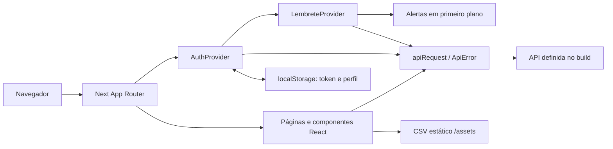
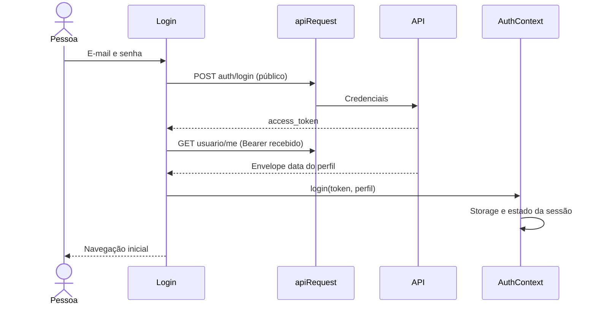
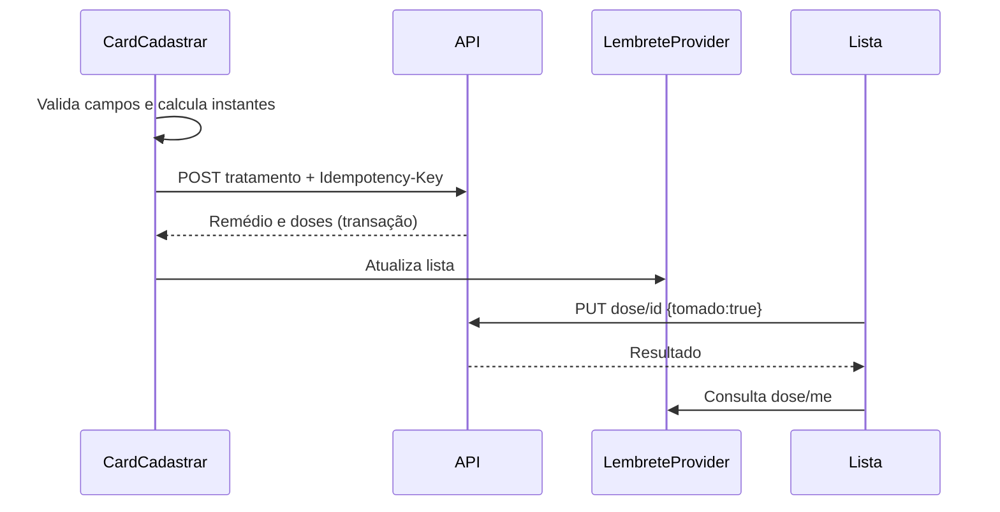

# Arquitetura do frontend

Revisão local em 04/11/2026: `84b5ae7` mais integração no working tree. O diagnóstico de 01/10/2026 é histórico. Os diagramas representam a estrutura do código revisado, sem atestar implantação ou comportamento real da API.

[layout.tsx](../src/app/layout.tsx) compõe AuthProvider, LembreteProvider, alerta e SidebarProvider. Páginas interativas usam componentes cliente. Rotas protegidas passam por [ProtectedRoute](../src/app/components/ProtectedRoute/ProtectedRoute.tsx); a autorização efetiva de recursos pertence ao backend.

O [cliente HTTP](../src/app/utils/api.ts) monta origem e endpoint, aplica Bearer/Content-Type quando pertinente, interpreta resposta e produz `ApiError` com status, mensagens e Retry-After. Não faz retry automático. Um 401 autenticado invalida a sessão por padrão; a troca de senha usa política operacional própria e revalida o perfil para distinguir senha atual incorreta de token inválido. O evento de invalidação alcança AuthContext.

O frontend usa o contrato atômico para evitar anunciar sucesso após duas gravações independentes. A transação e o escopo da chave são garantias do backend, verificáveis em [E2E isolado](specs/integracao-backend/tasks.md). A interface só preserva a chave de reenvio e bloqueia submissões concorrentes.

O [histórico](../src/app/historico/HistoricoContent.tsx) lê doses autenticadas, filtra por medicamento/status/período e deriva nomes a partir do remédio associado. Respostas obsoletas são descartadas quando a identidade muda. O CSV é baixado via Fetch estático e processado por PapaParse nos componentes de busca; não passa pelo cliente da API.

`NEXT_PUBLIC_API_URL` é incorporada pelo Next no build; [`.env.example`](../.env.example) documenta a origem. `NEXT_PUBLIC_API_ENV=isolated` exige origem explícita. Sem configuração fora de teste isolado permanece o fallback legado de produção. O backend precisa permitir a origem do frontend e os headers usados via CORS. Alterar variável pública exige novo build. Segredos não pertencem às variáveis `NEXT_PUBLIC_*`.

Não há banco local, serviço de push ou confirmação de entrega em segundo plano. Escala e disponibilidade da API são fronteiras externas, detalhadas em [ESCALABILIDADE](ESCALABILIDADE.md).
