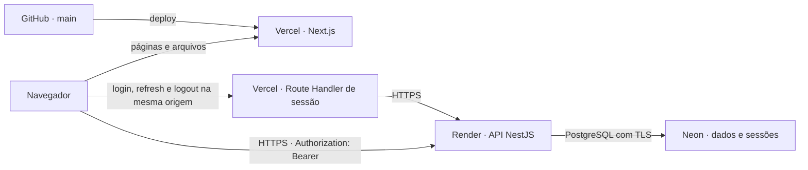

# Computação em Nuvem II — frontend do MedReminder

## Objetivo no Projeto Integrador

Aplicar conceitos de computação em nuvem com deploy automatizado, distribuição de conteúdo, separação entre aplicação e banco de dados e monitoramento básico. O Next.js entrega a interface na Vercel, a API NestJS executa no Render e os dados persistem no PostgreSQL do Neon.

| Entregável | Implementação e evidência |
| --- | --- |
| Infraestrutura em nuvem configurada | Projeto `med_reminder` na Vercel, vinculado à branch `main`. Domínio de produção com HTTPS e origem da API do Render incorporada ao build. |
| Serviços escaláveis | Entrega de páginas e arquivos pela rede da Vercel e execução da rota de sessão sob demanda. O limite atual da API e do banco consta na [documentação do backend](https://github.com/Hosana09/medreminder-backend/blob/master/docs/CLOUD.md). |
| Monitoramento básico | Estado dos builds e deploys na Vercel, verificação HTTP do site e monitoração de prontidão da API. Há comandos reproduzíveis e resultados observados abaixo. |
| Evidências para GitHub | Este guia, [modelo de configuração](../.env.example), [workflow de qualidade](../.github/workflows/quality.yml) e referências aos commits publicados. |

## Infraestrutura configurada

| Item | Valor |
| --- | --- |
| Site público | [medreminder-phi.vercel.app](https://medreminder-phi.vercel.app/) |
| Projeto e runtime | `med_reminder`, framework Next.js, Node.js 22.x na Vercel |
| Origem do código | [MagalDevs/Front_MedReminder](https://github.com/MagalDevs/Front_MedReminder), branch `main` em produção |
| API | `https://medreminder-backend-m1f4.onrender.com` |
| Build | `npm run build` no projeto Next.js. A Vercel publica as páginas, arquivos estáticos e o Route Handler de sessão. |



## Como funciona na prática

1. **Login e sessão.** O formulário envia o login para `POST /auth/session/login` no próprio domínio da Vercel. O [Route Handler](../src/app/auth/session/%5Baction%5D/route.ts) encaminha login, renovação e logout para a API, repassa o cookie de renovação e usa `Cache-Control: no-store`. O cookie de renovação é `HttpOnly`, `SameSite=Lax` e `Secure` em produção. O token de acesso fica em `localStorage` e é enviado como Bearer às rotas protegidas do Render. Essa divisão mantém o cookie de renovação na origem do site e permite chamadas de negócio diretas à API.
2. **Perfil e foto.** Após o login e ao restaurar a sessão, o frontend carrega `GET /usuario/me`. Em Configurações, a seleção aceita JPEG, PNG ou WebP de até 5 MiB. Arquivos maiores que 64 KiB passam por redução para caber no limite da API. O frontend envia a imagem Base64 para `POST /usuario/foto`. Após a confirmação, o [contexto de autenticação](../src/app/contexts/AuthContext.tsx) atualiza a foto em memória. O [avatar](../src/app/components/ProfileAvatar.tsx) a exibe no menu inicial e na barra lateral, com ícone padrão quando a imagem está ausente ou falha ao carregar.
3. **Medicamentos e lembretes.** A busca lê o catálogo CSV servido com os arquivos do site. O envio do tratamento usa `POST /tratamento`, com Bearer e `Idempotency-Key`. A API grava medicamento e doses no banco em uma transação. Após confirmação, o frontend redireciona para `/meus-medicamentos`. A UI consulta as doses pela API e apresenta o lembrete na aplicação. Consulte o [cadastro](../src/app/components/CardCadastrar/cardCadastrar.tsx) e a [rota do formulário](../src/app/novo-medicamento/page.tsx).

## Configuração e deploy

| Variável ou configuração | Onde e como funciona |
| --- | --- |
| `NEXT_PUBLIC_API_URL` | Em **Settings → Environment Variables → Production** na Vercel. Use `https://medreminder-backend-m1f4.onrender.com`. A variável é pública e entra no JavaScript durante o build. Para mudar a origem, publique um novo build. |
| `NEXT_PUBLIC_API_ENV=isolated` | Em homologação isolada, exige uma URL explícita da API. Configure uma API e dados próprios para o ambiente e utilize essa origem nos testes reais. |
| `CORS_ORIGINS` | No Render. Deve incluir a origem exata `https://medreminder-phi.vercel.app` para as chamadas diretas do navegador. Para uma prévia com API isolada, autorize o domínio naquela API. |

O [resolvedor da origem](../src/app/utils/api-url.ts) dá prioridade a `NEXT_PUBLIC_API_URL`. Em desenvolvimento sem variável explícita, usa `http://localhost:3001`. O fallback legado de produção ainda aponta para `https://medreminder-backend.onrender.com`, por isso a variável explícita é necessária para que o build use o serviço atual. O PostgreSQL e os segredos de autenticação são configurados no Render.

1. Abra um PR para `main`. A integração do GitHub com a Vercel cria um deploy de prévia. O [CI do frontend](../.github/workflows/quality.yml) verifica lint, tipos, build, testes e cobertura. O E2E real depende de `E2E_API_URL` apontando para uma API isolada com dados sintéticos.
2. Quando a entrega altera o contrato da API, publique primeiro o backend e confirme `/health/ready`. Após o merge em `main`, acompanhe **Deployments** na Vercel até o commit esperado ficar `READY` com o domínio público atribuído.
3. Abra a página inicial e `/login`, confirme a origem da API no build e, para testes que gravam dados, use homologação. Se houver regressão, selecione um deploy anterior compatível em **Deployments** e confira se o domínio voltou a servir a versão esperada. Reverter o site não reverte dados ou migrations no Neon. [Integração GitHub da Vercel](https://vercel.com/docs/git/vercel-for-github)

## Escalabilidade

A rede de entrega da Vercel atende páginas e arquivos como JavaScript, CSS e o catálogo. A rota de sessão roda sob demanda e encaminha operações ao Render. O volume de requisições que a interface pode servir e a capacidade de gravar tratamentos são medidas diferentes. Login, leituras e gravações continuam sujeitos à capacidade da API e do Neon. O Render Free opera com uma instância e pode levar mais tempo na primeira requisição após inatividade. A validação registrada aqui é de disponibilidade e integração. A capacidade sob carga permanece sem medição. [Limites da Vercel](https://vercel.com/docs/functions/limitations) · [Limites do Render Free](https://render.com/docs/free)

## Monitoramento básico

| Sinal | Onde acompanhar |
| --- | --- |
| Build e versão publicada | **Deployments** na Vercel. Compare o commit da `main`, o estado `READY` e o domínio atribuído. Em falhas, abra os logs do build. |
| Disponibilidade do site | Teste `GET /` e `GET /login` no domínio público. São verificações de entrega da página. |
| Falha no login | Inspecione o status de `/auth/session/login` no navegador e a prontidão da API. O proxy responde `502` se a comunicação com a API falhar. Um `401` do login indica que a API rejeitou a autenticação. |
| API e banco | `GET /health/live` testa o processo e `GET /health/ready` executa uma consulta ao banco. As métricas estão em `GET /health/metrics`. |

```bash
curl -fsS -o /dev/null -w 'Site HTTP %{http_code}\n' https://medreminder-phi.vercel.app/
curl -fsS -o /dev/null -w 'Login HTTP %{http_code}\n' https://medreminder-phi.vercel.app/login
curl -fsS https://medreminder-backend-m1f4.onrender.com/health/ready
```

Use status e duração para investigar erros. Token, cookie, senha, CPF e dados de tratamento devem ficar fora de relatórios e capturas. A verificação é pontual. A configuração de alertas contínuos externos ainda não foi comprovada.

## Evidências de produção

Verificação somente de leitura em **24/11/2026**, sem usar conta de paciente.

| Evidência | Resultado |
| --- | --- |
| Deploy Git → Vercel | `READY` em produção na `main`, commit [19021c6](https://github.com/MagalDevs/Front_MedReminder/commit/19021c65458110ec504e890d9f21b1a651c649e6) e domínio `medreminder-phi.vercel.app` confirmado no deploy. |
| Site e login | `GET /` e `GET /login` responderam `200`. O JavaScript público da página de login continha a origem atual do Render. |
| Integração HTTPS e CORS | `OPTIONS /tratamento` no Render respondeu `204` para a origem da Vercel, com `Authorization`, `Content-Type` e `Idempotency-Key` permitidos. |
| Contrato autenticado | `GET /usuario/me` sem sessão respondeu `401`. A verificação pública não executou login nem gravou registros. |
| Histórico das entregas da interface | [Lembrete e redirecionamento](https://github.com/MagalDevs/Front_MedReminder/pull/55) · [Upload Base64](https://github.com/MagalDevs/Front_MedReminder/pull/56) · [Avatares e testes](https://github.com/MagalDevs/Front_MedReminder/pull/57) |
