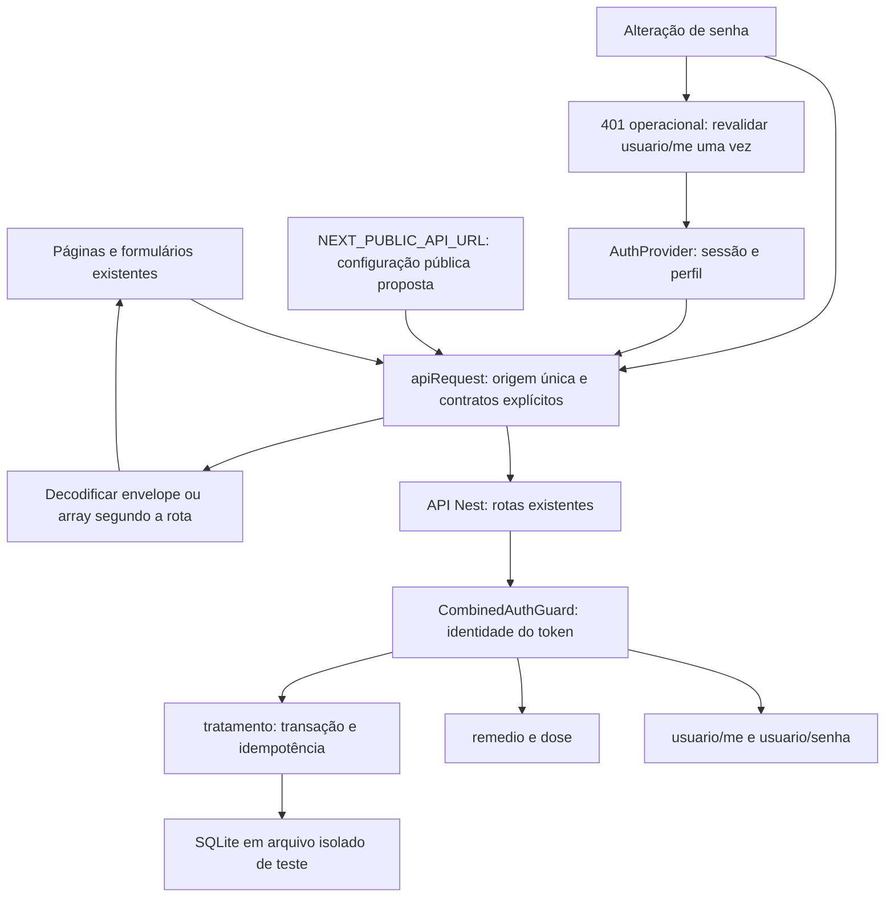

# Backend Integration Design

**Spec**: [spec.md](spec.md)
**Status**: Approved — em execução
**Date**: 2026-11-04, America/Sao_Paulo.
**Frontend baseline**: `43b05890d8a6cca1311969a6ca51a9f9decc2620`.
**Backend baseline**: `b6b63168ba2a092e6e6350c256bfa15483199b4a`.

Há lacunas de integração entre os dois checkouts. O backend atual já implementa recursos que os documentos históricos tratavam como ausentes, incluindo troca de senha, CORS configurável e criação atômica de tratamento. O frontend ainda tem URLs fixas, chamadas diretas, leitura incorreta do envelope após atualizar perfil e tratamento uniforme de 401 que não distingue senha atual inválida de sessão expirada.

Este documento registra inspeção estática e alinhamento proposto. Não houve chamada à API de produção, execução de fluxo no navegador ou comprovação de que o deploy remoto contém este backend. `F/` identifica o repositório `Front_MedReminder`; `B/` identifica `medreminder-backend`. As linhas citadas pertencem às baselines acima.

## Architecture Overview

Manter Next.js App Router, React Context e Fetch. A integração aproveita o cliente `apiRequest`, os providers e os formulários atuais. O alinhamento adiciona configuração pública de origem da API, tipos de transporte explícitos e tratamento de erros conforme o endpoint. Não envolve cookies novos, migração de autenticação, novo framework ou retry automático.



O diagrama representa o destino do alinhamento, não o estado já implementado. Hoje cadastro, histórico e upload de foto usam Fetch direto; `apiRequest` tem origem Render fixa (`F/src/app/utils/api.ts:3`). A ordem dos providers e a estrutura visual permanecem as atuais. Um cliente único não torna o navegador uma fronteira de autorização: a identidade e o ownership continuam sendo responsabilidade do servidor.

## Current Contract Matrix

| Operation | Backend contract | Frontend observation and alignment |
| --- | --- | --- |
| POST `/auth/login` | Corpo `{email,senha}`; resposta `{access_token,message}`; status 200 explícito. `B/src/auth/auth.controller.ts:18-33`. | O contrato principal já corresponde ao login. Preservar o token recebido e a consulta posterior do perfil; testes devem cobrir credencial inválida, validação e 429 sem confundi-los com falha de rede. |
| POST `/usuario` | Cadastro sem Bearer é permitido; identidade Firebase é opcional e tem contrato próprio. Corpo inclui `nome,dataNasc,cpf,email,cep,cuidador,senha`; resposta `{message,data:UsuarioResponseDto}`. `B/src/usuario/usuario.controller.ts:28-37`; `B/src/usuario/usuario.service.ts:33-61`. | `F/src/app/cadastro/page.tsx:34-54` envia esses campos e usa Fetch direto. Migrar a origem e o tratamento de erro sem acrescentar autenticação obrigatória ao cadastro. |
| GET `/usuario/me` | Bearer; resposta `{message,data:UsuarioResponseDto}`. `B/src/usuario/usuario.controller.ts:47-55`. | A leitura inicial de Configurações usa `response.data` corretamente (`F/src/app/Configuracoes/ConfiguracoesContent.tsx:38-53`). Não corrigir esse trecho como se esperasse objeto na raiz. |
| PATCH `/usuario/me` | Bearer; aceita somente `nome,dataNasc,email,cep`, todos opcionais quando omitidos; resposta `{message,data:UsuarioResponseDto}`. `B/src/usuario/dto/update-usuario.dto.ts:3-6`; `B/src/usuario/usuario.service.ts:119-137`. | O frontend envia somente `nome,email,cep`, que são campos permitidos (`F/.../ConfiguracoesContent.tsx:125-129`). O erro está na leitura: tipa o retorno como `Usuario` e lê os campos da raiz em vez de `data` (`:131-151`). CEP vazio também exige alinhamento com a validação, pois atualmente é enviado como `''`. |
| PATCH `/usuario/senha` | **Já implementado**; Bearer e limite de tentativas; corpo `{senhaAtual,novaSenha}`; sucesso `{message}`; senha atual incorreta gera 401. `B/src/usuario/usuario.controller.ts:74-80`; `B/src/usuario/usuario.service.ts:154-177`. | URL, método e chaves atuais já correspondem (`F/.../ConfiguracoesContent.tsx:136-143`). Falta distinguir 401 operacional de token inválido, apresentar validação de senha e não anunciar sucesso da operação inteira se apenas o perfil tiver sido salvo. |
| POST `/usuario/foto` | Nenhuma rota correspondente no controller do backend desta baseline. `B/src/usuario/usuario.controller.ts:24-91`. | A chamada direta em `F/.../ConfiguracoesContent.tsx:196-205` continua sem contrato comprovado. Manter dependência explícita; não inventar upload, formato de retorno ou persistência de foto. |
| GET `/remedio` | Bearer obrigatório; retorna **array na raiz**, filtrado por `usuarioId`. `B/src/remedio/remedio.controller.ts:19-36`; `B/src/remedio/remedio.service.ts:49-53`. | O array esperado pelo histórico é compatível com esta rota. A divergência é a chamada sem Bearer e a geração aleatória de registros, não um envelope supostamente ausente. O endpoint não é uma lista global pública. |
| GET `/remedio/me` | Bearer; `{message,data:Remedio[]}`, inclusive lista vazia. `B/src/remedio/remedio.controller.ts:39-42`; `B/src/remedio/remedio.service.ts:56-75`. | Usar tipos e fixtures diferentes da rota `/remedio`, sem um unwrap global que quebre arrays válidos. |
| POST `/remedio` | Bearer; valida `CreateRemedioDto`; retorna `{message,data:Remedio}`. `B/src/remedio/remedio.service.ts:29-46`. | O cadastro de tratamento atual lê `data.id` e depois envia as doses. O formato é compatível, mas as duas chamadas não formam uma transação. |
| PUT `/remedio/:id` e DELETE `/remedio/:id` | Bearer e ownership; PUT retorna `{message,data}`; DELETE retorna `{message}`. `B/src/remedio/remedio.controller.ts:68-84`; `B/src/remedio/remedio.service.ts:114-155`. | Preservar métodos e IDs; não exigir campo `data` na exclusão. Erros de autorização não equivalem a coleção vazia. |
| GET `/dose/me` sem query | Bearer; `{message,data:Dose[]}` com projeção de `remedio`; lista vazia também tem envelope. `B/src/dose/dose.service.ts:143-189`. | A chamada atual do contexto pode manter o contrato sem paginação. O objeto de remédio retornado não contém todos os campos do tipo local. Modelar o transporte real, não presumir entidade completa. |
| GET `/dose/me` com query | `page,limit,from,to,tomado,order`; retorna `{message,data,pagination}`. Defaults `page=1`, `limit=20`, `order=ASC`; `limit<=100`; ordena por instante e ID. `B/src/dose/dose.controller.ts:47-55`; `B/src/dose/dto/list-doses.dto.ts:9-52`; `B/src/dose/dose.service.ts:84-133`. | Paginação é capacidade disponível, não obrigação de ativá-la nesta correção. Se usada no histórico real, consumir todas as páginas necessárias ou apresentar paginação explícita; não confundir a primeira página com total completo. |
| POST `/dose/doses` | Bearer; `{remedioId:number,doses:string[]}`; 1–1000 datas únicas por instante; `{message,data:Dose[]}`. `B/src/dose/dto/create-doses.dto.ts:12-28`; `B/src/dose/dose.service.ts:66-81`. | O payload legado usa as chaves corretas. O frontend não pode enviar mais de 1000 doses nem dividir silenciosamente o lote para contornar o limite. |
| PUT `/dose/:id` | Bearer e ownership; aceita somente `{tomado:boolean}`; retorna `{message,data:Dose}`. `B/src/dose/dto/update-dose.dto.ts:4-8`; `B/src/dose/dose.service.ts:209-229`. | A confirmação atual `{tomado:true}` corresponde ao contrato. Não enviar horário, proprietário ou medicamento como atualização da dose. |
| POST `/tratamento` | Bearer; `{remedio:CreateRemedioDto,doses:string[]}` e header `Idempotency-Key`; retorna `{message,data:{remedio,doses}}`. `B/src/tratamento/tratamento.controller.ts:8-18`; `B/src/tratamento/create-tratamento.dto.ts:7-14`; `B/src/tratamento/tratamento.service.ts:107-110`. | Caminho disponível para resolver a falha parcial do fluxo legado. Migrar o submit em tarefa específica, com testes de atomicidade, reenvio e falhas, sem tratar essa mudança funcional como otimização de busca. |

## Input and Transport Rules

| Boundary | Verified rule | Consequence for implementation |
| --- | --- | --- |
| Campos desconhecidos | `ValidationPipe` usa `transform`, `whitelist` e `forbidNonWhitelisted`; serviços também validam DTOs. `B/src/configure-app.ts:8-14`; `B/src/common/validate-dto.ts:6-25`. | Enviar allowlists por operação. Não copiar a entidade do usuário ou remédio inteira para PATCH/PUT. |
| Nascimento | String `YYYY-MM-DD` válida e não futura. `B/src/common/dto-normalization.ts:72-85`. | O cadastro atual já usa o valor do input `type=date` diretamente (`F/src/app/cadastro/page.tsx:36`, `:189-191`); isso é compatível. Não introduzir conversão para ISO completo. |
| CEP de perfil | Quando presente, segue a validação de oito dígitos do cadastro; string vazia não equivale a omissão. `B/src/usuario/dto/update-usuario.dto.ts:3-6`; `B/src/usuario/dto/create-usuario.dto.ts:42-47`. | CEP vazio submetido produz 400: apresentar essa validação e não anunciar sucesso. Não omitir o campo para preservar o anterior nem presumir apagamento por suposição. Alterar a semântica do campo está fora do adendo. |
| Senha nova | Pelo menos oito caracteres, maiúscula, minúscula, número e símbolo. `B/src/usuario/dto/update-usuario-senha.dto.ts:8-23`. | O frontend só verifica comprimento atualmente. Exibir as mensagens reais de validação e testar o contrato completo sem relaxar regras do servidor. |
| Validade do remédio | `dataValidade` é obrigatória e precisa de data válida. `B/src/remedio/dto/create-remedio.dto.ts:27-30`. | O frontend calcula `null` quando não há validade (`F/src/app/components/CardCadastrar/cardCadastrar.tsx:218-227`). Esse estado deve ser impedido antes da mutação ou apresentado como rejeição de contrato, sem alterar o DTO para aceitar null por conta própria. |
| Inteiros e identificadores | Quantidades inteiras de pelo menos 1; `remedioId` inteiro positivo; identidade vem do Bearer. `B/src/remedio/dto/create-remedio.dto.ts:22-35`, `:81-84`; `B/src/dose/dto/create-doses.dto.ts:25-28`. | Validar fronteiras e preservar números JSON. Não enviar IDs de proprietário como fonte de autorização. |
| Instantes de doses | `YYYY-MM-DD` ou ISO com timezone e até três casas decimais. `B/src/common/dto-normalization.ts:33-47`. | Payloads `toISOString()` são compatíveis com instantes. Cobrir virada de dia/fuso com valores esperados explícitos. |
| Perfil de resposta | Allowlist `id,nome,email,dataNasc,cpf,cep,cuidador`, sem senha. `B/src/usuario/dto/usuario-response.dto.ts:4-22`. | Tratar datas JSON como strings de transporte. Não acrescentar `senha` ou `foto` como capacidades comprovadas da resposta. |
| Semântica de quantidades | O frontend atribui intervalo a `quantidadeDiaria` e duração bruta a `quantidadeDias` (`F/src/app/components/CardCadastrar/cardCadastrar.tsx:228-234`). O DTO apenas exige inteiros positivos. | **Checkpoint semântico**: confirmar significado com especificações/contrato antes de qualquer alteração. O nome da propriedade, sozinho, não comprova fórmula nova nem autoriza recalcular duração/doses. |

## Configuration and CORS

`NEXT_PUBLIC_API_URL` é proposta de configuração do frontend, ainda não lida pelo código. O valor é público e incorporado ao build; não contém JWT secret, credenciais Firebase Admin ou tokens. Centralizar a origem e migrar os Fetch diretos evita editar telas para alternar local/homologação. Documentar a configuração efetiva e o commit da API de destino, sem usar produção para os testes.

O backend já chama `configureApp` em `B/src/main.ts:7`; escuta `PORT` ou 3000 (`:9`) e não define prefixo global nesse bootstrap. O CORS atual (`B/src/common/cors-config.ts:3-27`) tem:

- Origem exata em `CORS_ORIGINS`, separada por vírgula; produção exige a variável. Caminhos e curingas são rejeitados.
- Defaults locais de `localhost:3000`, `3001`, `8081` e `8082` fora de produção.
- `credentials:false`, métodos GET/HEAD/PUT/PATCH/POST/DELETE, headers Authorization/Content-Type/Idempotency-Key e exposição de Retry-After.

A tarefa de integração deve validar a origem concreta do frontend e o preflight do ambiente escolhido. Não reimplementar CORS nem afirmar que o YAML ou o código comprovam a configuração do deploy remoto. Não trocar Bearer por cookies ou habilitar `credentials:include` como ajuste implícito.

## Proposed HTTP Error Interface

Reutilizar `apiRequest` e acrescentar informação estruturada de erro no próprio limite HTTP. O nome `invalidateSessionOn401` abaixo é **proposto**, ainda não existe:

```typescript
interface IntegrationFetchOptions extends RequestInit {
  requireAuth?: boolean;
  invalidateSessionOn401?: boolean;
}

interface IntegrationApiError extends Error {
  status?: number;
  code?: string;
  messages: string[];
  retryAfter?: string;
}
```

Preservar a assinatura de retorno por rota; não aplicar unwrap universal. Normalizar `message:string` e `message:string[]`, com fallback para corpo não JSON. O backend declara esse formato de erro em `B/src/common/api-response.ts:34-39`. Hoje o cliente só trata `message` como string e pode escolher o genérico `error:'Bad Request'` antes das mensagens de validação (`F/src/app/utils/api.ts:80-92`).

O comportamento padrão de 401 autenticado continua invalidando sessão. Somente chamadas com um 401 operacional conhecido, como senha atual inválida, usam o controle explícito e revalidam a sessão no fluxo correspondente. Uma opção técnica sem decisão de uso não pode desativar a proteção global.

```mermaid
sequenceDiagram
    actor User as Usuário
    participant Form as Configurações
    participant HTTP as apiRequest
    participant API as Backend
    participant Auth as AuthProvider
    User->>Form: Solicita troca de senha
    Form->>HTTP: PATCH usuario/senha com invalidateSessionOn401=false
    HTTP->>API: Bearer + senhaAtual/novaSenha
    API-->>HTTP: 401
    HTTP-->>Form: Erro estruturado, sem limpar sessão
    Form->>HTTP: GET usuario/me para revalidar uma vez
    HTTP->>API: Mesmo Bearer
    alt Sessão continua válida
        API-->>Form: 200 com data do usuário
        Form-->>User: Mensagem operacional; sessão preservada
    else Token inválido ou expirado
        API-->>HTTP: 401
        HTTP->>Auth: Invalidar sessão e dados associados
        Auth-->>User: Fluxo de login
    else Rede ou servidor indisponível
        API-->>Form: Erro de rede ou 5xx
        Form-->>User: Verificação indisponível; sem declarar token inválido
    end
```

Esse GET é verificação após o erro, não retry da alteração de senha. Limitar a verificação a uma tentativa; não criar loop de requisições. Ler o status HTTP real em vez de procurar `'401'` dentro de uma mensagem. Em sucesso parcial de perfil seguido de falha na senha, exibir os resultados separados; uma transação entre essas duas operações não existe no backend.

## Atomic Treatment Flow

Substituir os dois POSTs de criação por uma chamada a `/tratamento` somente na tarefa funcional correspondente. Reutilizar a preparação do medicamento e o conjunto de instantes, depois de verificar seus campos e limites. Não alterar simultaneamente a regra temporal sob o rótulo de integração.

| Situation | Existing backend behavior | Planned frontend handling |
| --- | --- | --- |
| Primeira submissão válida | Transação grava remédio e doses conjuntamente. `B/src/tratamento/tratamento.service.ts:63-96`. | Uma chave nova por operação; bloquear envio duplicado enquanto a operação estiver pendente; sucesso somente ao receber o envelope completo. |
| Reenvio da mesma operação/conteúdo | Busca por usuário e chave, confere hash e devolve os mesmos registros. `:65-76`, `:98-110`. | Preservar a chave para retomada manual da mesma operação; não gerar chave nova após timeout sem saber o resultado. |
| Mesma chave, outro conteúdo | 409. `:73-76`. | Não tratar como sucesso; não trocar a chave automaticamente para contornar conflito. |
| Chave ausente/inválida | 400; 1–128 caracteres alfanuméricos ASCII ou `. _ : -`. `:21-26`. | Gerar chave compatível e testar o header; nunca usar senha/token como chave. |
| Banco indisponível ou em memória | 503; requer SQLite em arquivo inicializado. `:41-49`. | Pré-condição do E2E é banco isolado em arquivo com migrações; fixture `:memory:` não comprova esse endpoint. |
| Busy após tentativas internas do servidor | 503 orienta mesma chave. `:117-130`. | Mostrar falha recuperável e preservar o contexto da operação; sem retry automático no cliente. |
| Lote acima de 1000 ou instantes duplicados | DTO rejeita. `B/src/dose/dto/create-doses.dto.ts:12-23`. | Validar antes de enviar e explicar a limitação do contrato. Não dividir silenciosamente um tratamento em várias transações. |

O mecanismo tem escopo por usuário e chave. A mudança não comprova notificação fora da página, adiamento persistido ou capacidade de escrita concorrente em produção.

## Components and Reuse

| Component | Planned change | Existing dependencies and verification boundary |
| --- | --- | --- |
| `F/src/app/utils/api.ts` | Origem por ambiente, erro estruturado, mensagens em array e controle explícito de 401. | Fetch/Headers/storage existentes; testes unitários e integração com respostas controladas, sem rede de produção. |
| `F/src/app/contexts/AuthContext.tsx` e contexto de lembretes | Validar restauração de sessão na API e manter identidade/limpeza consistentes conforme spec. | Context e router atuais; integração com 200/401/5xx e troca de conta. A presença do token não prova validade. |
| `F/src/app/cadastro/page.tsx` | Usar configuração/cliente central e manter cadastro público e nascimento date-only. | Formulário e payload existentes; validação, erro da API e 429. |
| `F/src/app/Configuracoes/ConfiguracoesContent.tsx` | Ler envelope de PATCH, alinhar CEP, tratar perfil e senha como resultados distintos e reconhecer foto sem contrato. | UI e provider atuais; integração com resposta realista, senha incorreta e token expirado. |
| `F/src/app/historico/HistoricoContent.tsx` | Autenticar a consulta e usar doses persistidas no trabalho funcional de histórico real. | API `/dose/me` e envelope observado; lista vazia, erro, filtros e persistência, sem `Math.random` como fonte real. |
| `F/src/app/components/CardCadastrar/cardCadastrar.tsx` | Validar campos obrigatórios/limites e migrar criação para tratamento atômico. | Formulário e cálculo existentes; testes de payload, chave, replay, conflito e rollback na API isolada. |

Nenhuma nova biblioteca de HTTP ou store global é necessária para o alinhamento. A stack de teste continua Vitest/React Testing Library e Playwright, já escolhida no pacote de manutenção.

## Error Handling Strategy

| Scenario | Planned outcome | Limit |
| --- | --- | --- |
| 400 com `message:string[]` | Mostrar mensagens de validação normalizadas; manter dados editáveis. | Não reclassificar como erro de rede nem ocultar o conteúdo útil em `Bad Request`. |
| 401 em dado protegido comum | Invalidar sessão e limpar dados associados segundo o contrato de sessão. | O servidor continua validando token e conta; o cliente não inventa refresh token. |
| 401 na alteração de senha | Revalidar `/usuario/me` uma vez e distinguir falha operacional de sessão inválida. | Não suprimir um token expirado nem executar novamente o PATCH automaticamente. |
| 403 de ownership | Exibir acesso negado, sem mostrar dados de outra conta. | Não transformar em lista vazia ou sucesso. |
| 409 de idempotência | Preservar erro e contexto, sem contornar conflito por chave nova automática. | Ação editada/nova precisa do ciclo de operação definido no spec. |
| 429 | Mostrar limitação e considerar `Retry-After` como informação da resposta. | Não acrescentar novas tentativas automáticas. |
| 5xx, timeout ou offline | Exibir indisponibilidade, encerrar loading e permitir decisão de retomada do usuário. | Sem sucesso falso, limpeza indiscriminada de sessão ou promessa de rollback no fluxo legado. |
| Rota de foto ausente | Registrar capacidade indisponível e dependência de contrato. | Implementar endpoint ou mudar controles continua decisão explícita; este documento não executa nenhuma opção. |

## Risks & Concerns

| Concern | Evidence | Impact | Mitigation |
| --- | --- | --- | --- |
| Deploy diferente dos checkouts | Baselines locais e índices Graphify; nenhum deploy inspecionado. | Endpoint local pode não existir no ambiente remoto. | Identificar commit/API de homologação antes do teste; se ausente, registrar bloqueio sem fallback para produção. |
| Fontes históricas desatualizadas | Diagnóstico de 01/10/2026 tratava senha/contratos como ausentes. | Planejamento pode pedir backend já implementado. | Usar esta matriz com baseline; preservar o histórico como histórico e corrigir referências vigentes. |
| URLs fixas e Fetch diretos | `F/src/app/utils/api.ts:3`; cadastro `:48`; configurações `:197`. | Ambiente de teste pode atingir destino errado e tratamento de erro divergir. | Origem única, migração por chamada e bloqueio de rede inesperada nas suítes. |
| Envelope de atualização de perfil | `F/.../ConfiguracoesContent.tsx:131-151`; `B/src/usuario/usuario.service.ts:134-137`. | Campos visuais ficam vazios ou inconsistentes após sucesso. | Tipar e ler `data`, atualizar estado a partir do usuário retornado e testar reload. |
| CEP vazio permitido na UI | `F/.../ConfiguracoesContent.tsx:90-97`, `:125-129`. | `cep:''` gera 400 no backend atual. | Alinhar envio/validação com DTO; não presumir exclusão do CEP. |
| 401 operacional provoca logout | `F/src/app/utils/api.ts:61-65`; `B/src/usuario/usuario.service.ts:162-163`. | Senha atual incorreta destrói sessão ainda válida. | Controle explícito e revalidação do perfil; testar sessão válida e expirada com mesmo status de erro inicial. |
| Campo de validade não alinhado | `F/.../cardCadastrar.tsx:218-227`; `B/src/remedio/dto/create-remedio.dto.ts:27-30`. | Tratamento falha antes da gravação por null. | Validar obrigatoriedade e resultado 400, sem relaxar backend. |
| Nomes de quantidade não comprovam semântica | `F/.../cardCadastrar.tsx:228-234`; DTO só valida tipo/faixa. | Refatoração pode mudar doses indevidamente. | Checkpoint contratual; registrar incerteza e manter cálculo fora da migração de transporte. |
| Fluxo legado em duas mutações | `F/.../cardCadastrar.tsx:242`, `:316`. | Remédio pode ficar sem doses após falha parcial. | Migrar para endpoint atômico existente com chave estável e testes reais em banco isolado em arquivo. |
| Lotes e projeções ignorados | DTO máximo 1000; `/dose/me` inclui projeção e paginação opcional. | Rejeição de tratamento grande ou leitura de dados incompletos. | Tipos por rota, limites explícitos e testes de fronteira/páginas. |
| Foto sem endpoint | Front chama `/usuario/foto`; controller backend não define a rota. | Operação não pode ser apresentada como integrada. | Manter bloqueio/decisão de contrato; nenhum mock aprova persistência inexistente. |
| Testes com mocks parecem E2E | Cliente e servidor podem divergir mesmo com suíte local verde. | Falsa comprovação da conexão real. | Separar testes de contrato controlados do E2E em API isolada, incluindo CORS no navegador. |

## Verification Boundaries

Os requisitos, tarefas e provas ficam em `spec.md` e `tasks.md`. Testes locais de contrato devem usar os envelopes e DTOs desta matriz; um mock deve falhar quando o frontend enviar campo não permitido ou ler o envelope incorreto. O E2E deve usar API e banco isolados, contas sintéticas A/B e o commit efetivo de ambos os repositórios.

Cobrir preflight para Authorization/Content-Type/Idempotency-Key, sucesso/falha do perfil, senha atual incorreta versus token inválido, validações 400 em array, lote de 1000/1001, datas duplicadas, replay de tratamento e 409 com conteúdo divergente. Revisar armazenamento e logs das evidências para não publicar token, senha, CPF ou dados de tratamento.

Esta inspeção confirma contratos no código local. Não confirma disponibilidade, CORS efetivo, latência, persistência ou funcionamento do deploy remoto.
