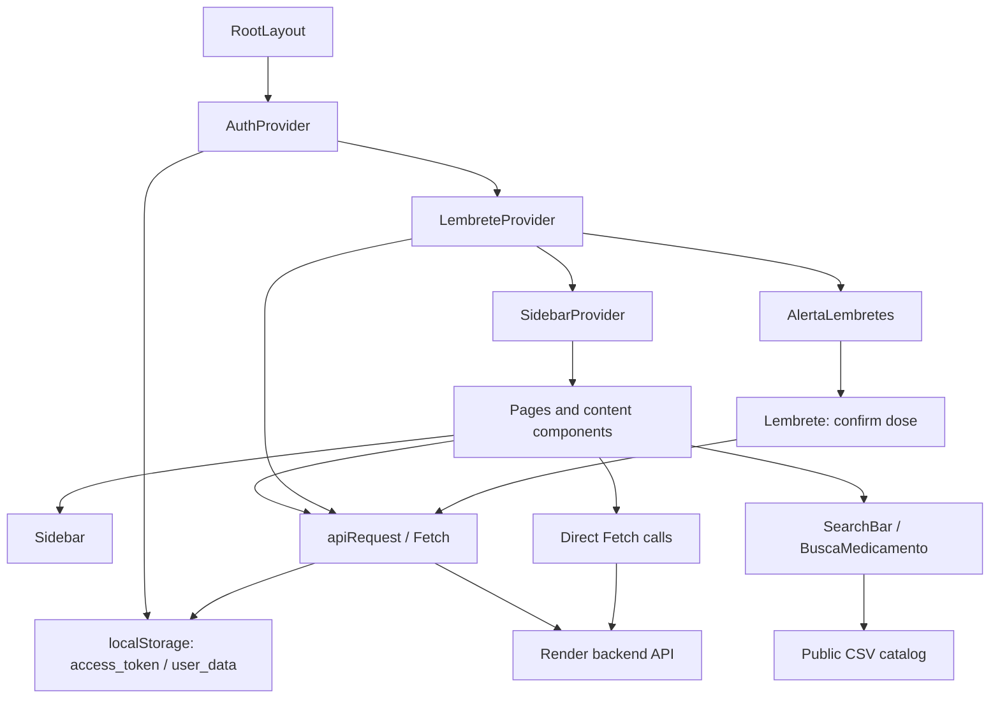

# Quality and Maintenance Design

**Spec**: [spec.md](spec.md)
**Context**: [context.md](context.md)
**Status**: Approved — em execução
**Date**: 2026-11-04, America/Sao_Paulo.
**Code baseline**: `43b05890d8a6cca1311969a6ca51a9f9decc2620`.

Este plano mantém a arquitetura do frontend. A manutenção prevista atualiza ferramentas, reduz trabalho repetido na busca e elimina logs sensíveis. As suítes propostas caracterizam os contratos existentes. Este documento descreve o projeto observado e a organização dos testes futuros; não comprova implementação, cobertura ou desempenho.

**Backend recheck, 04/11/2026**: o [adendo de integração](../integracao-backend/README.md) confrontou este frontend com o backend `b6b6316`. Troca de senha, CORS e tratamento atômico já existem nesse backend. Foto de usuário continua sem rota. As correções funcionais de cliente estão no adendo; este plano de manutenção não precisa preservar um consumo de envelope comprovadamente incorreto como comportamento desejado.

## Architecture Overview

O frontend usa Next.js App Router com TypeScript, React Context e componentes de interação no navegador. `RootLayout` compõe os providers e o alerta global em `src/app/layout.tsx:24`. O repositório não contém a implementação da API, do banco ou do aplicativo mobile. A API Render recebe as operações de usuário, remédio e dose.

As setas representam composição ou acesso observado. Os providers não constituem fronteira de autorização do servidor. `AuthContext.tsx:80` considera a presença do token suficiente para o estado autenticado. O wrapper trata um 401 autenticado limpando o armazenamento e atribuindo `/login` a `window.location.href` em `utils/api.ts:61`.

### Routes

| Route | Existing responsibility | Access behavior observed |
| --- | --- | --- |
| `/` | Busca, menu de usuário e entrada do fluxo | Página pública; hidratação e menu dependem de estado local (`src/app/page.tsx:10`). |
| `/cadastro` | Cadastro de usuário | Fetch direto para `/usuario` (`src/app/cadastro/page.tsx:47`). |
| `/login` | Login e carregamento do perfil | Wrapper com `requireAuth: false`; perfil recebe Bearer explícito (`src/app/login/page.tsx:23`, `:42`). |
| `/novo-medicamento` | Seleção de medicamento e configuração do tratamento | A página não usa `ProtectedRoute`; o submit exige autenticação e `user.id` (`src/app/novo-medicamento/page.tsx:64`; `CardCadastrar/cardCadastrar.tsx:164`). |
| `/meus-medicamentos` | Lista e exclusão de medicamentos | A página não usa `ProtectedRoute`; o conteúdo usa o wrapper autenticado (`src/app/meus-medicamentos/page.tsx:7`; `MeusMedicamentosContent.tsx:46`). |
| `/meus-lembretes` | Filtros e confirmação de dose | Usa `ProtectedRoute` (`src/app/meus-lembretes/page.tsx:9`). |
| `/historico` | Histórico simulado e filtros | A página não usa `ProtectedRoute`; conteúdo faz Fetch direto para `/remedio` (`src/app/historico/page.tsx:7`; `HistoricoContent.tsx:34`). |
| `/Configuracoes` | Consulta e atualização de perfil | Usa `ProtectedRoute`; manter inicial maiúscula da rota (`src/app/Configuracoes/page.tsx:11`). |

### Integration Boundaries

| Boundary | Existing contract | Preservation rule |
| --- | --- | --- |
| Wrapper HTTP | `apiRequest<T>(endpoint, options): Promise<T>`, `requireAuth` verdadeiro por padrão; headers via `Headers`; JSON ou texto conforme Content-Type (`src/app/utils/api.ts:16`). | Preservar URL, método, corpo, headers, retorno e erros definidos pelo código. |
| Cadastro | POST `/usuario` via Fetch direto (`src/app/cadastro/page.tsx:47`). | Eliminar exposição no console sem alterar payload, validação ou navegação. |
| Tratamento | POST `/remedio`, depois POST `/dose/doses`, seguido de recarga do contexto (`src/app/components/CardCadastrar/cardCadastrar.tsx:242`, `:316`). | Preservar sequência e cálculo existente. Não introduzir transação, retry ou compensação. |
| Doses | GET `/dose/me`; PUT `/dose/:id` com `{ tomado: true }` (`src/app/contexts/lembreteContext.tsx:42`; `AlarmeDose/Lembrete.tsx:45`). | Provar alteração persistida em ambiente isolado; mock prova integração local, não persistência real. |
| Histórico | GET `/remedio` sem Bearer e geração aleatória de registros (`src/app/historico/HistoricoContent.tsx:34`, `:48`). | Caracterizar e documentar como simulação; não substituir por histórico real neste plano. |
| Perfil | GET/PATCH `/usuario/me`; PATCH `/usuario/senha` existente no backend atual; `/usuario/foto` ausente (`src/app/Configuracoes/ConfiguracoesContent.tsx:38`, `:131`, `:137`, `:197`). | PATCH perfil retorna envelope com data, hoje lido incorretamente. Validar perfil/senha pelo contrato do adendo; não criar upload fictício. |
| Catálogo | Fetch público e Papa Parse com `header: true`, `skipEmptyLines: true` (`SearchBar/SearchBar.tsx:19`; `CardBusca/cardBusca.tsx:44`). | Preservar dados, ordem de origem, seleção e máximo de dez sugestões visíveis. |

## Code Reuse Analysis

| Existing component | Source | Planned reuse |
| --- | --- | --- |
| Cliente HTTP | `src/app/utils/api.ts:16` | Testar o módulo real com respostas controladas de Fetch; não duplicar o comportamento no mock. |
| Autenticação e proteção | `src/app/contexts/AuthContext.tsx:50`; `components/ProtectedRoute/ProtectedRoute.tsx:11` | Montar o provider real em testes de integração; controlar navegação e armazenamento nas fronteiras. |
| Busca inicial | `src/app/components/SearchBar/SearchBar.tsx:7` | Preservar resultados, ordem, mensagens e condição de exibição de “Cadastrar”. |
| Busca do formulário | `src/app/components/CardBusca/cardBusca.tsx:16` | Preservar seleção, callback `onSelect`, medicamento inicial e comportamento próprio do dropdown. |
| Formulário de tratamento | `src/app/components/CardCadastrar/cardCadastrar.tsx:43` | Exercitar validação, cálculo e dois POSTs pelas entradas observáveis; não reimplementar o algoritmo no teste. |
| Lembretes e alerta | `src/app/contexts/lembreteContext.tsx:39`; `components/AlarmeDose/AlertaLembrete.tsx:15` | Controlar relógio e timers nos testes sem mudar identidade do contexto ou ciclo dos efeitos. |
| Estilos e recursos | `src/app/globals.css:1`; `public/fonts/`; `public/assets/` | Reutilizar os arquivos atuais em regressão visual, com dados sintéticos e fontes carregadas. |
| Documentação histórica | `docs/INVENTARIO.md:3`; `docs/PLANO_TESTES.md:5`; `docs/RELATORIO_QUALIDADE.md:3` | Referenciar a baseline de 01/10/2026 e registrar evidências novas separadamente. |

## Components

| Component | Purpose and interface | Dependencies | Planned validation |
| --- | --- | --- | --- |
| `AuthProvider` | Expor `user`, `isAuthenticated`, `loading`, `login`, `logout`, `getUserDisplayName` (`AuthContext.tsx:23`). | React, localStorage, router. | Vitest + RTL para montagem, restauração da sessão e logout; sem redefinir validade do token. |
| `LembreteProvider` | Expor `lembretes`, `lembretesHoje`, `getLembretes(): Promise<void>` (`lembreteContext.tsx:31`). | Wrapper e relógio local. | Integração do estado com dados controlados, datas e resposta da API. |
| `SearchBar` | Buscar e navegar para `/novo-medicamento?medicamento=...` (`SearchBar.tsx:71`). | Papa Parse, Fetch e router. | Consultas vazias, sem resultado, variação de caixa, duplicatas, mais de dez resultados e nome codificado. |
| `BuscaMedicamento` | Receber `medicamentoInicial?` e emitir `onSelect(medicamento)` (`cardBusca.tsx:11`). | Papa Parse, Fetch e estado local. | Seleção e limpeza via interface; preservar diferenças em relação a `SearchBar`. |
| `ConfigurarLembrete` | Receber `{ nome, tipo }`, validar campos e enviar medicamento/doses (`cardCadastrar.tsx:22`, `:83`, `:159`). | Contextos, wrapper, datas e alertas do navegador. | Casos derivados dos critérios, incluindo falha em cada POST, sem marcar simulação como prova de persistência. |
| `MeusLembretesContent` | Filtrar por medicamento, status e período; confirmar dose (`MeusLembretesContent.tsx:26`). | Contexto, wrapper e relógio. | Resultados observáveis para combinações de filtros e resposta de confirmação. |
| `AlertaLembretes` / `Lembrete` | Agendar alerta e confirmar dose (`AlertaLembrete.tsx:20`; `Lembrete.tsx:45`). | Contexto, timers e wrapper. | Relógio controlado; registrar defeitos existentes sem incorporar mudanças no agendamento. |
| Test harness futuro | Vitest + React Testing Library para unitários e integração; Playwright para navegador, conforme `context.md`. | Configurações e dependências ainda a criar nas tarefas. | Isolar dados, rede, armazenamento, relógio e efeitos; distinguir testes controlados de testes com API real. |

Os caminhos abreviados nesta tabela são relativos a `src/app/` ou ao diretório do componente explicitado na coluna anterior. Os contratos são descrições do código atual. Não há nova camada de serviço, novo estado global ou alteração de modelo de domínio prevista aqui.

## Design Constraints

| Source | Existing visual contract | Preservation rule |
| --- | --- | --- |
| `src/app/globals.css:3` | Fundo `#f6f6f6`, foreground `#171717`, rosa `#be185d`, teal `#0d9488`. | Manter valores atuais. Não consolidar cores apenas por semelhança. |
| `src/app/globals.css:17` | Kantumruy Pro local em cinco pesos; classes específicas. | Manter arquivos, classes e pesos. |
| `src/app/layout.tsx:9` | Variáveis Geist/Geist Mono. | Preservar carregamento e uso existentes. |
| `tailwind.config.js:10` | Cores nominais e famílias de fonte. | Validar a compatibilidade real com Tailwind 4 antes de modificar configuração. |
| `components/Sidebar/sidebar.tsx:38` | Fundo cinza, sidebar expansível `w-60`, ativo por pathname exato. | Preservar navegação, rótulos e expansão. |
| `components/SearchBar/SearchBar.tsx:131` | Dropdown com dez sugestões e mensagens existentes. | Otimização não muda layout, texto, ranking ou quantidade. |

Não foi fornecida captura ou referência Figma neste pedido. O design observado no repositório é a referência para regressão. Antes de uma alteração futura que afete renderização, a tarefa registra capturas da baseline nas dimensões do plano de testes; uma captura criada durante execução não pode ser apresentada como referência originalmente entregue pelo usuário.

## Data Models

Manter os modelos locais e os envelopes atuais. O catálogo usa `NOME_PRODUTO` e `DESCRIÇÃO` (`CardBusca/cardBusca.tsx:6`). O contexto de doses contém `id`, `tomado`, `data_dose`, `usuarioId`, `remedioId` e `remedio` (`contexts/lembreteContext.tsx:6`). `apiRequest<T>` faz coerção estática no retorno, não valida o JSON em runtime (`utils/api.ts:139`).

As datas de JSON chegam como texto, embora alguns tipos locais declarem `Date`; os testes devem usar os valores efetivamente transportados. Não acrescentar validação de runtime, converter modelos ou mudar regras de fuso neste pacote. Desvios de contrato entram no relatório de defeitos com fonte e evidência.

## Error Handling Strategy

| Scenario | Existing handling | Planned treatment |
| --- | --- | --- |
| Requisição autenticada sem token | Erro antes do Fetch (`utils/api.ts:34`). | Assertar ausência de envio e erro existente. |
| 401 autenticado | Limpeza de `access_token`/`user_data` e `/login` (`utils/api.ts:61`). | Validar armazenamento e destino sem migrar a sessão. |
| HTTP não 2xx | Mensagem do corpo ou fallback por status (`utils/api.ts:59`, `:97`). | Cobrir JSON/texto e mensagem visível; retirar corpo sensível do console sem alterar erro ao consumidor. |
| Erro de rede | Rejeição do Fetch propagada ao consumidor (`utils/api.ts:50`). | Caracterizar tratamento em cada tela, sem criar política global de retry/timeout. |
| Cadastro inválido | Senhas divergentes impedem envio (`cadastro/page.tsx:25`). | Preservar validação e mensagem; verificar que console não recebe o payload. |
| Falha após criação do remédio | POST de doses falha depois do remédio criado; alertas locais (`cardCadastrar.tsx:328`). | Testar falha parcial e documentar remédio já criado. Recuperação transacional permanece fora deste escopo. |
| Falha de catálogo | `CardBusca` registra erro; `SearchBar` não possui catch explícito (`cardBusca.tsx:56`; `SearchBar.tsx:19`). | Registrar comportamento e defeitos; não inventar novo estado de UI como otimização. |
| Falha de perfil | Configurações usa dados do contexto como fallback e mostra mensagem (`ConfiguracoesContent.tsx:55`). | Cobrir sucesso e falha existentes; não declarar endpoint ausente aprovado. |

## Risks & Concerns

| Concern | Location (file:line) | Impact | Plan mitigation |
| --- | --- | --- | --- |
| Script incompatível com Next 16 | `package.json:9`, `:13`, `:29` | `lint` invoca `next lint`, removido na versão 16. Build também não executa lint automaticamente. | Tarefa de ferramentas usa ESLint CLI e gate explícito. A conclusão deriva da configuração local e do [guia oficial Next.js 16](https://nextjs.org/docs/app/guides/upgrading/version-16#next-lint-command), consultado em 04/11/2026; não é resultado de execução local do comando. |
| Logs de cadastro contêm credenciais e PII | `src/app/cadastro/page.tsx:34`, `:44` | Senha, CPF, CEP e email são impressos. | Remover o log de payload e provar ausência dos valores sintéticos em todos os métodos de console exercitados. |
| Logs de erro e tratamento | `src/app/utils/api.ts:69`; `components/AlarmeDose/AlertaLembrete.tsx:32` | Corpo arbitrário e dados de tratamento chegam ao console. | Remover dados sensíveis preservando mensagens de UI e fluxo de requisição. |
| Normalização repetida na busca | `SearchBar/SearchBar.tsx:38`; `CardBusca/cardBusca.tsx:67` | A consulta é normalizada a cada item do catálogo. | Normalizar a consulta uma vez por filtragem; demonstrar igualdade de resultados/ordem e medir antes/depois. Sem debounce, cache ou nova indexação. |
| Efeitos de alerta e contexto acoplados | `contexts/lembreteContext.tsx:78`; `AlarmeDose/AlertaLembrete.tsx:20`, `:38`, `:50` | Alterar identidade de função/contexto ou timers pode alterar alertas. | Excluir estabilização do contexto, limpeza e deduplicação de timers das otimizações deste plano; testar e registrar limites como defeitos separados. |
| Estado autenticado não valida token | `contexts/AuthContext.tsx:80` | Presença no storage não comprova sessão válida. | Documentar limite e testar 401 do wrapper; validação remota/cookies exige escopo próprio. |
| Providers executam consulta global | `contexts/lembreteContext.tsx:60`; `layout.tsx:34` | Consulta autenticada no mount também ocorre em páginas públicas. | Controlar essa chamada na fixture e relatar falhas reais; não mascarar rejeições nem alterar o mount neste pacote. |
| Falha parcial entre dois POSTs | `CardCadastrar/cardCadastrar.tsx:242`, `:316` | Remédio criado pode ficar sem doses no cliente legado. | Não prometer rollback no fluxo legado. O backend atual já oferece POST `/tratamento` atômico/idempotente; a migração funcional está no adendo de integração. |
| Histórico e ações de perfil incompletos | `historico/HistoricoContent.tsx:48`; `ConfiguracoesContent.tsx:137`, `:197` | Dados simulados e chamadas sem contrato comprovado podem gerar falsa aprovação funcional. | Identificar como limitações no relatório e vincular ao backlog existente. |
| Modelos locais divergentes do transporte | `contexts/lembreteContext.tsx:9`; `utils/api.ts:139` | Tipos estáticos não garantem formato recebido. | Fixtures baseadas no contrato observado e testes de fronteira; sem remodelagem silenciosa. |
| Cobertura e ferramentas ainda ausentes | `package.json:5`; `docs/PLANO_TESTES.md:5` | Não há comando de suíte própria na configuração atual; percentual atual não foi medido. | Instalar/configurar stack escolhida em tarefas futuras e publicar métricas por camada e denominador. Não declarar cobertura zero nem testes aprovados por inspeção. |
| Documentação de versão desatualizada | `README.md:23`; `docs/INVENTARIO.md:7`; `package.json:13` | Leitor pode aplicar instruções de Next 15 ao manifesto atual. | Atualizar documentação operacional com versões verificadas e manter datas das evidências históricas. |
| Escala de produção não demonstrada | `docs/CLOUD.md:5`, `:20` | CDN, deploy e capacidade da API não foram comprovados por este repositório. | Relatório separa inferência arquitetural, medição local e teste em ambiente autorizado; assets cacheáveis não provam escala do backend. |

## Tech Decisions

| Decision | Choice | Rationale |
| --- | --- | --- |
| Arquitetura da aplicação | Manter App Router, Context, Fetch e componentes atuais. | O usuário solicitou manutenção sem mudar lógica. |
| Testes | Vitest + React Testing Library; Playwright para funcionais. | Escolha explícita registrada em `context.md`. A configuração será entregue nas tarefas, sem afirmar disponibilidade atual. |
| Otimização de busca | Reduzir normalização repetida mantendo semântica, ordem e dez sugestões. | Mudança localizada com comparação observável antes/depois. |
| Segurança | Eliminar logs sensíveis nos pontos mapeados. | Melhoria verificável que preserva contratos e lógica da aplicação. |
| Dependências | Atualizar somente após inventário, compatibilidade, changelog e gates. | A versão alvo é decisão baseada na evidência da execução futura; não instalar `latest` sem avaliação. |
| Evidências | Identificar commit, ambiente, comando, data e resultado. | Build, mocks, testes com API real e medições demonstram propriedades diferentes. |

## Historical Sources

- [Inventário](../../INVENTARIO.md): diagnóstico em 01/10/2026, baseline `ffd8893`.
- [Plano de testes](../../PLANO_TESTES.md): cenários WEB e NF-WEB preexistentes; propostas não equivalem a resultados executados.
- [Relatório de qualidade](../../RELATORIO_QUALIDADE.md): build/lint históricos e limitações conhecidas; os 101 kB reportados são tamanho de bundle, não latência ou evidência de escala.
- [Cloud](../../CLOUD.md): infraestrutura e monitoramento não verificados; distingue possibilidade técnica de prova de operação.
- [Next.js 16 upgrade guide](https://nextjs.org/docs/app/guides/upgrading/version-16#next-lint-command): remoção de `next lint` e lint separado do build, consultado em 04/11/2026.

As linhas deste documento referem-se à baseline de código acima. Documentos novos não substituem os registros históricos nem marcam limitações como resolvidas.
